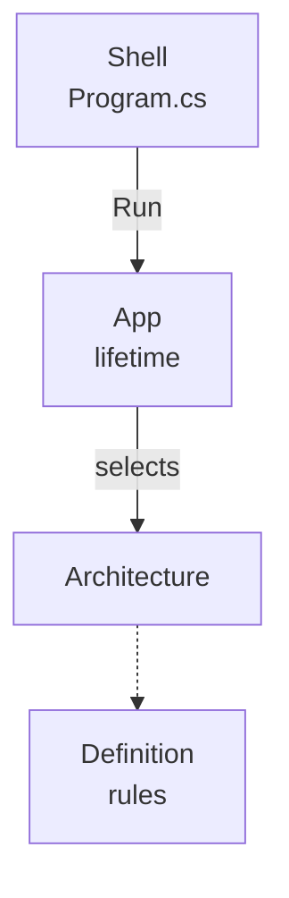

# Notion conventions for the doc kit

A Notion page uses only native blocks (Free plan, no custom blocks). The exporter `tools/notion2doc.mjs` changes each Notion block into a `doc.json` block. `doc.html` draws `doc.json` with `kit.js`.

## Page

| Notion | doc.json |
|---|---|
| Page title | `title` |
| First paragraph before the first heading 2 | `summary` |
| Heading 2 | A new section: `{ "title", "blocks": [] }` |
| Heading 3 (not a toggle) | `{ "type": "h", "text" }` |

## Content blocks

| Notion | doc.json |
|---|---|
| Paragraph | `p` |
| Bulleted list items, one after the other | `list` |
| Numbered list items, one after the other | `list` with `ordered: true` |
| Code block (any language except mermaid, and no `dk:` first line) | `code` with `lang` |
| Table | `table` (first row is the head) |
| Callout | `callout` |
| Inline code and bold | `` `code` `` and `**bold**` |

## Kit blocks

| Kit block | Notion block | Rule |
|---|---|---|
| Folder tree | Code block, first line `dk:tree` | One line for each path. Two spaces of indent for each level. Then two or more spaces, then the description. Optional at the end: `[kind]` and `!later` |
| Call stack | Code block, first line `dk:stack` | One line for each call. Two spaces of indent for each level. `*` before a call marks a key call. `//` starts the note. A line that starts with `>` is the foot note |
| Topology graph | Code block, language **mermaid** | `flowchart TD`. Nodes `id["Label<br/>sub"]`. Edges `a -->|label| b`, dashed `a -.-> b`. Kinds `class id key` (key, data, outside). The exporter calculates rows and columns from the arrows |
| Topology in columns | Columns block | Each column: a bold first line or a heading 3 is the group title. The next paragraph is the group text. Each bullet is one box: `**Name** `meta` — description` |
| Folds | Toggle blocks, one after the other | Toggle text `Title — summary`. Children are the body. A toggle inside a toggle is a child fold, so the result is a composed fold |

## Tree example

```
dk:tree
architecture/        The definition API  [library]
  Architecture.cs    The base class of each architecture
packs/               The real architectures  [group folder]
  Mvvm/              A second pack  [pack] !later
```

## Stack example

```
dk:stack
*TickService.ExecuteAsync      // every 3 s
  *Supervisor.Tick             // one lock, one pass
    StopRunningTurns           // control.json stopped → cancel
> no turn starts here: the next tick starts it
```

## Graph example


