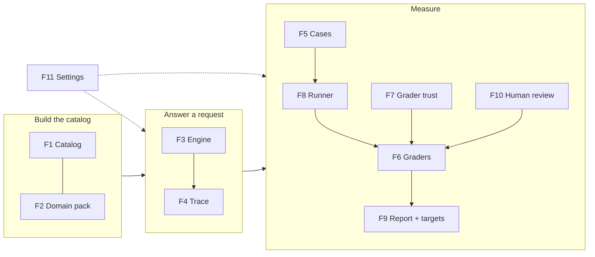

# Pattern engine: design

The pattern engine turns a request into an output with a catalog of patterns, and measures how well it does that. It has 11 features. The spikes show that each feature works on the `shapes` domain, and they found blind spots in 6 of them. The target design is a modular hybrid engine in C#: code owns the loop, and agent calls make the judgments. Two more domains (logic circuits, then software topology) prove that the core is generic.

## The features and their state

| Feature | State | Blind spot found |
|---|---|---|
| F1 Catalog | Works | Rules can point at each other; no promotion of proposed patterns |
| F2 Domain pack | Works for one domain | Not proven on a second domain |
| F3 Engine | Two harnesses work | No reasoning or question when something is unexpected |
| F4 Trace | Exact when code writes it | An agent that writes the trace is wrong in 27% of runs |
| F5 Cases | Works | Tuned set close to 100%; no "ask" cases |
| F6 Graders | Works | Data only; no visual or judge grader |
| F7 Grader trust | Works | One hole found and closed; operators by hand |
| F8 Runner | Works | — |
| F9 Report + targets | Works | Targets not calibrated |
| F10 Human review | Works | No verdicts collected yet |
| F11 Settings | Works | — |

## Files

| File | Content |
|---|---|
| [features.md](features.md) | Each feature: purpose, state, tests, findings, pending tests |
| [architecture.md](architecture.md) | The target components, flows and contracts |
| [plan.md](plan.md) | The code plan in phases, each with its exit tests |
| [open-questions.md](open-questions.md) | The decisions, the open questions and the non-goals |

The explainer pages are in [../pages/](../pages/). The research is in [../research/](../research/).
