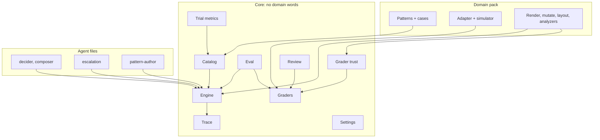
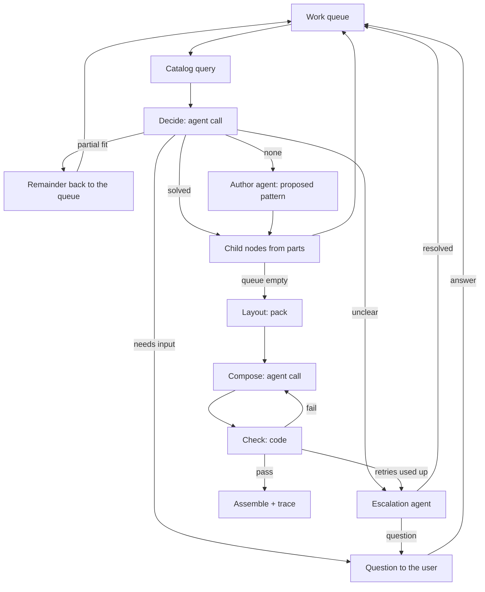
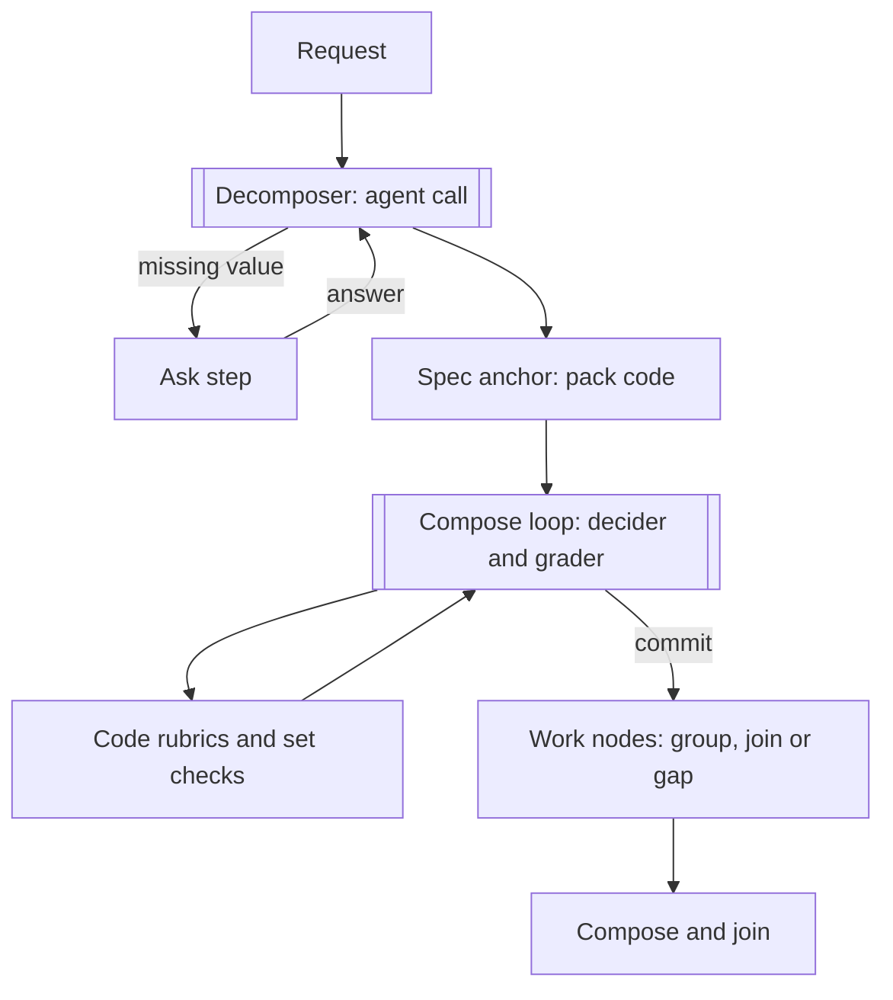
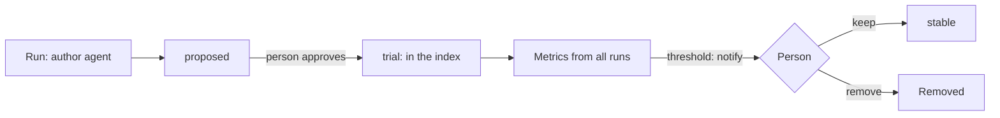
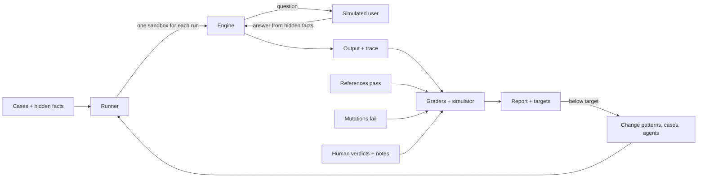

# Architecture

[← Design index](README.md)

The engine is a modular hybrid. Code owns the loop, the checks, the limits and the trace. Each judgment is an agent call: an agent file with `tools: StructuredOutput` and an output schema. An escalation agent and an author agent come in on triggers. A domain pack holds the subject behind one contract. The decisions behind this design are in [open-questions.md](open-questions.md).

The map of code and agents (which element is code, which is an agent, who starts whom) is designed with the owner before the escalation phase. The flows below are the starting point for that design.

## Components



| Component | Owns | Depends on |
|---|---|---|
| Catalog | Load, check, index, hashes, lifecycle of patterns | Pack patterns |
| Engine | Work queue, node states, compose and check loop, limits, escalation, questions | Catalog, pack hooks, agent files |
| Trace | The graph state of one run, as `trace.json` | Engine |
| Graders | Output graders give the pass of one run (is the output correct). Solution graders give a grade of the solution (which patterns) | Pack adapter and simulator |
| Grader trust | References, mutations, fixtures, regrade | Pack hooks, graders |
| Eval | Cases, simulated user, runner, report, targets | Engine, graders, settings |
| Trial metrics | Metrics of each `trial` pattern, notifications at thresholds | Results, catalog hashes |
| Review | Review page, verdicts, notes, agreement | Results, pack renderers |

## One request: the engine flow



The flow above is the status decider (`engine.decider: status`: shapes, circuits). A pack with `engine.decider: compose` (topology) has a different decide phase. The compose and join steps are the same.



| Part | Kind | Where |
|---|---|---|
| Spec role (R2) | Agent | `agents/decomposer.md` + `<pack>/decomposer.md` |
| Spec anchor, code rubrics, set checks (R1) | Code | `IComposeHooks` of the pack (`Domains/Topology/TopologyCompose.cs`) |
| Loop, limits, stop (R3), cache (G1) | Code | `Features/Compose/Domain/ComposeLoop.cs` |
| Decider and grader | Agent | `agents/composer-decider.md`, `agents/grader.md` + `<pack>/strategies/`, `<pack>/grading.md` |
| Commit to work nodes (B3, B4) | Code | `Features/Engine/Domain/ComposeDecide.cs` |
| Grader fixtures and stamp (G2) | Code | `<pack>/grader-fixtures.yaml`, `pe grader-check` |

- **`partial_fit`:** a pattern is always complete, but it can cover only a part of the request. The decider names the remainder in `open`. Each remainder item goes back into the queue for the top-level patterns. A remainder is always in scope: code reads `outside` as a no-fit, and pattern-author fills the gap. The trace records each remainder item in `remainder`, and a case can expect them with `remainder: [no-fit]`.
- **Solution:** after the compose step, code composes each remainder item and joins all patterns into one `solution` block (the join step). Code makes each wire whose type allows only one choice; the `joiner` agent call chooses the others, and code checks them. The trace tree then has a `solution` root.
- **Needs input:** a pattern declares its inputs. If the request does not give a required input, the engine asks. It does not guess.
- **`none`:** the author agent writes a proposed pattern with the authoring guide. Code validates it and runs the novelty check. The pattern makes the output of this run and goes into the promotion flow.
- **Limits:** each node has limits on depth, retries and escalations. Each run has limits on agent calls, cost and time. A stop writes a stop reason in the trace.

## Escalation triggers

All triggers are settings.

| Trigger | Source |
|---|---|
| The decide answer is "unclear" | Agent call |
| Two candidates are almost equal (off by default) | Agent call gives a margin |
| A node is not allowed or too deep | Code |
| The check fails after the retries | Code |
| The request is outside the domain | Agent call |

## The catalog flow



Each result records the catalog hash and the hash of each pattern that it used. An edit to a `trial` pattern restarts its metrics.

## The measure flow



## Contracts

| Contract | Shape |
|---|---|
| Pattern file | Front matter (F1 fields, plus typed `inputs` and `outputs`, each input required or with a default) + Intent, Rules, Rationale |
| Agent file | `name`, `description`, `model`, `tools` (with `StructuredOutput`), `output_schema`; the body is the system prompt |
| Pack adapter | `parse`, `lint`, `assert`, `checkLeaf`, `readParam`, `simulate` (for domains with behavior) |
| Pack hooks | `reference`, `operators`, `layout`, `assemble`, `wrap`, `checkBox`, review renderers, analyzers (later) |
| Judge | `call(agent, input) → { data, ms, cost, error }` |
| Case | `request`, `hidden` facts, `expect` (tree or behavior, `asks`), tags |
| Question | `about` (`requirement`, `pattern choice`, `input`, `domain`), `options`, answer |
| Trace | `outcome`, `tree`, `open requirements`, `nearest`, `deltas`, `proposed`, `questions`, `attempts`, `stop reason`, `hashes`, `graph` |
| Run result | One record for each run: case, trace, output grader results, pass, solution grader results, `solution_score`, agent stats, hashes |
| Note | `target` (case, fixture, output), `author` (person or agent), text |

## Code layout (C#)

The C# engine follows the layout of the VSA framework (`vsa-template`), but it does not use VSA.Sdk. It is plain .NET 10 with one app project and one test project. The model is the rule engine app of `vsa-template`: one entry command whose handler sends one command for each step.

```
pattern-engine/
├─ PatternEngine.slnx
├─ src/PatternEngine/
│  ├─ App/Host/           entry, settings, the pe CLI
│  ├─ Plugins/
│  │  ├─ Messages/        Result, Error, command and handler bases
│  │  └─ Agents/          IJudge, agent-file loader, CliJudge, ScriptedJudge
│  ├─ Features/
│  │  ├─ Catalog/         Slices: Load, Validate, BuildIndex, Query, Propose, Promote
│  │  ├─ Engine/          Slices: Solve, Decide*, Compose*, Check, Escalate*, Author*, Ask, Assemble
│  │  ├─ Trace/
│  │  ├─ Cases/           Slices: Generate, LoadHand, AnswerQuestion
│  │  ├─ Grading/
│  │  ├─ GraderTrust/     Slices: CheckReferences, RunMutations, Regrade
│  │  ├─ Eval/            Slices: RunEval
│  │  ├─ Report/          Slices: BuildReport, CheckTargets, TrialMetrics
│  │  └─ Review/
│  ├─ Domains/            Shapes/, Circuits/: code and data of each pack
│  └─ agents/             decider.md, composer.md, escalation.md, pattern-author.md
├─ tests/PatternEngine.Tests/
├─ docs/
└─ spike/                 the Node spike: parity reference for shapes
* = the handler makes one agent call
```

| Design rule | Mechanism in the code |
|---|---|
| Code owns the order of the steps | The `Solve` handler sends one command for each step |
| A model answers one question at a time | Each `*` slice makes one agent call through `IJudge` |
| Every value is a setting | One settings file; each feature reads its own section |
| No silent failure | `Result<T>` and `Error` with codes, recorded in the trace |
| Tests with no model | `ScriptedJudge` replaces `CliJudge` in the tests |

## Rules of the design

- Code owns the order of the steps, the checks, the retries, the limits and the trace.
- An agent call answers one question, with only the data that code gives it.
- The agent files are the source of truth for a judgment: model, tools, schema, prompt.
- Prefer rules that code can check or simulate. Use a judge only for the rest, after calibration.
- The same `pe` commands serve the agents and the system.
- Every value is a setting.
