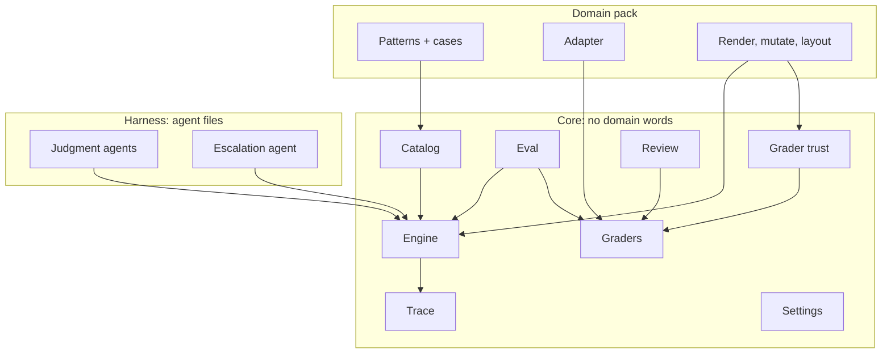
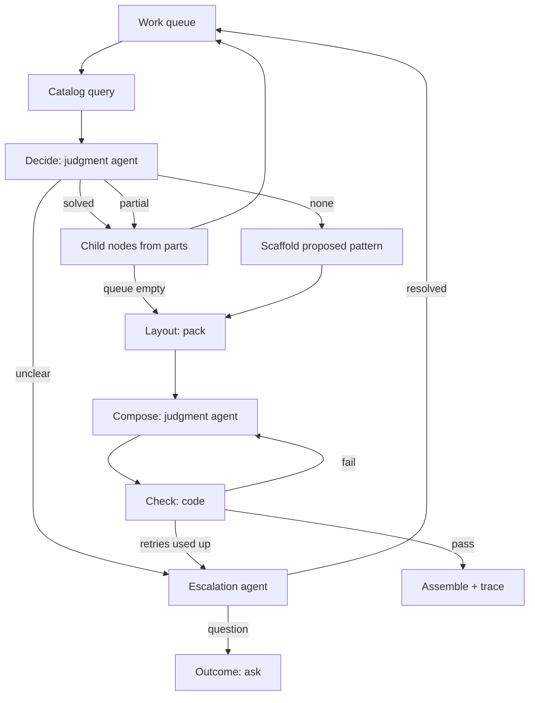
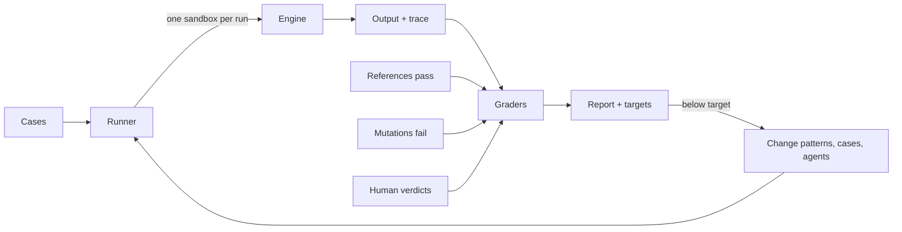

# Architecture

[← Design index](README.md)

The target design keeps the code-led solver for the normal path and adds an agent on call for exceptions. Code owns the loop, the checks and the trace. Each judgment is an agent file. A domain pack holds the subject behind one contract.

## Components

| Component | Owns | Depends on |
|---|---|---|
| Catalog | Load, check, index, lifecycle of patterns | Pack patterns |
| Engine | Work queue, node states, compose and check loop, escalation | Catalog, pack hooks, agent files |
| Trace | The graph state of one run, as `trace.json` | Engine |
| Graders | The verdict of one run | Pack adapter |
| Grader trust | References, mutations, fixtures, regrade | Pack hooks, graders |
| Eval | Cases, runner, report, targets | Engine, graders, settings |
| Review | Review page, verdicts, agreement | Results, pack renderers |

## One request: the engine flow

The escalation agent gets the node, the state and the reason. It has tools to read more of the catalog and to run `pe` commands. It returns one of three results: a decision that goes back into the queue, a proposed pattern, or a question for the user. In an eval, a question is the outcome `ask`, and a case can expect it.

## Escalation triggers

All triggers are settings.

| Trigger | Source |
|---|---|
| The decide answer is "unclear" | Judgment agent |
| Two candidates are almost equal | Judgment agent gives a margin |
| A node is not allowed or too deep | Code |
| The check fails after the retries | Code |
| The request is outside the domain | Judgment agent |

## The measure flow

## Contracts

| Contract | Shape |
|---|---|
| Pattern file | Front matter (F1 fields) + Intent, Rules, Rationale |
| Agent file | `name`, `description`, `model`, `tools` (with `StructuredOutput`), `output_schema`; body is the system prompt |
| Pack adapter | `parse`, `lint`, `assert`, `checkLeaf`, `readParam` |
| Pack hooks | `reference`, `operators`, `layout`, `assemble`, `wrap`, `checkBox`, review renderers |
| Judge | `call(agent, input) → { data, ms, cost, error }` |
| Trace | `outcome`, `tree`, `nearest`, `deltas`, `proposed`, `questions`, `attempts`, `graph` |
| Run result | One record for each run: case, trace, grader results, pass, agent stats |

## Rules of the design

- Code owns the order of the steps, the checks, the retries and the trace.
- A model answers one question at a time, with only the data that code gives it.
- The agent files are the source of truth for a judgment: model, tools, schema, prompt.
- The same `pe` commands serve the agent and the system.
- Every value is a setting.
