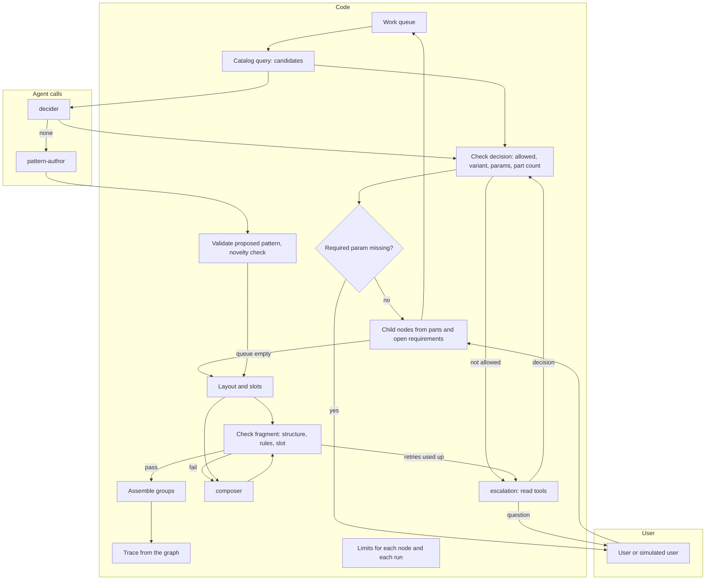

# Build log: the C# engine

[← Design index](README.md)

This file records the decisions that were made while the C# engine was built (phases P0 to P10), the results of each phase, and the findings. The owner was away during the build, so each decision here is open for review.

## Result of each phase

| Phase | Exit test | Result |
|---|---|---|
| P0 Skeleton | `pe --help` runs; tests run | Done |
| P1 Catalog | A unit test for each validator rule; same index as the spike | 13 rules, 25 rule tests; index and graph equal to the spike |
| P2 Shapes + grader trust | Same counts as the spike; same regrade verdicts | References 82/82, mutations 813/813, 287 stored outputs give the same verdicts |
| P3 Engine core | Scripted loop, recursion, retries, limits, trace; one CLI smoke run | 9 scripted tests; `pe solve` with Haiku: 2 agent calls, $0.002 |
| P4 Eval + report | Same case list as the spike; a dev run meets the targets | Seeds 7 and 42 give the same cases; dev run 5/5 |
| P5 Questions | Scripted question tests; a smoke run on the ask cases | 7 tests; 4 ask cases pass 4/4, and 0/4 with questions and escalation off |
| P6 Escalation + author | Unclear cases resolve or ask; no-fit gives a valid proposed pattern | Both in the ask and dev runs; author fallback tested |
| P7 Circuits | Self-test passes; a dev run works; a list of core changes | Trust 8/8 and 37/37; dev run 9/9; 3 core changes (below) |
| P8 Trial metrics | Scripted results reach each threshold | 6 tests; the lifecycle works end to end on a real proposed pattern |
| P9 Review | Browser check at phone and desktop width | 390 px and 1440 px, light and dark: no overflow, no errors |
| P10 Topology | Self-test passes; a dev run works | Trust 12/12 and 38/38; dev run 10/13, then 2 core fixes |

All runs were small: Haiku, 4 to 13 cases, k=1 or 2. The total cost of all agent calls in the build was about $0.20. No full run was made.

## The map of code and agents (for review)

The plan put a design step with the owner before P6. The owner asked the build to continue, so this map is the one that the code uses now. It is a proposal: change it if you want a different balance.

| Who starts | What | Who answers | Why this side |
|---|---|---|---|
| Code | Candidates for a node | Code | A lookup in the catalog |
| Code | Which pattern, variant, params, children | decider (agent) | A judgment about words |
| Code | Is the pattern allowed; is a part over its count | Code | A rule of the catalog |
| Code | A required param that the request does not give | The user | Only the user knows it; no agent guesses |
| Code (trigger) | An unclear or out-of-domain node; a rule broken; retries used up | escalation (agent with read tools) | Reasoning about an exception |
| escalation | A choice that only the user can make | The user | The agent must not guess |
| Code | No pattern fits | pattern-author (agent) | Writing a pattern is a judgment |
| Code | Is the proposed pattern valid and new | Code | Validator and novelty check |
| Code | The fragment of one node | composer (agent) | Making output is a judgment |
| Code | Is the fragment correct | Code | Graders and slot checks |
| Code | Assemble groups, write the trace | Code | Deterministic |

## Decisions made during the build

| # | Decision | Reason |
|---|---|---|
| D1 | One app project and one test project; the VSA layout in folders (`Features/<F>/Domain`, `Domain/Shared`, `Slices/<S>`), no VSA.Sdk | The owner asked for the VSA style without the SDK. One project keeps the build simple. |
| D2 | One file for each slice (command, result and handler together) | The slices are small. VSA puts them in separate files; split them when a slice grows. |
| D3 | Shared contracts in `Domain/Shared` of the feature that owns them: `PatternCatalog` (Catalog), `Case` and `TreeNode` (Cases), `IDomainPack` (Packs), `IGrader` (Grading), `RunTrace` (Trace), `IUserChannel` and `IJudgeFactory` (Engine) | Other features read only the published domain of a feature. |
| D4 | Each system is a list of named parts in the composition root; the settings choose which parts run: packs, case sources, graders, trust checks, ablations, judges | The owner asked that eval, fixtures, grading and judging stay modular. See "Extension points". |
| D5 | Agent calls use stdin for the input and copy the agent file into `<work dir>/.claude/agents` | A long input does not fit in an argument. `--agent` finds the file in the work dir. Never `--bare`. |
| D6 | The composer schema has one generic field, `fragment` | The engine agents are the same for each pack. The subject rules of the pack tell the format. |
| D7 | A pack can replace an engine agent: `<pack>/agents/<name>.md` wins | One pack can tune a judgment without a change for the others. |
| D8 | Params are values that a request sets; `required: true` means the engine asks. Ports (`inputs`, `outputs`) are typed data flow | Two different ideas, so two fields. Q12 uses params; Q10 uses ports. |
| D9 | A new `sign` pattern in `shapes`, with a required board color | The ask cases needed a pattern with a required input. |
| D10 | The parity tests use a frozen copy of the spike data (`tests/.../Parity/shapes`) | The pack data can change (for example D9) and the parity still holds. |
| D11 | A `partial_fit` makes remainder nodes; they are decided, authored when no pattern fits, and recorded, but not composed yet | Q3 (changed after review): a pattern is always complete; the fit is partial. How to join the outputs is an open question. |
| D12 | The pattern hash leaves out the `status:` line | An approval must not restart the trial metrics; any other edit does (Q6). |
| D13 | `pe remove` moves the file to `patterns/removed/` | The history stays, and the catalog does not load it. |
| D14 | Trial metrics read all C# result files of the pack | Q14 keeps the result files in git, so the history is there. |
| D15 | The review page uses the template of the spike | It was already checked at both widths; the C# builder fills it. |
| D16 | Circuits and topology share a `Domains/Blocks` kit: block model, wiring, types, loops | Both are blocks with ports and wires. The kit is domain code, not core code. |
| D17 (replaced by D30) | Topology: code assembles a system and wires the events of the pipeline to each observer | A composition rule of the domain, not a judgment. |
| D18 | Behavior graders are pack graders: `behavior` (circuits, truth table) and `flow` (topology, data flow) | Q10: rules that code can run come first. |
| D19 | The escalation agent has the tools Read, Grep and Glob, and runs in the sandbox | It can read the catalog files; it cannot change files. |
| D20 | `results/solve/` and `results/runs/` stay out of git | Q14: only the result files are in git. |
| D21 | The output of a request is a solution. If it uses more than one pattern, code puts them in one `solution` block; else the output is the one pattern | The owner expects a solution to the problem, with one or more patterns in a combination. Each pattern stays complete (Q3). |
| D22 | The join step makes the wires from the port types in the catalog: one output of the same type gives a wire; none gives an outer port; more than one goes to the `joiner` agent call, and code checks each choice | Code decides what the types decide. A judgment only where the types allow more than one answer. |
| D23 | `ILayout.Join` and `ILayout.Ports` are optional. The Blocks kit implements them for topology and circuits. A pattern with no catalog ports, for example an assembled `cqrs_system`, gets its ports from the wires of its fragment | One contract for each pack. A pack that cannot join yet records the remainder as not joined. |
| D24 | pattern-author writes typed ports if the catalog has them. Code refuses a proposed pattern with no ports or with a type that the catalog does not have | Without ports, code cannot join the pattern. |
| D25 | An expected tree can use `p: "*"` for a pattern that the run authors | A case cannot know the id of an authored pattern. |
| D26 | Two grader lists in the settings: `grading.output` decides the pass; `grading.solution` gives `solution_score` in each result | Q17. A grader moves between the lists with no code change |
| D27 | Circuits and topology: the output list has `structure`, `rules`, the behavior grader (`behavior` or `flow`) and `questions`; `selection`, `built` and `proposed` are solution graders. Shapes keeps all graders in the output list | Shapes has no behavior to simulate: the drawing is the output |
| D28 | A topology case states `io` (input types and output types). If a case has no `io`, the flow grader uses the ports of the reference of its tree. A case with no behavior fails | No magic: each case has a clear expected output |
| D29 | The behavior grader of circuits fails a case that names no truth table. The request names the ports of the truth table | Q17: a clear input and a clear output. A real run named the ports in a different way |
| D30 | `PortJoin` holds the port rule in the pack contracts. The join step and the `cqrs_system` assembly both use it; D17 is replaced | Q19. One rule for each join |

## Core changes that the new domains needed

The second and third domains are the test of the core. Each change below is a place where the first domain had leaked into the core.

| Found by | Change |
|---|---|
| Circuits | The case generator had "Draw" in code. The request templates are pack settings now. |
| Circuits | Grader trust ran only the core graders. Pack graders (behavior) run in the mutation and fixture checks now. |
| Circuits | The "trace matches output" metric compared levels that the engine did not decide (the inner circuit of one compose call). It compares only the decided levels now. |
| Topology | The case generator ignored the maximum part count (shapes has only `0..n`). Grader trust showed invalid expected trees. Fixed. |
| Topology | Code did not check the part count at decide time. A real run made two query handlers. A child over the count is "not allowed" now, so the escalation trigger fires. |

## Findings

- **Grader trust finds pattern bugs.** The new `sign` pattern broke the street count assert; the known-good references failed until the assert counted signs.
- **The ask cases test what they must.** With questions and escalation turned off, the 4 ask cases fail 4/4; with them on, they pass 4/4.
- **Escalation works on real requests.** "Draw a building" escalated and asked which building; "Write me a poem" escalated and asked about the domain.
- **The author agent writes valid patterns.** The lighthouse of a real run passed the validator and went through propose, approve and remove.
- **A no-fit inside a partial fit (resolved by Q3).** In topology, the decider covered "retry a payment" with the command pipeline and made "wait a delay" an open requirement. The escalation agent asked if the delay is in scope. The case expected a no-fit for the full request. See the open questions.
- **After the Q3 change.** In two Haiku runs of the delay case, no run asked about scope. One run chose the observer, with two authored remainder items. One run chose the command pipeline with no remainder. The engine works as designed; the case accepts only one split.
- **An ambiguous near-miss case.** "A query handler that also saves the changes" went to the system pattern (two jobs). The case expects the command pipeline. The case or the system rule needs a decision; it was not tuned.
- **The join in a real run.** "Place orders through a command pipeline; after each order event, wait ten minutes, then send a reminder" gave a solution of `cqrs_system` and an authored delayed observer. The first run showed a defect: an assembled system has no catalog ports, so it had no wire. Fixed with D23. The second run wired the order event to the delay. Cost $0.007 for each run.
- **The output gate on real runs.** Topology dev (5 runs): 4 pass. The fail is correct: for "a query handler that also saves", the engine joined a query handler to a store, and a store needs an Event. Circuits dev (5 runs): 4 pass, then 5 after the majority case named its ports. Solution grades were 4/5 and 5/5.
- **Cost.** The code-led engine costs $0.002 to $0.004 for each run with Haiku, with 2 to 9 agent calls.

## Extension points

| To add | Write | Register in `Composition.cs` | Turn on in settings |
|---|---|---|---|
| A domain | A class that implements `IDomainPack`, and a folder with patterns, cases, fixtures, `instructions.md`, `pack.settings.yaml` | `AddSingleton<IDomainPack, ...>` | — |
| A grader for all packs | A class that implements `IGrader` | Add it to `GraderSet.Default` | `grading.graders` |
| A grader for one pack | Return it from `IDomainPack.Graders` | — | `grading.graders` in the pack settings |
| A case source | A class that implements `ICaseSource` | `AddSingleton<ICaseSource, ...>` | `eval.case_sources` |
| A grader test | A class that implements `ITrustCheck` | `AddSingleton<ITrustCheck, ...>` | `grader_trust.checks` |
| An ablation | A class that implements `IAblation` | Add it to `Ablations.All` | `--ablate <name>` |
| A judge | A class that implements `IJudge` and a factory | Replace `IJudgeFactory` | `judge.kind` |
| A judgment | An agent file with `tools: StructuredOutput` and `output_schema` | — | Put it in `agents/` or `<pack>/agents/` |
| A mutation operator | Add a `MutationOperator` to the pack list | — | `grader_trust.mutations` |
| A join of a solution for a pack | `ILayout.Join` (and `ILayout.Ports` if a pattern has no catalog ports) | — | — |
| A validator rule | A class that implements `ICatalogRule` | Add it to `CatalogRules.All` | — |
