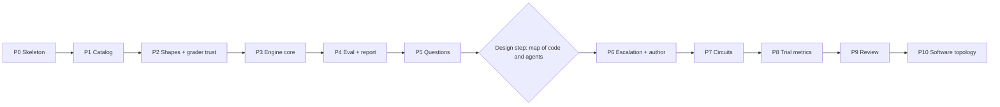

# Code plan

[← Design index](README.md)

The engine is built in C# from now on. It uses the layout of the VSA framework without VSA.Sdk (see [architecture.md](architecture.md)). The Node spike in `spike/` stays as the parity reference for `shapes`. Each phase ends with tests that must pass.

## Phases

| Phase | Work | Exit tests |
|---|---|---|
| P0 Skeleton | Solution, app project, test project (NUnit), `Result` and `Error`, settings file, `IJudge` with `ScriptedJudge` | `pe --help` runs; one test passes |
| P1 Catalog | Pattern records with typed `inputs` and `outputs`; loader, validator, index; catalog and pattern hashes | A unit test for each validator rule; the same index as the spike for `shapes` |
| P2 Shapes + grader trust | `shapes` adapter, reference, operators; the five graders; regrade | References and mutations give the same counts as the spike; regrade of stored outputs gives the same verdicts |
| P3 Engine core | Work queue, node states, `partial` with open requirements, compose and check loop, limits for each node and each run, stop reasons, trace; `CliJudge` (no `--bare`) | Scripted judge: loop, recursion, retries, limits and trace with no model; one smoke run with the CLI judge |
| P4 Eval + report | Case generator, hand cases, runner (modes, sandbox, concurrency), report, targets | The same case list as the spike for the same seed; a dev run meets the targets |
| P5 Questions | Typed pattern inputs make questions; cases with hidden facts; simulated user; question graders | Scripted tests for needed, extra and used answers; a smoke run on 3 ask cases |
| Design step | With the owner: the map of code and agents, who starts whom | The owner approves the map |
| P6 Escalation + author | Escalation agent with triggers as settings; author agent with the authoring guide; novelty check | Smoke run: unclear cases resolve or ask; no-fit cases get a valid proposed pattern; normal cases keep their score and cost |
| P7 Circuits | Pack for logic circuits: blocks with typed ports, simulator, truth-table grader, mutations | Self-test passes; a dev run works; a list of each core change that the pack needed |
| P8 Trial metrics | Metrics for each `trial` pattern from all results; notification at the thresholds; `pe promote` | Scripted results reach each threshold and give the notification |
| P9 Review | Review page from result files, with notes | Browser check at phone and desktop width, light and dark |
| P10 Software topology | Pack of design patterns with typed input and output; data-flow simulation | Self-test passes; a dev run works |

Each eval run in a phase is small: about 5 cases, k=1 or 2, Haiku.

## Points to test during the work

- **CLI judge:** do not use `--bare`. It ignores the subscription login. If `-p` makes bare mode the default, turn it off.
- **Persistent CLI process:** test if a `stream-json` process keeps `--agent` and `--json-schema` for each message. Use it only if the context does not carry over between agent calls.
- **Parity of the case generator:** the same seed must give the same cases, so port the random number generator of the spike exactly.

## Test types

| Type | Model | Cost | When |
|---|---|---|---|
| Unit and validator tests | None | None | Each change |
| Grader trust (references, mutations, fixtures) | None | None | Each change |
| Regrade of stored outputs | None | None | Each change to an assert or a grader |
| Scripted engine test | None | None | Each change to the engine |
| Smoke or dev eval | Haiku | Cents | Each change to agents or patterns |
| Full eval on a held-out set | Sonnet | Dollars | Only to validate |
