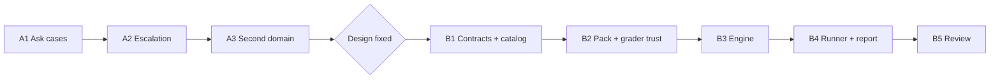

# Code plan

[← Design index](README.md)

The plan has two stages. Stage 1 closes the open design points in the Node spike, because there they are cheap to try. Stage 2 ports the proven design to C#, with parity tests against the spike. Each phase ends with tests that must pass.

## Stage 1: Node spike

| Phase | Work | Exit tests |
|---|---|---|
| A1 Ask cases | Outcome `ask` in cases, trace and graders; 3 hand cases: unclear, outside the domain, two equal patterns | Grader self-test covers `ask`; the solver fails the 3 cases (baseline) |
| A2 Escalation | Triggers as settings; an escalation agent file with tools; the engine flow in [architecture.md](architecture.md) | Smoke run: the 3 ask cases pass; normal cases keep their score and cost |
| A3 Second domain | A pack for logic or topology problems: patterns, adapter, reference, mutations, layout, review | Self-test passes; a dev run works; a list of each core change that the pack needed |

Each run in stage 1 is small: about 5 cases, k=1 or 2, Haiku.

## Stage 2: C# core

One .NET solution. The Node spike stays as the reference until each phase has parity.

| Phase | Work | Exit tests |
|---|---|---|
| B1 Contracts + catalog | Records for pattern, case, trace, run result; loader, validator, index | A unit test for each validator rule; same index as Node for `shapes` |
| B2 Pack + grader trust | `shapes` adapter, reference, operators; graders; regrade | References and mutations: same counts as Node; regrade of stored outputs gives the same verdicts |
| B3 Engine | Work queue, node states, escalation; `IJudge` with a scripted judge and a CLI judge that reads agent files | Scripted judge: loop, recursion, retries and trace with no model; smoke run with the CLI judge |
| B4 Runner + report | Modes, sandbox, concurrency, targets, case generator | Same case list as Node for the same seed; dev run meets targets |
| B5 Review | Page builder from result files | Browser check at phone and desktop width |

## Test types

| Type | Model | Cost | When |
|---|---|---|---|
| Unit and validator tests | None | None | Each change |
| Grader trust (references, mutations, fixtures) | None | None | Each change |
| Regrade of stored outputs | None | None | Each change to an assert or a grader |
| Scripted engine test | None | None | Each change to the engine |
| Smoke or dev eval | Haiku | Cents | Each change to agents or patterns |
| Full eval on a held-out set | Sonnet | Dollars | Only to validate |
