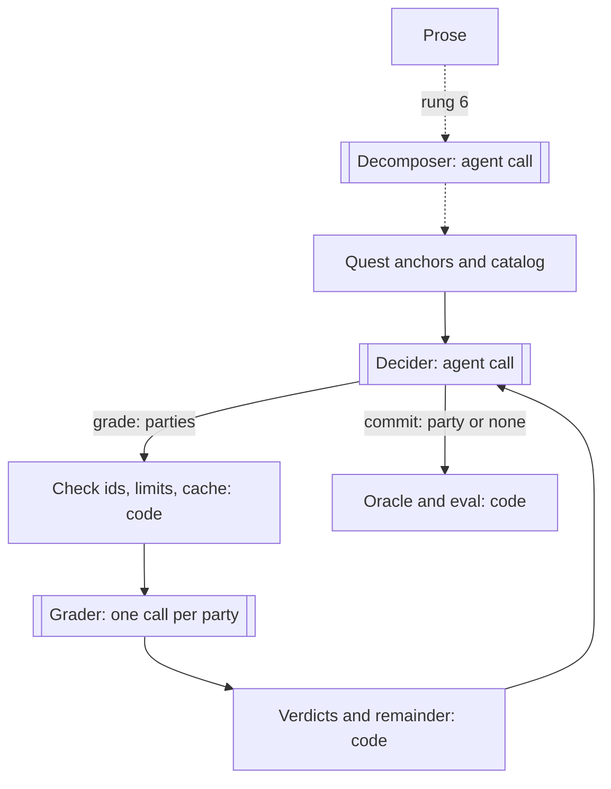
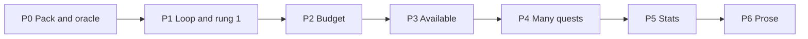

# Composition plan: the party domain

Status: final. The owner agreed with this plan.

A new test domain, `party`, tests composition with no ports: choose a party of heroes for one or more quests. Agents decide and grade from rubrics. Code runs the turns, counts the limits, and computes the exact best party as the oracle.

Visual version with tabs: [Party Composition Plan](https://claude.ai/artifact/SJY5dD2DQLZx5b4MxtH7Rt).

## Rungs

Each rung adds one idea. Code always knows the exact answer.

| Rung | The run gets | Gate adds | Exact grade |
|---|---|---|---|
| 1 Cover | Quest as tag rubrics | Each tag present | Party size = smallest |
| 2 Budget | + hero cost, budget | Cost within budget | Cost = best cost |
| 3 Available | + heroes not free | No unavailable hero | Cost = best cost |
| 4 Many quests | + one shared pool | No hero in two parties | Total cost = best total |
| 5 Stats | + stat minimums | Each stat total reached | Cost = best cost |
| 6 Prose | Quest as prose only | Hidden rubrics, same gate | Cost, and rubrics = hidden |

If no valid party exists, the correct answer is "none".

| Goal | Rungs |
|---|---|
| The decider-grader loop works from rubrics | 1 to 6 |
| Composition from partial fits, with a remainder | 1, 5 |
| Compare several valid solutions, choose the best | 2, 3 |
| Share resources across requests | 4 |
| Decompose prose into a spec | 6 |
| Change templates and anchors, compare the results | All, by settings |

## Decisions

| # | Decision |
|---|---|
| C1 | A hero has tags, stats (1 to 10) and a cost (0 or more). Tags first, then cost, then stats |
| C2 | Agents decide and grade from rubrics. Code is the oracle only |
| C3 | The grader is passive: it gets a party and rubrics, and returns a verdict for each rubric |
| C4 | The strategy is in the decider file. A change of strategy is a change of file |
| C5 | Generic grader and decider files; the pack adds its rules. No grader works without its pack |
| C6 | Decider to grader in turns: the decider lists parties, code grades them in parallel |
| C7 | One fixed catalog and fixed cases, written by the agent. No seed, no random cases |
| C8 | A grade is a list of true or false rubrics. A setting makes the pass rule |
| C9 | The grader always grades a party, from one hero to many. The "no" rubrics are the remainder |
| C10 | A separate decomposer agent turns prose into a quest anchor. `lore.md` is a setting: on or off |
| C11 | Many quests: one run sees all quests and the pool. "Quests in order" is a baseline strategy |
| C12 | A new loop beside the engine, on its own branch and PR. It can change the engine where useful |
| C13 | Small Haiku runs only. A larger run only after the owner agrees |

## Catalog

A hero file uses the pattern format. Path: `Domains/Party/heroes/<id>.md`.

```markdown
---
id: paladin
tags: [healer, tank, fighter]
cost: 9
stats: { strength: 8, intelligence: 4, agility: 3, knowledge: 5 }
---
A holy knight who heals and holds the line.
```

The setting `party.fields` sets the fields that the agents see. Rung 1 shows only `tags`.

Stats (S I A K): strength, intelligence, agility, knowledge. Tags: healer, tank, fighter, scout, tracker, lockpick, mage, lore. Strong heroes cover more tags for each hero. Specialists are cheaper for each tag. This makes the greedy trap.

| Hero | Tags | Cost | S I A K |
|---|---|---|---|
| champion | fighter, tank, scout, healer | 14 | 9 5 7 5 |
| archmage | mage, lore, healer | 10 | 1 10 3 9 |
| paladin | healer, tank, fighter | 9 | 8 4 3 5 |
| druid | healer, tracker, lore | 7 | 3 6 4 7 |
| spellblade | fighter, mage | 6 | 6 6 5 3 |
| knight | tank, fighter | 5 | 7 2 3 3 |
| ranger | scout, tracker | 4 | 4 3 7 4 |
| bard | lore, scout | 4 | 2 5 5 6 |

| Hero | Tags | Cost | S I A K |
|---|---|---|---|
| thief | lockpick, scout | 3 | 2 4 8 3 |
| cleric | healer | 3 | 3 5 2 6 |
| barbarian | fighter | 3 | 9 1 4 1 |
| guard | tank | 2 | 5 1 2 1 |
| hunter | tracker | 2 | 4 2 5 2 |
| apprentice | mage | 2 | 1 6 2 3 |
| sage | lore | 2 | 1 6 1 9 |
| squire | fighter | 1 | 3 1 2 1 |

## Quests

A quest is an anchor file: context, then one rubric for each requirement. The fields follow the anchor format (A1 in [decider.md](decider.md)). A prose case keeps its text in `domain.text`.

```yaml
---
id: b1
kind: success
level: case
score: { rule: all }
domain: { rung: budget, unavailable: [] }
---
A quest in the hills. The party must heal, hold a line and fight. Budget: 12 gold.

- id: healer
  ask: Does the party have a healer?
  check: grader
  args: { tag: healer }
- id: budget
  ask: Is the total cost of the party 12 or less?
  check: grader
  args: { max_cost: 12 }
```

The grader agent answers each `ask`. The oracle reads the typed `args`: `tag`, `max_cost`, `stat` with `min`, `unavailable`, `pool`.

| Rung | Case file |
|---|---|
| Many quests | `quests: [ids]`, plus a pool anchor with "No hero is in two parties" |
| Prose | `domain.text` with the prose and the budget. All rubrics have `visibility: eval`, so the run never sees them |

## Loop



| Part | Kind | File |
|---|---|---|
| Decider | Agent | `agents/composer-decider.md` + `Party/strategies/<name>.md` |
| Grader | Agent | `agents/grader.md` + `Party/grading.md` |
| Decomposer | Agent | `agents/decomposer.md` + `Party/lore.md` (setting) |
| Turn loop, limits, cache, trace | Code | `Features/Compose` |
| Hero ids and quest ids exist | Code | `Features/Compose` |
| Remainder from the verdicts | Code | `Features/Compose` |
| Decomposer output: known tags and stats, amounts in range | Code | `Domains/Party` |
| Oracle: rubric truth, best party, best assignment | Code | `Domains/Party/Oracle.cs` |

Code does not refuse an unavailable hero or a party over budget. Those are rubrics, so the agents must find them.

```jsonc
// compose-turn.json: one decider turn
{
  "action": "grade",            // grade | commit
  "grade":  [ { "quest": "b1", "party": ["cleric", "guard", "squire"] } ],
  "commit": [ { "quest": "b1", "party": null, "reason": "" } ],
  "note": "one sentence"
}
// grade.json: one grade
{ "verdicts": [ { "rubric": "healer", "verdict": true, "reason": "cleric" } ] }
```

In each turn the decider gets: the quest anchors (or the decomposed anchors), the catalog with only the fields of `party.fields`, each graded party with its verdicts and remainder, and the turns and grade requests that are left.

| Strategy | How it works | First rung |
|---|---|---|
| `greedy` | Add the hero that closes most open rubrics; grade; repeat | 1 |
| `compare` | Build some valid parties from different first heroes; grade all; commit the cheapest | 2 |
| `in-order` | Many quests: do each quest alone, in the listed order | 4 |
| `pool` | Many quests: plan the scarce heroes first, then grade the full assignment | 4 |

## Grading

The run grades itself with agents. The eval grades the run with code. The pass never uses the verdicts of the run: it uses the oracle truth of the committed party.

Eval anchor: `Domains/Party/anchors/eval.md`. The run never gets it.

| Rubric | Ask | Rungs |
|---|---|---|
| `valid` | Is each quest rubric true for the party, or is "none" correct? | All |
| `smallest` | Is the party size equal to the smallest size? | 1 |
| `best-cost` | Is the cost equal to the best cost? | 2 to 6 |
| `best-total` | Is the total cost equal to the best total? | 4 |
| `spec` | Are the decomposed rubrics equal to the hidden rubrics? | 6 |

The setting `party.pass` lists the rubrics in the gate and the rule (`all`, or `percent` with `pass_at`). Default: `valid` only, rule `all`. Each other rubric is a grade.

| Measure (beside the verdicts) | Example |
|---|---|
| Cost and best cost | cost 9, best 6 |
| Size and smallest size | size 3, smallest 1 |
| Grader accuracy | 38 of 40 verdicts true |
| Spec match (rung 6) | 1 missed, 0 extra, 1 wrong amount |
| Turns, grade requests, agent calls | 4 turns, 9 grades, 13 calls |
| Cost of the run | $0.012 |

## Cases

22 fixed cases. A script computed each exact answer on the catalog. The oracle tests repeat these values.

| Case | Tags; budget; other | Exact answer | Kind |
|---|---|---|---|
| c1 | healer, tank | Smallest 1: paladin | One hero |
| c2 | scout, lockpick | Smallest 1: thief | One hero |
| c3 | healer, tank, scout, tracker | Smallest 2: paladin + ranger | Remainder |
| c4 | mage, lore, lockpick, tracker | Smallest 3: archmage + thief + hunter | Remainder |
| c5 | healer, necromancer | None | Unknown tag |
| b1 | healer, tank, fighter; 12 | 6: cleric + guard + squire | Greedy pays 9 |
| b2 | healer, tank, scout; 10 | 8: cleric + guard + thief | Greedy over budget |
| b3 | mage, lore; 5 | 4: apprentice + sage | Greedy over budget |
| b4 | healer, tank, scout, mage; 6 | None (cheapest 10) | No valid party |
| a1 | healer, tank, fighter; 12; cleric not free | 9: paladin | Best changes |
| a2 | mage, lore; 8; apprentice not free | 8: sage + spellblade | One party |
| a3 | scout, lockpick; 6; thief not free | None | Only lockpick |

| Case | Quests (tags; budget) | Best assignment | In order |
|---|---|---|---|
| m1 | Q1 healer, lore; 8 · Q2 healer, tank; 6 | 12: druid · cleric + guard | Q2 fails |
| m2 | Q1 scout, tracker; 5 · Q2 scout, lockpick; 4 · Q3 scout, lore; 5 | 11: ranger · thief · bard | Same (control) |
| m3 | Q1 healer; 3 · Q2 healer; 3 | None (one cleric) | Q2 fails |

| Case | Tags; stats; budget | Best |
|---|---|---|
| s1 | fighter; strength 15; 8 | 6: guard + barbarian + squire |
| s2 | mage; intelligence 14; 6 | 6: hunter + apprentice + sage (only party) |
| s3 | healer, tank; strength 12, knowledge 10; 12 | 8: cleric + guard + hunter + squire |

s1 and s3 have more than one best party. The grade compares the cost, not the names.

| Case | Text (the run sees only this) | Hidden rubrics | Best |
|---|---|---|---|
| p1 | A dungeon full of orcs. Keep each other alive. 12 gold. | fighter, healer; strength 15; 12 | 7 |
| p2 | A sealed vault in an old library, with wards on the lock. 9 gold. | lockpick, mage, lore; 9 | 7 |
| p3 | Follow a lost caravan into the forest and help the wounded. 9 gold. | tracker, scout, healer; 9 | 7 |
| p4 | Guard the gate of a small town for one night. 5 gold. | tank; strength 8; 5 | 3 |

`lore.md` maps words to needs, for example "orcs: fighter, strength".

## Build, tests and runs

One branch, one PR. Each step ends with its tests and one small run.



| Test with no model | Proves |
|---|---|
| Oracle values for all 22 cases | The exact answers above |
| Loop with `ScriptedJudge` | Turns, limits, cache, remainder, unknown id, commit "none" |
| Mutations of a best party | Drop a hero, add an unavailable or costly hero: the eval fails in the named rubric |
| Decomposer output check | Unknown tag, unknown stat, amount out of range: refused |
| Anchor and hero loader | Each case and hero file loads and validates |

Small runs: Haiku, `--k 1`, one rung at a time. Estimate: less than $0.10 for each step. No larger run before the owner agrees.

| Step | Cases | Compares |
|---|---|---|
| Grader check | 20 fixed party-quest pairs | Grader verdicts against the oracle |
| P1 | c1 to c5 | greedy |
| P2 | b1 to b4 | greedy against compare |
| P3 | a1 to a3 | compare |
| P4 | m1 to m3 | in-order against pool |
| P5 | s1 to s3 | compare |
| P6 | p1 to p4 | lore on, lore off, hidden anchor given |

Settings in `Domains/Party/pack.settings.yaml`. The run limits of `pe.settings.yaml` (agent calls, cost, time) also apply.

```yaml
compose:
  strategy: greedy              # greedy | compare | in-order | pool
  limits:
    turns: 8
    grades_per_turn: 8
    grades: 40
    party_size: 6
  cache: true                   # same quest + same party = no new grader call
party:
  fields: [tags]                # tags | cost | stats: what the agents see
  pass: { rubrics: [valid], rule: all }   # rule: all | percent, with pass_at
  grade: [smallest, best-cost, best-total, spec]
  decomposer: { lore: on }      # rung 6
eval:
  modes:
    smoke: { sample: 3, k: 1, model: haiku }
    dev:   { sample: 5, k: 1, model: haiku }
```

## Non-goals

- **No learning from won or failed quests in this plan.** Reason: it is a separate pass about evals, after rung 6 works.
- **No random or seeded cases.** Reason: fixed cases give stable results across runs.
- **No code checks of rubrics during a party run** (`compose.code_checks: off`). Reason: the agents must find each rubric failure; the oracle checks them after the run. Code checks are a setting of each pack (R1 in [decider.md](decider.md)).

## Decided after the plan

| # | Decision |
|---|---|
| A1 | The anchor field names are final: see [decider.md](decider.md). A prose case keeps its text in `domain.text`. |
| R1 | Code checks during the run are a pack setting. Party: off. |
| R2 | The decomposer is one role for all domains, with a rules file of each pack. |

## Open questions

| Item | Depends on |
|---|---|
| Confidence in a verdict | Later; true or false only for now |
