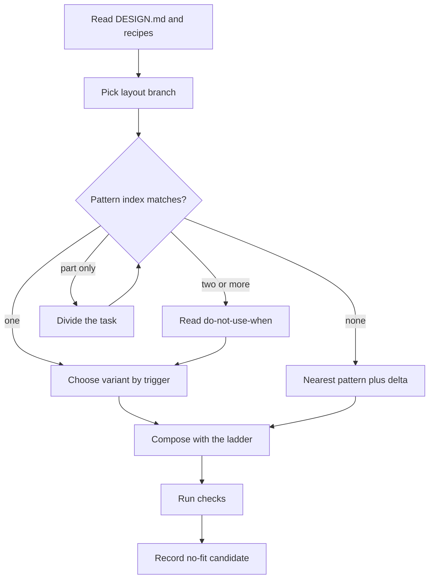

# Patterns stay prose while agents get components

Most of the 15 systems document patterns, but only three give an agent a real pattern unit: Primer (`list_patterns` and `get_pattern`), shadcn (`registry:block`) and Salesforce (85 YAML "blueprints"). All other agent tools serve components, tokens and doc search, and patterns reach the agent only as page text. No system checks that the output follows a pattern, and only Primer and Salesforce write a no-fit rule for the agent. Thus a VSA pattern system can take the best page template from Carbon and GOV.UK, the machine form from Salesforce and shadcn, and the agent rules from Primer and Shopify, and add the two parts that nobody has: a pattern check and a recorded no-fit result.

**Terms in this report**

| Term | Meaning |
|---|---|
| Pattern | A documented combination of components for a user goal |
| Pattern unit | One pattern entry that a tool can list and get |
| Agent artifact | MCP server, skill, `llms.txt` or agent instructions |
| No-fit case | No pattern matches the task |
| Pattern check | A machine check of the output against a pattern |

## 1. Three systems give an agent a pattern unit

**Pattern model and agent artifacts of each system**

| System | Pattern unit | Agent artifact | Pattern tool? |
|---|---|---|---|
| Carbon | Pattern; community pattern | `carbon-mcp`, `carbon-builder` skill | No, "coming soon" |
| Atlassian | No section; AMP patterns | `@atlaskit/ads-mcp`, internal skill | No |
| Polaris | Template; composition | `shopify` skill, Dev MCP | Names only |
| Primer | Scenario pattern; UI pattern | `@primer/mcp` 1.1.2 | Yes, two tools |
| SLDS | Blueprint; SLDS 2 pattern | Three `sf-skills` SLDS skills | Blueprints only |
| Fluent 2 | None | Contributor `AGENTS.md`; Blazor MCP | No |
| GOV.UK | Pattern with variants | None official | No |
| USWDS | Pattern with sub-patterns | None found | No |
| Material 3 | Canonical layout | None official | No |
| Ant Design | None; design specs | `antd mcp`, `llms.txt`, `DESIGN.md` | No; one prompt |
| Spectrum | Guidelines | MCP servers, skill, agent-surface spec | Planned, empty |
| shadcn | `registry:block` | Registry MCP, `shadcn` skill | Yes, by type |
| Storybook | None; stories | Storybook MCP (preview) | No |
| Figma Make | `composition/` folder | `Guidelines.md` files | No, prose only |
| zeroheight, Supernova, Knapsack | Doc page | MCP servers | No |

The table shows a gap between docs and agents. Carbon defines patterns as **"reusable combinations of components"** and has 17 core patterns ([Carbon patterns overview](https://carbondesignsystem.com/patterns/overview/); [Carbon llms.txt](https://carbondesignsystem.com/llms.txt)). But its MCP roadmap lists "Carbon Patterns context" under "Enablement coming soon" ([carbon-website overview.mdx](https://github.com/carbon-design-system/carbon-website/blob/main/src/pages/developing/carbon-mcp/overview.mdx)). Salesforce has the same gap: SLDS 2 calls its guidelines "patterns", but the apply skill puts "composition, interaction patterns" out of scope ([slds-apply SKILL.md](https://raw.githubusercontent.com/forcedotcom/sf-skills/main/skills/design-systems-slds-apply/SKILL.md)).

Atlassian has no general pattern section. `atlassian.design/patterns` returns an empty page. Its only pattern catalog, AMP, covers human and agent collaboration ([AMP Patterns](https://atlassian.design/amp)). The doc platforms serve pattern pages as text, with no pattern content type ([Supernova blog](https://www.supernova.io/blog/design-system-mcp-servers)).

## 2. The best page templates pair a trigger with variants

Each pattern page has the same three parts: a trigger, a solution and a reason. The best templates add a negative trigger and a trigger for each variant.

**Sections of a pattern page in each system**

| System | Sections, in order | Source |
|---|---|---|
| Carbon | Overview; Anatomy; When (not) to use; Designing with; Accessibility; Related | [documentation.mdx](https://github.com/carbon-design-system/carbon-website/blob/main/src/pages/contributing/documentation.mdx) |
| GOV.UK | Per variant: When to use; When not to use; How it works | [Addresses](https://design-system.service.gov.uk/patterns/addresses/) |
| Polaris (current) | Related; Supported components; Recommended compositions; Use cases; Examples | [Homepage template](https://shopify.dev/docs/api/app-home/patterns/templates/homepage.md) |
| Polaris (archived) | How it helps; Use when merchants need to; Using this pattern; Useful to know | [variant.md.template](https://raw.githubusercontent.com/Shopify/polaris-react-archive/main/polaris.shopify.com/content/patterns/variant.md.template) |
| Primer scenario | Where this happens; Implementation guidelines; User experience principles | [Delete](https://primer.style/product/scenario-patterns/delete) |
| Primer UI | Component anatomy; Variations; Content and copy; Error states | [Empty states](https://primer.style/product/ui-patterns/empty-states) |
| USWDS | Why this matters; Help users to (sub-patterns); Latest updates | [Create a user profile](https://designsystem.digital.gov/patterns/create-a-user-profile/) |
| Fluent 2 | Principles; Visual patterns; Behavior; Accessibility; Content patterns | [Wait UX](https://fluent2.microsoft.design/wait-ux) |
| SLDS blueprint | YAML: `usage_guidelines`, `variants`, `related_components`, `code_examples` | [cards.yaml](https://raw.githubusercontent.com/forcedotcom/sf-skills/main/skills/design-systems-slds-apply/assets/blueprints/components/cards.yaml) |
| shadcn block | JSON: `description`, `categories`, `registryDependencies`, `files`, `docs` | [registry-item.json](https://ui.shadcn.com/schema/registry-item.json) |

Four features are the most useful. Carbon makes "When to use" and "When not to use" template sections, so each pattern has its selection rule in a known place. GOV.UK writes the trigger for each variant, so a page is a choice of one from N. Polaris links patterns in two directions: a template lists its compositions, and a composition lists its templates. Each Polaris page also has an `.md` twin with front matter, which is an agent-readable form ([Media card](https://shopify.dev/docs/api/app-home/patterns/compositions/media-card.md)).

Carbon also writes thresholds into its selection tables. Examples: **"Use a dialog form when dealing with less than five inputs"**, and a side panel for more than five inputs ([Carbon Forms](https://carbondesignsystem.com/patterns/forms-pattern/)). Material 3 is the most deterministic: the window size class sets the pane count, so a lookup table selects the layout ([Android canonical layouts](https://developer.android.com/develop/ui/compose/layouts/adaptive/canonical-layouts)).

<details>
<summary>Contribution and status · Carbon, GOV.UK, Polaris</summary>

| System | Contribution | Status labels | Source |
|---|---|---|---|
| Carbon | GitHub issue; review for wide use | Core (governance board); community | [community patterns](https://github.com/carbon-design-system/carbon-website/blob/main/src/pages/community/patterns/index.mdx) |
| GOV.UK | Backlog discussion with evidence; no design first | Trial; Stable after 6 months | [Lifecycle statuses](https://design-system.service.gov.uk/community/component-lifecycle-statuses/) |
| Polaris (archived) | `variant.md.template` | None found | [variant.md.template](https://raw.githubusercontent.com/Shopify/polaris-react-archive/main/polaris.shopify.com/content/patterns/variant.md.template) |

GOV.UK has the clearest gate. A proposal must be "Useful" and "Unique". A pattern in development must be "Usable", "Consistent" and "Versatile" ([Contribution criteria](https://design-system.service.gov.uk/community/contribution-criteria/)). Carbon names the maintainers on each community pattern page ([Edit pattern](https://github.com/carbon-design-system/carbon-website/blob/main/src/pages/community/patterns/edit-pattern/index.mdx)). Primer, SLDS 2, Fluent 2 and current Polaris publish no pattern contribution template.

</details>

## 3. Agent artifacts are component-first, with three exceptions

The agent artifacts of 12 systems serve components, tokens, icons and doc search. Patterns reach these agents only as search results. Carbon's `docs_search` returns chunks with `site_area: "patterns"`, and the skill protocol "Discover → Canonicalize → Target" looks for a `component_id` ([carbon-builder SKILL.md](https://github.com/carbon-design-system/carbon-mcp/blob/main/public/skills/carbon-builder/SKILL.md)). Atlassian's `ads_plan` discovers "tokens, icons, and components" ([@atlaskit/ads-mcp](https://www.npmjs.com/package/@atlaskit/ads-mcp)). Ant Design puts page composition only in the prompt `antd-page-generator` ([Ant Design MCP](https://ant.design/docs/react/mcp.md)).

**The three pattern-aware agent artifacts**

| Artifact | Find | Choose | Source |
|---|---|---|---|
| `@primer/mcp` | `list_patterns`; `get_pattern` gets the live page | Prefer scenario, else UI pattern | [server.ts](https://raw.githubusercontent.com/primer/react/main/packages/mcp/src/server.ts) |
| `sf-skills` SLDS apply | `search-blueprints.cjs` over local YAML | Four-level ASCII decision tree | [component-selection.md](https://raw.githubusercontent.com/forcedotcom/sf-skills/main/skills/design-systems-slds-apply/references/component-selection.md) |
| shadcn MCP and skill | `search_items_in_registries` (fuzzy) | Selection table; search before custom UI | [shadcn SKILL.md](https://raw.githubusercontent.com/shadcn-ui/ui/main/skills/shadcn/SKILL.md) |

Primer is the only system with a pattern order in the tool text: **"Prefer a scenario pattern when one fits the task, and fall back to the more generic UI patterns otherwise"** ([server.ts](https://raw.githubusercontent.com/primer/react/main/packages/mcp/src/server.ts)). The SLDS decision tree has four levels: base components, then blueprints, then custom with styling hooks, then custom CSS ([slds-apply SKILL.md](https://raw.githubusercontent.com/forcedotcom/sf-skills/main/skills/design-systems-slds-apply/SKILL.md)). shadcn writes composition rules as a title plus a correct and incorrect code pair, for example "Empty states use Empty component" ([composition.md](https://raw.githubusercontent.com/shadcn-ui/ui/main/skills/shadcn/rules/composition.md)).

Shopify gives a partial case. Its skill lists all patterns by name, but gives no choice rule, so the agent must search for each page ([polaris-app-home.md](https://raw.githubusercontent.com/Shopify/shopify-ai-toolkit/main/skills/shopify/references/polaris-app-home.md)). Spectrum plans a `get_guidance` operation in its agent-surface contract, but the operation stays empty until RFC-D ([Agent surface spec](https://opensource.adobe.com/spectrum-design-data/spec/agent-surface/)).

Two systems build their skill from the docs source. Atlassian says its internal skill "is generated from the same content as" `llms.txt` ([Atlassian llms.txt](https://atlassian.design/llms.txt)). Primer's `get_pattern` reads the live docs page ([server.ts](https://raw.githubusercontent.com/primer/react/main/packages/mcp/src/server.ts)). Our repo uses the same model: the skills are build output of our source. Atlassian reports **52% better accuracy and 26% fewer tool calls** with its context engine, but it does not give the eval method ([Atlassian blog](https://www.atlassian.com/blog/ai-at-work/atlassian-design-system-building-the-context-engine-for-the-ai-era)).

## 4. Agents find and verify by machine, but choose by judgment

**How each agent artifact finds, chooses, composes and verifies**

| System | Find | Choose | Compose | Verify |
|---|---|---|---|---|
| Carbon | `docs_search` | User gives `COMPONENT_LIST` | Grid and UIShell rules | `code_audit` |
| Atlassian | `ads_plan` | `WHEN TO USE:` per tool | Examples and props | Lint rules; axe-core |
| Shopify | Routing table; `search_docs.mjs` | None | Example code | `validate.mjs`, mandatory |
| Primer | `list_patterns` | Scenario, then UI | Coding guidelines | `lint_css`, "MUST" |
| SLDS | Blueprint search script | Decision tree | Blueprint YAML | SLDS Linter, mandatory |
| shadcn | Registry search | Selection table | 13 composition rules | `get_audit_checklist` |
| Storybook | `docs-list` | Agent reads list | Documented props only | `test-run` |

Sources: [Carbon prompts](https://github.com/carbon-design-system/carbon-website/blob/main/src/pages/developing/carbon-mcp/prompts.mdx), [@atlaskit/ads-mcp](https://www.npmjs.com/package/@atlaskit/ads-mcp), [shopify SKILL.md](https://raw.githubusercontent.com/Shopify/shopify-ai-toolkit/main/skills/shopify/SKILL.md), [Primer server.ts](https://raw.githubusercontent.com/primer/react/main/packages/mcp/src/server.ts), [slds-apply SKILL.md](https://raw.githubusercontent.com/forcedotcom/sf-skills/main/skills/design-systems-slds-apply/SKILL.md), [shadcn MCP source](https://raw.githubusercontent.com/shadcn-ui/ui/main/packages/shadcn/src/mcp/index.ts), [Storybook MCP](https://storybook.js.org/docs/ai/mcp/overview).

### No check examines the choice of a pattern

All checks act on components, props, classes or tokens. The closest checks to a pattern are small local rules. Carbon's `code_audit` has a "composition errors" category ([code-audit-protocols.md](https://github.com/carbon-design-system/carbon-mcp/blob/main/public/skills/carbon-builder/references/code-audit-protocols.md)). Atlassian has lint rules such as `use-modal-title` and `use-heading-level-in-section-message` ([@atlaskit/ads-mcp](https://www.npmjs.com/package/@atlaskit/ads-mcp)).

The strongest verify steps are mandatory and have a loop limit. Shopify says **"Validation is mandatory"**, and after three failed attempts the agent returns its best effort with an explanation ([shopify SKILL.md](https://raw.githubusercontent.com/Shopify/shopify-ai-toolkit/main/skills/shopify/SKILL.md)). SLDS says "Do not rationalize violations as acceptable." A search summary of a Salesforce page says that agents can skip a linter step that a skill marks mandatory ([SLDS Linter with AI skills](https://developer.salesforce.com/docs/platform/slds-linter/guide/get-started-linter-AI-skills.html)). This source is secondary, because the page refused a direct fetch. SLDS also asks for the required states first: "loading, empty, error, success".

### Only two systems write a no-fit rule for the agent

**What each system does when no pattern fits**

| System | No-fit rule | Kind | Source |
|---|---|---|---|
| Primer | No match: "There is no pattern named"; use `list_patterns` | Next level | [server.ts](https://raw.githubusercontent.com/primer/react/main/packages/mcp/src/server.ts) |
| SLDS | "No blueprint match? → Build custom with styling hooks" | Next level | [component-selection.md](https://raw.githubusercontent.com/forcedotcom/sf-skills/main/skills/design-systems-slds-apply/references/component-selection.md) |
| Atlassian | `atlaskit_*` tools; "try alternate wording" | Wider catalog | [@atlaskit/ads-mcp](https://www.npmjs.com/package/@atlaskit/ads-mcp) |
| shadcn | Ask which registry; custom markup last | Ask; last resort | [shadcn SKILL.md](https://raw.githubusercontent.com/shadcn-ui/ui/main/skills/shadcn/SKILL.md) |
| Storybook | Undocumented prop: ask the user | Ask | [Storybook MCP](https://storybook.js.org/docs/ai/mcp/overview) |
| GOV.UK | Backlog discussion with evidence of need | Record and promote | [Propose a pattern](https://design-system.service.gov.uk/community/propose-a-component-or-pattern/) |
| Brad Frost | Product recipe; promote if general | Local unit | [Design system recipes](https://bradfrost.com/blog/post/the-art-of-design-system-recipes/) |
| Carbon, Ant, Spectrum | None stated | None | [Spectrum spec](https://opensource.adobe.com/spectrum-design-data/spec/agent-surface/) |

The common agent fallback is "compose from components and tokens, then run the check". No agent artifact records the no-fit result. GOV.UK and Frost record and promote a new unit, but only for people. Thus the no-fit result of an agent leaves no trace in any system.

## 5. Proposal: a VSA pattern entry and an agent workflow

### The pattern entry adds six fields to the Web Awesome recipe

A Web Awesome recipe has four parts: a name with its layout branch, **Intent**, **Rationale** and **Code** ([patterns.md](../.claude/skills/webawesome-design/references/patterns.md)). The proposed entry keeps these four parts. It adds the fields that the research shows in the best systems.

**Field origin and mapping to the Web Awesome recipe**

| Field | Web Awesome recipe | Borrowed from |
|---|---|---|
| Name and layout branch | Heading | Web Awesome |
| Kind: page, composition, scenario | None | Polaris, Primer |
| Use when | Intent | Carbon, GOV.UK |
| Do not use when | None | Carbon, GOV.UK |
| Variants, each with a trigger | None | GOV.UK, Carbon |
| Anatomy and components | Code only | Carbon, `registryDependencies` |
| Required states | None | SLDS phase 1 |
| Rules, correct and incorrect | Rationale prose | shadcn, Primer |
| Rationale | Rationale | Web Awesome |
| Related patterns, two ways | None | Polaris, Carbon |
| Status and owner | None | GOV.UK, Carbon |
| Checks | Skill-wide searches | Shopify, SLDS |
| Code | Code | Web Awesome |

The entry is design first. At status `proposed` and `trial`, the Code field can be a sketch or empty. The design fields must be complete. At status `stable`, Code is mandatory and the checks must pass.

**Proposed pattern entry: front matter and body**

```markdown
---
name: settings-section
title: Settings section
kind: composition            # page | composition | scenario
layout: in-page              # full-page (wa-page) | in-page (utilities only)
status: trial                # proposed | trial | stable
owner: <team or person>
use-when: A user changes saved preferences of one area.
do-not-use-when: The change has a high cost or cannot be undone. Use the confirm-action pattern.
components: [wa-card, wa-switch, wa-select, wa-button]
states: [loading, empty, error, success]
related: [app-shell, confirm-action]
checks: [check.mjs, screenshots]
---

## Intent
One sentence: the user goal.

## Variants
### Inline save
- Use when: each field saves alone.
- Do not use when: fields depend on each other.

## Anatomy
Numbered parts, each with its component.

## Rules
1. Rule title. Correct: <snippet>. Incorrect: <snippet>.

## Rationale
The web convention that the pattern follows.

## Code
The Web Awesome composition. Optional before `stable`.
```

The front matter gives the agent a pattern unit, like the SLDS YAML and the shadcn JSON. The `use-when` line is the index key, so the index can list each pattern with one line, like `list_patterns` and the Polaris `.md` twins. The `related` list must have a link back from each target. A script can check this rule.

### The agent workflow adds a pattern step and a no-fit record

**Agent workflow for VSA patterns**



1. Read `vsa/DESIGN.md` and the house recipes. This is Web Awesome step 1.
2. Pick the layout branch for the outer frame. This is Web Awesome step 2.
3. Read the pattern index. Prefer a scenario pattern, then a composition, then a page. This is the Primer order.
4. If one pattern matches, choose its variant by the variant trigger.
5. If two patterns match, read their "Do not use when" lines. If both still match, ask the user.
6. If one part of the task matches, divide the task. Do steps 3 to 5 for each part.
7. Compose with the components of the pattern. Then use the Web Awesome ladder for the rest.
8. Make each state in `states`: loading, empty, error and success.
9. Run `node vsa/scripts/check.mjs` and the screenshots. If a check fails three times, stop and report.
10. If no pattern fits, start from the nearest pattern. State each change as a delta.
11. If no pattern is near, build from the ladder. Mark the result as off-pattern.
12. Record each off-pattern result as a `proposed` entry. A person promotes it to `trial`.

Steps 3, 5, 9 and 12 come from the research. Step 3 copies Primer. Step 5 copies the Carbon and GOV.UK negative triggers. Step 9 copies the Shopify loop limit. Step 12 copies the GOV.UK backlog and the Frost recipe layer, and it is the part that no agent artifact has.

### The repo needs one decision record before the first pattern

**Where each part goes in this repo**

| Part | Place | Rule |
|---|---|---|
| Pattern entries | `vsa/docs/patterns/<name>.md` | Like `vsa/docs/components/` |
| Pattern index | `vsa/docs/index.json`, `patterns` group | Name, title, `use-when` |
| No-fit rule and order | `vsa/DESIGN.md` | Brief has priority over skills |
| Pattern checks | `vsa/scripts/check.mjs` | Front matter; two-way links |
| Recipe template change | `packages/webawesome/scripts/design-skill/` | Needs a decision record |

`AGENTS.md` makes the guideline source a system change, so a change to the recipe template needs a decision record (`0001`). The first phase can avoid this change. It keeps the Web Awesome recipes as they are and puts our entries in `vsa/docs/patterns/`. The recipe file ends at "Want more?", which points to Web Awesome Pro, and the project uses no Pro code. Our pattern index replaces that end for VSA agents.

## Conclusion

The research changes the question. The hard part is not the page template: Carbon, GOV.UK and Polaris already give a good one, and the fields agree. The hard part is the agent contract around the template. Primer proves that a list and get pair with a stated order is enough for "find" and "choose". Shopify and SLDS prove that a mandatory check with a loop limit is enough for "verify". No system closes the loop from the no-fit case back into the catalog. If VSA records each off-pattern result as a `proposed` entry, the agent becomes the source of pattern candidates, and the catalog grows from real tasks.

The second implication is the check. All 15 systems check tokens and components, and none checks a pattern. A front matter with `components`, `states` and `related` gives a script facts to examine: the declared components appear, each state exists, and each link has a link back. This check is small, but no system in the research has it.

## Open questions

- Pattern index key: one `use-when` line, or a situation table like Carbon "Deciding what to use"?
- Does a scenario pattern need a separate file kind, or a `kind` value only?
- Who promotes a `proposed` entry to `trial`, and with what evidence?
- The research did not read the Carbon platform (`next.carbondesignsystem.com`), the live SLDS 2 pattern index or the v0 "Design Systems 2.0" docs.
- No source measures agent accuracy for pattern selection as the catalog grows.
