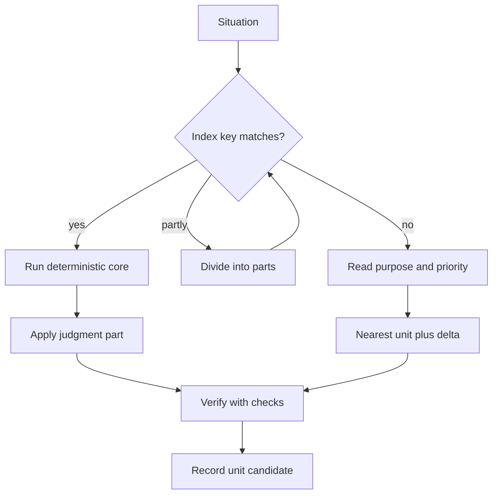

# Good pattern systems define their own failure

Mature pattern systems share one shape. An index key selects a unit, a small deterministic core runs, and judgment fills the rest. The strongest systems also define the no-fit case: their fallback gives a purpose and a priority order, not steps. The Web Awesome skill has the shape, but its no-fit case ends at one rung, "Extend".

**The common model of a pattern system**

**Terms in this report**

| Term | Meaning |
|---|---|
| Unit | One pattern, recipe, checklist, drill or skill |
| Index key | The fact that selects a unit |
| Deterministic part | The part that runs the same each time |
| Judgment part | The part that the practitioner decides |
| No-fit case | No unit matches the situation |
| Fallback | The rule for the no-fit case |

## 1. Each unit has a trigger, a fixed core and a reason

All templates have three elements: a trigger (when to use), a fixed core (the solution or the steps) and a reason (forces, rationale or evidence). The PLoP community names the minimum set: name, problem, context, forces and solution. The names and the order can change ([Pitt course page](https://people.cs.pitt.edu/~chang/231/8pattern/LANGUAGE/project/s10.html); [Carleton slides](https://people.scs.carleton.ca/~deugo/Patterns/Agent/Presentations/AgentPatterns/tsld116.htm)).

Some catalogs add two elements. Azure adds a negative trigger, "This pattern might not be suitable when", and a pillar table of trade-offs ([Azure: Circuit Breaker](https://learn.microsoft.com/en-us/azure/architecture/patterns/circuit-breaker)). Alexander and GRADE add a confidence label. Alexander uses asterisks for **"our degree of faith in these hypotheses"** ([Wikipedia: A Pattern Language](https://en.wikipedia.org/wiki/A_Pattern_Language)). GRADE separates evidence quality from the strength of a recommendation ([Guyatt et al., BMJ 2008](https://pmc.ncbi.nlm.nih.gov/articles/PMC2376019)).

A Web Awesome recipe has a name with its layout branch, an intent, a rationale and code. It has no negative trigger, no confidence label and no links to related recipes.

Unit template of each design and software system (10 systems)

| System | Unit template, in order | Source |
|---|---|---|
| GOV.UK | When to use; how it works; research | [GOV.UK Check answers](https://design-system.service.gov.uk/patterns/check-answers/) |
| Carbon | Guidance that combines components; some code | [Carbon patterns](https://carbondesignsystem.com/patterns/overview/) |
| Material 3 | Canonical layout plus a code scaffold | [Android canonical layouts](https://developer.android.com/develop/ui/compose/layouts/adaptive/canonical-layouts) |
| Alexander | Picture; up-links; problem; "Therefore:"; solution; down-links | [Kerievsky template](https://www.industriallogic.com/papers/template.html) |
| GoF | 13 headings, Intent to Related Patterns | [Wikipedia: Software design pattern](https://en.wikipedia.org/wiki/Software_design_pattern) |
| PoEAA | Intent; sketch; How It Works; When to Use It | [PoEAA contents](https://toc.uni.li/FLMF008074.pdf) |
| Azure | Problem; solution; considerations; when (not) to use | [Azure: Circuit Breaker](https://learn.microsoft.com/en-us/azure/architecture/patterns/circuit-breaker) |
| AWS PG | Prerequisites and limitations; tools; epics | [AWS PG patterns](https://docs.aws.amazon.com/prescriptive-guidance/latest/patterns/welcome.html) |
| Golden path | Tutorial; Backstage template; Soundcheck track | [Spotify Engineering](https://engineering.atspotify.com/2020/08/how-we-use-golden-paths-to-solve-fragmentation-in-our-software-ecosystem/) |
| Agent Skill | `name`; `description`; body; reference files | [Agent Skills overview](https://platform.claude.com/docs/en/agents-and-tools/agent-skills/overview) |

Unit template of each other discipline and agent format (9 systems)

| System | Unit template, in order | Source |
|---|---|---|
| Aviation | Trigger; memory items; reference items; branches | [Brainscape QRH aid](https://www.brainscape.com/flashcards/qrh-non-normal-checklist-instructions-8576380/packs/14596906) |
| Battle drill | Cue; fixed collective actions; no deliberate decision | [Wikipedia: Battle drill](https://en.wikipedia.org/wiki/Battle_drill) |
| ACLS | 12 numbered boxes; yes/no nodes; timed loops | [AHA 2025 algorithm](https://cpr.heart.org/-/media/CPR-Files/CPR-Guidelines-Files/2025-Algorithms/Algorithm-ACLS-CA-250527.pdf?sc_lang=en) |
| GRADE | Statement; direction; strength; evidence quality | [Guyatt et al., BMJ 2008](https://pmc.ncbi.nlm.nih.gov/articles/PMC2376019) |
| Cooking ratio | Proportions of a few base ingredients | [NPR, 2009](https://www.npr.org/2009/07/26/107019060/throw-away-the-recipe-learn-the-ratio-instead) |
| TRIZ | Contradiction; matrix cell; principles; Ideal Final Result | [TU Braunschweig methodos](https://methodos.ik.ing.tu-bs.de/methode/WiderspruchsmatrixundInnovationsprinzipienausTRIZ.html?lang=en) |
| Polya | Four phases, each with a question list | [Wikipedia: How to Solve It](https://en.wikipedia.org/wiki/How_to_Solve_It) |
| Toyota | Takt time; work sequence; in-process stock | [Lean Enterprise Institute](https://www.lean.org/?p=1808) |
| llms.txt | H1; summary; H2 link lists; "Optional" | [llmstxt.org](https://llmstxt.org/) |

## 2. Units relate by links, by levels or by deltas

Three relation models exist:

- **Links in a graph.** Alexander puts up-links in the first paragraph and down-links in the last ([Kerievsky template](https://www.industriallogic.com/papers/template.html)). Azure names composable pairs, for example Retry with Circuit Breaker ([Azure patterns](https://learn.microsoft.com/en-us/azure/architecture/patterns/)).
- **Levels.** Aviation keeps normal checklists in the FCOM and non-normal checklists in the QRH ([737NG FCOM](https://www.737ng.co.uk/737NG%20POH.pdf)). The military orders units by time and novelty, from battle drill to full MDMP ([Wikiwand: MDMP](https://wikiwand.com/en/articles/Military_Decision_Making_Process)).
- **Deltas from a base.** A small sauce is a mother sauce plus one or two ingredients ([Tasting Table](https://tastingtable.com/1154290/the-3-techniques-that-turn-french-mother-sauces-into-small-sauces)). The WHO checklist is a fixed core that local sites can extend ([WHO tools](https://www.who.int/teams/integrated-health-services/patient-safety/research/safe-surgery/tool-and-resources)).

Recursion occurs in three places. Atomic Design organisms can contain other organisms ([Atomic Design ch. 2](https://atomicdesign.bradfrost.com/chapter-2/)). Cynefin divides a confused problem into parts and assigns each part to a domain ([Wikipedia: Cynefin](https://en.wikipedia.org/wiki/Cynefin_framework)). The Web Awesome layout gate asks its question again for each inner container. The Agent Skills rule "Keep references one level deep" limits file depth, not decision depth ([best practices](https://platform.claude.com/docs/en/agents-and-tools/agent-skills/best-practices)).

Protected cores are a common rule. WHO permits additions, but deleted items probably make the checklist less effective ([Harvard DASH report](https://dash.harvard.edu/server/api/core/bitstreams/d74f7fd4-5d80-4736-851e-0bfbb67297c9/content)).

## 3. Selection needs an index key, and the hard case has no key

**Index key of each system**

| System | Index key | Decided by | Source |
|---|---|---|---|
| GOV.UK | User task ("Ask users for…") | Person | [GOV.UK Patterns](https://design-system.service.gov.uk/patterns/) |
| Azure | Problem statement and acceptable trade-offs | Person | [Azure patterns](https://learn.microsoft.com/en-us/azure/architecture/patterns/) |
| GoF | Intent; cause of redesign; what varies | Person | [GoF chapter 1](https://box.cs.istu.ru/public/docs/devel/patterns/Design%20Patterns/lowres/sample.htm) |
| Porsche notifications | Decision tree with four cases | Tree | [Porsche decision tree](https://designsystem.porsche.com/v4/patterns/notifications/decision-tree) |
| Golden path | Discipline filter in Backstage Explore | Person | [Spotify Engineering](https://engineering.atspotify.com/2020/08/how-we-use-golden-paths-to-solve-fragmentation-in-our-software-ecosystem/) |
| Agent Skill | `description` text | Model | [Agent Skills overview](https://platform.claude.com/docs/en/agents-and-tools/agent-skills/overview) |
| AGENTS.md | Nearest file in the directory tree | Fixed rule | [agents.md](https://agents.md/) |
| Cursor, Copilot | Always, glob, description or manual mention | Fixed rule, except description | [Cursor rules](https://cursor.com/docs/context/rules) |
| Aviation | EICAS alert message | Fixed rule | [Brainscape QRH aid](https://www.brainscape.com/flashcards/qrh-non-normal-checklist-instructions-8576380/packs/14596906) |
| Military | Cue (drill); receipt of mission (MDMP) | Fixed rule | [Wikipedia: Battle drill](https://en.wikipedia.org/wiki/Battle_drill) |
| ACLS | Patient state, then "Rhythm shockable?" | Fixed rule | [AHA 2025 algorithm](https://cpr.heart.org/-/media/CPR-Files/CPR-Guidelines-Files/2025-Algorithms/Algorithm-ACLS-CA-250527.pdf?sc_lang=en) |
| TRIZ | Parameter to improve and parameter to keep | Matrix lookup | [Triz.co.uk](https://www.triz.co.uk/glossary/contradiction-matrix) |
| Polya | A related problem with the same unknown | Person | [Wikipedia: How to Solve It](https://en.wikipedia.org/wiki/How_to_Solve_It) |
| Cynefin | Type of cause and effect | Person | [Wikipedia: Cynefin](https://en.wikipedia.org/wiki/Cynefin_framework) |

The best index keys name the situation, not the solution. GOV.UK names patterns by user task. Azure says: **"Choose a pattern based on the problem you need to solve, not the technology you want to use"** ([Azure patterns](https://learn.microsoft.com/en-us/azure/architecture/patterns/)). The hard case in aviation is the failure with no alert message. The crew then uses a QRH index by condition.

In agent formats, only the description match needs model judgment. The other triggers are fixed rules. Anthropic says that routing works when the input categories are distinct ([Building effective agents](https://www.anthropic.com/engineering/building-effective-agents)). GoF has the same risk for people: novice developers select the wrong one of two near patterns ([Polyzoidou et al. 2023](https://sites.uom.gr/a.ampatzoglou/public_html/papers/polyzoidou2023spe.pdf)).

Always-on text has a measured cost. The best frontier models reach **about 68% accuracy at 500 simultaneous instructions** ([IFScale, arXiv 2507.11538](https://arxiv.org/abs/2507.11538)). In one Atlassian test, an MCP server and skills gave about 80% of the necessary context, and DESIGN.md gave about 30% ([Atlassian blog](https://www.atlassian.com/blog/how-we-build/atlassians-design-md-is-here-what-we-learned-testing-portable-design-context-in-practice)). The Web Awesome recipe catalog has no index key except the screen name.

## 4. A small deterministic core sits inside a judgment part

**Deterministic part and judgment part of each system**

| System | Deterministic part | Judgment part | Source |
|---|---|---|---|
| Golden path | Template start; scorecard checks | Tutorial text | [Soundcheck docs](https://backstage.spotify.com/docs/plugins/soundcheck/core-concepts/tracks) |
| Agent Skill | Scripts, low freedom | Text instructions, high freedom | [best practices](https://platform.claude.com/docs/en/agents-and-tools/agent-skills/best-practices) |
| Azure | Problem; mechanism; pillar mapping | Thresholds; time-outs; combinations | [Azure: Circuit Breaker](https://learn.microsoft.com/en-us/azure/architecture/patterns/circuit-breaker) |
| GOV.UK | Five contribution criteria; research gate | Layout choices in "How it works" | [Contribution criteria](https://design-system.service.gov.uk/community/contribution-criteria/) |
| Aviation | Item sequence; memory items | Order and combination of checklists | [PRISM brief](https://safetymaterials.argus.aero/wp-content/uploads/2023/07/PRISM-Research-Brief-Cockpit-Checklist-Fundementals.pdf) |
| Military | Battle drill | COA creation and comparison | [Lightning Press: MDMP](https://www.thelightningpress.com/military-decision-making-process-mdmp/) |
| Medicine | Algorithm steps; drug timings | "Consider" items; weak recommendations | [AHA 2025 algorithm](https://cpr.heart.org/-/media/CPR-Files/CPR-Guidelines-Files/2025-Algorithms/Algorithm-ACLS-CA-250527.pdf?sc_lang=en) |
| Cooking | Ratio; technique | Seasoning; final adjustment | [Michael Nagrant review](https://www.michaelnagrant.com/reviews/cracking-the-code-michael-ruhlman-ratio) |
| TRIZ | Matrix lookup | Principle to concrete solution | [TU Braunschweig methodos](https://methodos.ik.ing.tu-bs.de/methode/WiderspruchsmatrixundInnovationsprinzipienausTRIZ.html?lang=en) |

The deterministic core is small and protects the most dangerous items. A good checklist has **five to nine "killer items"**, and a pause longer than 60 to 90 seconds becomes a distraction ([Graham Mann notes](https://grahammann.net/book-notes/the-checklist-manifesto-atul-gawande)). These figures come from summaries of Gawande, not from the book. A battle drill buys time for a later, better decision ([Warfare Mastery](https://warfaremastery.substack.com/p/the-problem-with-traditional-battle)).

The check method changes with the risk. Normal checklists use "do-verify". Abnormal checklists use "read-do" or "challenge-do-verify" ([PRISM brief](https://safetymaterials.argus.aero/wp-content/uploads/2023/07/PRISM-Research-Brief-Cockpit-Checklist-Fundementals.pdf)). Anthropic matches freedom to fragility: **"Narrow bridge with cliffs on both sides"** means exact steps ([best practices](https://platform.claude.com/docs/en/agents-and-tools/agent-skills/best-practices)).

Cynefin sets the limit of the deterministic part. Best practice is correct only in the clear domain, and **"best practice is, by definition, past practice"** ([Wikipedia: Cynefin](https://en.wikipedia.org/wiki/Cynefin_framework)). The Web Awesome skill states its split in "What is fixed, and what is yours to decide". Its regex searches are a do-verify pass, and its optional subagent review is a second-person check.

## 5. The fallback gives a purpose and a priority, not steps

**Fallback of each system**

| System | Fallback rule | Fallback kind | Source |
|---|---|---|---|
| Military | Disciplined initiative within commander's intent | Purpose | [Brainscape ADP 6-0](https://www.brainscape.com/flashcards/adp-6-0-adp-6-0-mission-command-2333767/packs/4116240) |
| Aviation | Aviate, navigate, communicate | Priority order | [Open Exam Prep](https://open-exam-prep.com/study-guides/faa-sport-pilot/ch7-airport-ops-adm-emergencies/emergency-procedures-equipment-failures-imc) |
| Aviation (Boeing) | Captain combines checklists, uses judgment | Combine units | [PPRuNe post](https://www.pprune.org/10425977-post2252.html) |
| Medicine | Weak recommendation: choose with patient values | Values | [Guyatt et al., BMJ 2008](https://www.doi.org/10.1136/BMJ.39493.646875.AE) |
| Cooking | Nearest mother sauce or ratio, small change | Nearest base plus delta | [Rouxbe](https://rouxbe.com/tips-techniques/333) |
| Polya | Solve a related or auxiliary problem | Analogy | [Wikipedia: How to Solve It](https://en.wikipedia.org/wiki/How_to_Solve_It) |
| TRIZ | ARIZ algorithm and Ideal Final Result | Stronger method; ideal target | [Wikipedia: TRIZ](https://en.wikipedia.org/wiki/TRIZ) |
| Toyota | A3, then a new standard | Record and promote | [Lean Enterprise Institute](https://www.lean.org/common/display/?o=2189) |
| Cynefin | Probe; act first in chaos; divide | Change of domain | [Wikipedia: Cynefin](https://en.wikipedia.org/wiki/Cynefin_framework) |
| Alexander | Patterns are tentative hypotheses | Revise the unit | [Wikipedia: A Pattern Language](https://en.wikipedia.org/wiki/A_Pattern_Language) |
| GoF | Consider what should be variable | Encapsulate the variation | [GoF chapter 1](https://box.cs.istu.ru/public/docs/devel/patterns/Design%20Patterns/lowres/sample.htm) |
| GOV.UK | Backlog discussion with evidence | Record and promote | [Propose a pattern](https://design-system.service.gov.uk/community/propose-a-component-or-pattern/) |
| Golden path | Leave the path, own the result | Leave with responsibility | [CNCF white paper](https://tag-app-delivery.cncf.io/whitepapers/platforms/) |
| Agent formats | User chat prompt overrides all | Human override | [agents.md](https://agents.md/) |

The military rule is the clearest. Disciplined initiative is action **"when existing orders no longer fit the situation"**, inside the commander's intent: the purpose and the end state ([Brainscape ADP 6-0](https://www.brainscape.com/flashcards/adp-6-0-adp-6-0-mission-command-2333767/packs/4116240)). This source is a study card that paraphrases the 2012 doctrine. The Boeing quote comes from a forum post, so compare it with a current QRH.

Golden paths have the weakest fallback. A team can leave the path, but central support stops. No source gives a request, exception or return process ([Spotify Engineering](https://engineering.atspotify.com/2020/08/how-we-use-golden-paths-to-solve-fragmentation-in-our-software-ecosystem/); [Netflix paved road deck](https://www.slideshare.net/diannemarsh/the-paved-road-at-netflix)). The scorecard shows the distance from the path but does not block.

The fallback kinds combine into one procedure. The flow below is a synthesis of the table, not a rule from one source.

**Proposed no-fit procedure for an agent**

1. If one part of the task matches a unit, divide the task. Run the selection for each part (Cynefin, layout gate).
2. Find the nearest unit. Change one or two elements, and state each change (cooking, Polya).
3. If no unit is near, read the purpose and the priority order in the project brief (mission command, aviation).
4. Build from the lower rungs of the ladder.
5. Run the same checks as for a matched unit (Soundcheck).
6. Mark the result as off-path. Record it as a candidate unit (GOV.UK backlog, Toyota A3).
7. If cause and effect are not known, make a small reversible probe and ask the user (Cynefin).

## 6. Comparison and transferable principles

**Comparison: design and software systems**

| System | Unit core | Relations | Index key | Fallback |
|---|---|---|---|---|
| GOV.UK | When to use; how it works | Pattern uses components | User task | Backlog with evidence |
| Carbon | Guidance across components | Pattern over components | Pattern name | Not stated |
| Material 3 | Layout plus scaffold | Closed set of three | Content relation | Not stated |
| Atomic Design | Atoms to pages | Recursive organisms | Size level | Not stated |
| Alexander | Problem, "Therefore:", solution | Numbered up-links and down-links | Project scale | Revise the hypothesis |
| GoF | 13 headings | Category graph | Intent; what varies | Encapsulate the variation |
| PLoP | Name, context, problem, forces, solution | Pattern language | Name; thumbnail | Not stated |
| Azure | Problem; solution; when (not) to use | Composable pairs; pillars | Problem statement | Pillar principles |
| Golden path | Tutorial; template; scorecard | One per discipline | Discipline filter | Leave, own the result |

**Comparison: other disciplines and agent formats**

| System | Unit core | Relations | Index key | Fallback |
|---|---|---|---|---|
| Aviation | Memory items; reference items | FCOM, QRH, memory items | Alert message | Aviate, navigate, communicate |
| Military | Drill; mission order | Drill to full MDMP | Cue; mission | Act within intent |
| Medicine | Algorithm; checklist; recommendation | Branches loop; local additions | Patient state | Patient values |
| Cooking | Ratio; recipe | Ratio, mother, small sauce | Base components | Nearest base plus delta |
| TRIZ | Contradiction; 40 principles | Matrix into catalog | Two parameters | ARIZ; Ideal Final Result |
| Polya | Four phases with questions | Analogy to solved problems | Same unknown | Auxiliary problem |
| Toyota | Takt, sequence, stock | Standard, A3, new standard | Process | A3, then new standard |
| Cynefin | Five domains | Selects the kind of practice | Cause and effect | Probe, act, divide |
| Agent Skill | `description`; body; files | Three load levels | Description match | Default plus escape hatch |
| AGENTS.md, rules | Markdown instructions | Nearest file wins | Location; glob | User prompt overrides |
| llms.txt | Index of links | "Optional" section | Link notes | Not stated |

**Transferable principles, mapped to the Web Awesome model**

| # | Principle | Borrow from | Web Awesome today | Change for our system |
|---|---|---|---|---|
| 1 | Index units by situation | GOV.UK, aviation, Azure | Recipes by screen name | Add a situation trigger |
| 2 | Write when not to use | Azure, Curtis "Use When" | Intent and rationale only | Add a negative trigger |
| 3 | Label the strength | GRADE, Alexander asterisks | Fixed or yours, per skill | Strong or weak, per recipe |
| 4 | Keep the core small | Memory items, killer items | Ordered ladder; rules table | Mark the killer rules first |
| 5 | Divide until a unit fits | Cynefin, Atomic Design | Recursive layout gate | Same gate for recipes |
| 6 | State the purpose | Commander's intent | "Extend" rung; ask the user | Purpose and priority in DESIGN.md |
| 7 | Prefer nearest base plus delta | Mother sauces, Polya | Copy, then re-theme | Name the base, list the delta |
| 8 | Check the distance | Soundcheck, do-verify | Regex searches; checklist | Report off-path distance |
| 9 | Promote with evidence | GOV.UK, Toyota A3 | "Want more?" points to Pro | Candidate backlog, then recipe |

The Web Awesome model already follows principles 4, 5 and 8. Its four steps match Polya: discover, select, build, verify. Its precedence rule, "project conventions > this skill's defaults > your own taste", matches the AGENTS.md rule that the nearest file wins.

Its gaps are in the no-fit case. The last rung, "Extend", gives a CSS playbook but no purpose, no delta form and no record. The recipe file ends at "Want more?", which points to Web Awesome Pro, and the project uses no Pro code. Thus a no-fit result leaves no trace and cannot become a recipe.

The selection evidence supports three limits. Keep each recipe trigger distinct from the others. Keep always-on text short, and load units on demand. Put each deterministic check in a script, as `vsa/scripts/check.mjs` does.

## 7. Open questions

- No source measures skill selection accuracy as the number of descriptions grows.
- IFScale finds a bias toward early instructions. arXiv 2510.14842 finds no consistent position effect ([arXiv 2510.14842](https://arxiv.org/pdf/2510.14842)).
- The Atlassian figures come from one test task, a log-in screen.
- The sources do not include the current ADP 6-0 (2019) wording, the Boeing QRH text or the WHO manual text.
- Cynefin facts come from Wikipedia, which cites Snowden and Boone (2007).
- No source gives a formal return process for a team that leaves a golden path.
