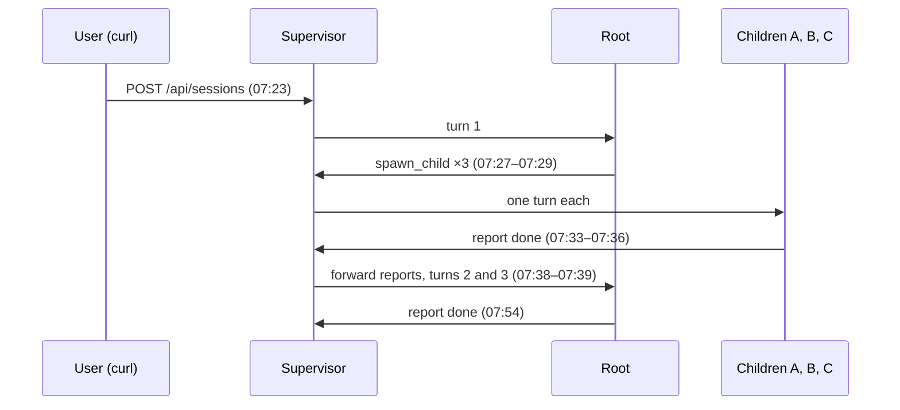

# C5 probe: a team in one VM (G1)

Yes: the orchestrator runs fully in one cloud VM, but only with the `orch` CLI installed on `PATH`; with it, one root and three child sessions used the orch tools and reached `done` in 31 s.

Without `orch` on `PATH` (run 1), each orch tool call failed and no child started. Run 2 installed `orch` with the command in `AGENTS.md` and repeated the brief on a clean repository and store.

| Item | Value |
|---|---|
| Date | 2026-11-18 (UTC) |
| Source | branch `orch/session-c46c4a77` |
| VM | Linux cloud container, `claude` 2.1.327, .NET SDK 10.0.404 |
| Store, port | `/tmp/c5store`, 7790, `ORCH_IMPORT=0`, `ORCH_PLUGIN_DIR=plugin/` |
| Raw data | [`c5-probe/`](c5-probe/) |

## Steps

| Step | Result | Time (UTC) |
|---|---|---|
| 1. Install .NET 10 | ✅ SDK 10.0.404 in 16 s | 00:05:17 |
| 2. Test repository | ✅ `/tmp/c5repo`, `AGENTS.md`, commit `init` | 00:05:40 |
| 3. Store | ✅ `/tmp/c5store/policy.json` from `policy.test.json` | 00:05:40 |
| 4. Publish, start supervisor | ✅ publish 12 s; `/api/sessions` 200; `/` 200 | 00:06:06 |
| 5. Send root brief (run 1) | ✅ 201, root `92416d8d` | 00:06:10 |
| 6. Watch (run 1) | ❌ 3 `spawn_child` failed; `report` not recorded | 00:06:28 |
| Extra: install `orch` | ✅ `dotnet pack` + `dotnet tool update -g`, 3 s | 00:07:15 |
| 4–5 again (run 2) | ✅ 200, 200; 201, root `ed3b908a` | 00:07:23 |
| 6. Watch (run 2) | ✅ root `done` before minute 1 | 00:07:54 |
| 7. Missing orch tools | Not needed: all sessions had the tools | 00:08:26 |
| 8. Session data | ✅ see the session table | 00:08:30 |
| 9. Stop supervisor, copy logs | ✅ stopped; logs in `c5-probe/` | 00:08:44 |

Run 1 error, from `log-supervisor.txt` of the root:

```
orch process failed: HooksError: orch: $.process.run(orch) failed to start: ENOENT: Executable not found in $PATH: "orch"
```

The tool results that the root got:

```
orch: spawn_child failed. Do the work yourself or report blocked.
orch: the report was not recorded. Continue your work.
```

### Run 2 sequence



## Sessions (run 2)

| Session | Parent | Turns | Orch tools | Final state | Active (UTC) |
|---|---|---|---|---|---|
| `ed3b908a` C5 root | none | 3 | `spawn_child` ×3, `report` ×1 | done | 07:23–08:02 |
| `05319f21` A | `ed3b908a` | 1 | `report` ×1 | done | 07:27–07:57 |
| `550482d6` B | `ed3b908a` | 1 | `report` ×1 | done | 07:28–07:43 |
| `d25e2594` C | `ed3b908a` | 1 | `report` ×1 | done | 07:29–07:57 |

Each child also called `Bash` one time to write and commit its file. The commits are `062d7b0` (A), `d6481c0` (B) and `6bbf979` (C), all on `master` of `/tmp/c5repo`.

Run 1 had one session: `92416d8d` C5 root, 1 turn, `spawn_child` ×3 and `report` ×1 (all failed), state `idle`. The root then wrote and committed A, B and C itself.

### Cost

The supervisor log has no `result` lines, so the total cost in dollars is not known. Token use from the transcripts in `~/.claude/projects/-tmp-c5repo/`:

| Run | Output | Cache write | Cache read | Input |
|---|---|---|---|---|
| Run 1 (root only) | 3,363 | 114,314 | 225,119 | 18 |
| Run 2 (4 sessions) | 3,919 | 42,664 | 670,190 | 44 |

## Findings

| # | Finding | Owner |
|---|---|---|
| C5-1 | The plugin hooks start `orch` from `PATH` (`plugin/hooks/state.ts:95`). A fresh VM has no `orch`, so each orch tool fails. The VM setup must install `orch` (`dotnet pack` + `dotnet tool update -g`) and put `~/.dotnet/tools` on `PATH`, with `DOTNET_ROOT` set | Stream D |
| C5-2 | The plugin hooks module loads in a child `claude -p` in this VM. No log or transcript has "hooks module not loaded". This result is different from C0-2 | Stream B |
| C5-3 | `orch process` fails on Linux: "the parent process is not known". `Processes.Snapshot()` and `Open()` work only on Windows. The lease gets no `pid` and `started`, so the supervisor cannot check if a live holder is alive | Stream B |
| C5-4 | Run 1: the tool failure was silent to the supervisor. The root became `idle`, not `blocked`, and its `done` report was lost. The tool result does not give the cause | Stream B |
| C5-5 | The store has no `report.json`. A report is a `report` event (`docs/store.md`). The probe used `state: done` from `GET /api/sessions` as the stop rule | Note |
| C5-6 | Each child `claude` gets the environment of the host session (`CLAUDE_CODE_*`). The commits use author `Claude` and the commit trailers of the host session | Stream B |
| C5-7 | The supervisor does not record the `result` line of `claude -p`, so the cost is not visible. Record `total_cost_usd` for each turn | Stream B |
| C5-8 | No permission prompt stopped a session. No person acted during the probe | Note |

## Raw data

| File | Content |
|---|---|
| `c5-probe/sup-run1.log`, `sup-run2.log` | Supervisor log, last 200 lines |
| `c5-probe/session-logs.txt` | `log-supervisor.txt` of each session, both runs |
| `c5-probe/reports-run2.json` | All `report` events of run 2 (no `report.json` exists) |
| `c5-probe/watch-run2.log` | The minute record of run 2 |
