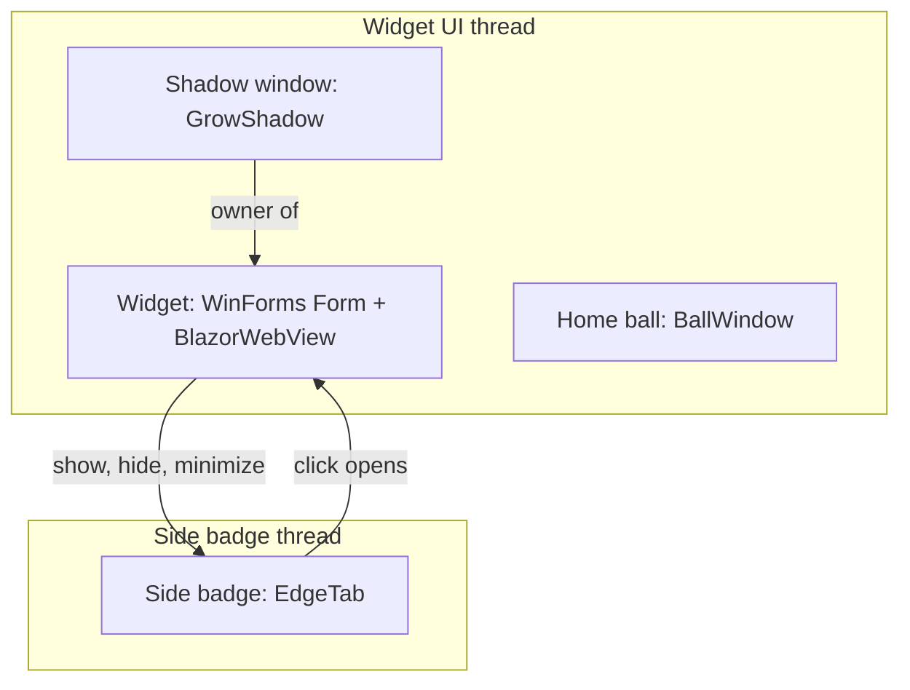

# Handover: the tray display (session V)

The tray widget is four native windows that must look like one. Most defects of session V came from the rules between those windows: the order on the screen, the threads, and the shared images. The last defect (a grey box after a click) was the shadow window in front of the widget; the fix makes the widget an owned window of the shadow, so Windows keeps the order.

One defect is open: the first drag after a start shows one frame of jitter. A new session examines the display design from a different angle.

## State

| Item | Value |
|---|---|
| Branch | `orch/v-visual-fixes-2` on GitHub, from `orch/integration-dlv` (PR #52); no PR yet |
| PR #50 | V1 to V7, merged into `orch/integration-dlv` |
| Tests | `dotnet test --solution Orchestrator.slnx`: 804 tests, 0 failed at commit `838b208` |
| Tray self-test | Each group passes alone; the full run passed 60 of 62 checks (the 2 failures were the user's mouse during real mouse input) |
| User check | V22 and V23 seen by the user; the other fixes of this branch were proven by self-test only |

## How the display works

| Window | Kind | Job |
|---|---|---|
| Widget (`WidgetForm`) | Normal top window, no system frame, rounded window region | The web UI (Blazor) |
| Shadow (`GrowShadow`) | Layered window (`UpdateLayeredWindow`), mouse goes through | The one shadow of the widget, and a page color fill in the four corners under the hard cut of the region |
| Home ball (`BallWindow`) | Layered window | The ball before and after the grow; the widget grows out of it |
| Side badge (`EdgeTab`) | Layered window on its own UI thread | The minimized form: ring, counts, peek bubble |

Rules that the code keeps:

| Rule | Where |
|---|---|
| The widget is an owned window of the shadow window, so it is always in front of it | `WidgetForm.OnHandleCreated`, `GWLP_HWNDPARENT` |
| The system draws no frame, no shadow and no round corners for the widget: with round corners on, the system draws its own shadow | `WidgetForm.Frame` |
| The shadow hides with the widget (hidden or minimized), shows on a restore, follows the pin | `OnVisibleChanged`, `OnResize`, `GrowShadow.Track` |
| A move only moves the shadow window; it draws again only when its size, the shown height or the fill changes | `GrowShadow.Track` |
| The home ball is one image, `home-ball.png`; each thread has its own copy | `EdgeTab.Ball`, `ThreadLocal<Bitmap>` |
| The handover from the ball to the page button waits two display frames | `WidgetForm.HandOver`, `HideWidget` |
| One form at a time: the side badge never shows with the widget | `TrayApp.Notify` |

## Issues and fixes

| Id | Issue | Cause | Fix | Proof |
|---|---|---|---|---|
| V1, V2 | Toast ghost, ring jitter | The side badge clock ran on the busy widget thread | Own thread, time-based fades, `DwmFlush` pacing | Store copy, before and after |
| V4 | Widget and side badge together | A store change during the grow slid the badge in | Rules in `Notify` | Self-test, old code fails |
| V5, V8 | Flat home button after the load | Two drawings (GDI+ and CSS) | One image | Pixel compare 0.6 |
| V10 | Darker shadow at open and minimize | Two shadows: the grow window and the system | One shadow window at all times | Self-test |
| V12 | Rings never draw | The V6 flag stopped all draws | A key for each ring | Self-test |
| V13 | Slow card tap, then a second animation | Wait on a replaced element (600 ms limit); CSS entrance animations restarted after the push | Watch the body; one view transition, no block animation | 920 ms to 350 ms |
| V14 | Dotted font | `disp` class on the title | Inter | Visible |
| V15 | 1 or 2 frames with no ball | Race between the native ball and the page paint | Two frames of overlap | Self-test, old code fails one run in two |
| V17 | No swipe | The native drag of the card link cancelled the pointer events | Not draggable | Real drag, old code fails |
| V19 | "Object is currently in use elsewhere" | One `Bitmap` drawn by two threads | Copy for each thread; exception log, no dialog | 0 errors, shared copy 568 errors |
| V20 | Grey box after a system minimize | The shadow did not hide on a minimize | Shadow follows the widget state | Self-test, old code fails |
| V21 | Grey box after one click | The shadow window came in front of the widget; its fill covered the widget and took the clicks | Owned window, mouse through, corner fill only | Trace, then forced raise test |
| V22 | Shadow too deep | 31 % black over 22 px | 17 % over 18 px | User |
| V23 | Slow drag, flicker | A full shadow draw on each move | Move only | User |

## Why it took so long

| Reason | Example |
|---|---|
| Four windows that must look like one: a fix in one window broke a rule of another | V10 gave one shadow, but made V20 and V21 possible |
| The checks tested the rule that the fix made, not the path of the user | The self-test clicked quickly and in a test place; the user held the mouse down, used "Show desktop", and waited a minute |
| Wrong build under test | The user first saw the old demo tray of session L, without the fixes |
| A guess from the code before the data | V20 was a true defect, but not the defect of the grey box after a click |
| A shared screen and mouse | Real mouse checks failed when the user used the mouse; other trays covered test windows |
| Each fix was proven alone, the full set late | Three defects came from earlier fixes: V12 from V6, V20 and V21 from V10 |

## The method that found V21

1. Stop the changes; the user asked for it.
2. Trace: each state step of the widget, the shadow and the side badge, the window order at each activation and move, WebView2 process failures, and a heartbeat each 2 s (`WidgetForm.Trace.cs`, `tray.<name>.log`).
3. The user did the steps; the log showed the order change from `[Orchestrator]` to `[Orchestrator shadow] > [Orchestrator]`, with no step of the tray code at the click.
4. Fix the rule, not the unknown trigger: the owned window makes the wrong order impossible.
5. A test forces the wrong condition: it raises the shadow window on purpose and checks that the widget stays in front.

Rules for each fix that worked: measure first (V13), run the check on the old code and see it fail (V4, V15, V17, V19, V20), and use the build of the branch only (`--instance v` with a label).

## How to run

| Job | Command |
|---|---|
| Test tray next to others | `Orchestrator.Tray.exe --instance v --live <store copy> --port 7804 --no-supervisor --pin`, from a copy of the build folder (a run from `bin` locks the build) |
| Trace | A named instance writes `%LOCALAPPDATA%\Orchestrator.Tray\tray.v.log` |
| Self-test groups | `--selftest <folder> --only <groups>`: `notify`, `overlap`, `ball`, `shadow`, `shadow-life`, `click`, `drag`, `edge`, `swipe`, `nav`, `transitions`, `motion`, `threads`, `cards` |
| Store rules | Copies only, ports 7800 to 7809, fake `ORCH_CLAUDE`, `ORCH_IMPORT=0`; never the live store or port 7777 |

## Open items

| Id | Item | Note |
|---|---|---|
| V24 | One frame of jitter at the first drag after a start | Not examined. The trace has the window order of each move |
| None | The trigger of the order change in V21 | Unknown; the owned window makes it harmless |
| V9 | Rules for minimize, close and pin | Waits for the user (Q1) |
| V18 | A tap on an option chip | Waits for the user (Q6) |
| V11 | X and pin buttons on the side badge | Later |
| V16 | Demo control pane | Root and session L |
| None | Records in `plan.md` for V8 to V23, the full self-test, the PR on `orch/integration-dlv` | Not done |
| None | The hidden Blazor views load on the widget thread after each store change | Not planned |

## Open questions for the new session

- Is a separate shadow window the right design? Other ways: the system frame shadow at rest with no grow shadow, or one composition-hosted window (spike E-5).
- Is the side badge thread necessary when the widget thread does no store work?
- Do the self-test checks follow the paths of a user: hold, drag, wait, system minimize, other windows?
