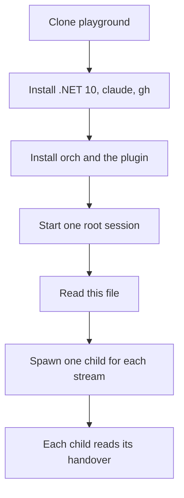

# Handover: root orchestrator (2026-11-25)

All work continues from pushed branches and published artifacts. Each stream has its own handover file on its own branch. The store, the transcripts and the worktrees are only on the computer that made them.



## Streams

| Stream | Branch | State |
|---|---|---|
| V2 visual restart | `orch/decision-toolu_015kkHdRgsS7ocnydT5LNSrM` (#97) | Waits for D2 |
| P pages | `orch/session-1ea8d8e0` (#56) | Waits for Q5, Q6, Q-S6, Q-S7 |
| M voice | `orch/session-4822b534` | Q8 deferred by the user |
| K architecture | `orch/k-roadmap` (#101) | Approval deferred by the user |
| W stream audit | `orch/decision-toolu_01X3Vy3JUZWV7o9Cod3TAenY` (#102) | Approval deferred by the user |
| N event store | `orch/session-393f41e3` | Question deferred by the user |
| Motion and visual review | `orch/motion-review-fixes`, #58, #59 | No child works on them |

Each branch has `session-orchestrator/docs/handover/<code>.md`, except the last row. To read it without a checkout:

```
git show origin/<branch>:session-orchestrator/docs/handover/<code>.md
```

## Artifacts

| Page | Link |
|---|---|
| Tracker (data by `ArtifactData` only) | https://claude.ai/artifact/CemHkpNcXTfe6d6kHhLrBV |
| V2 Target Design | https://claude.ai/artifact/FmECykMtYjwUtdgfTct32V |
| V2 Visual Restart | https://claude.ai/artifact/BNwcBE7dsYXYmGhyiPk1b6 |
| P Advanced Features | https://claude.ai/artifact/Kn888Us7Y4A7MnPTiQNmUj |
| P Workflow Shape Options | https://claude.ai/artifact/4hexcdNxAtjP4ZF1hoonC8 |
| K Architecture | https://claude.ai/artifact/1ah9eGXuB8rxFzRfwJqGwU |
| W Stream Audit | https://claude.ai/artifact/DKqHidbSJD1JTPHeKCKf7t |
| M Voice | https://claude.ai/artifact/1SeKtR99MvW6c6fko6rL65 |

## Rules of the user for the root

1. The user answers only in the root chat. Children send their questions to the root.
2. Show one question at a time, in full. One queue for all children, oldest first. A new or revised question goes to the end.
3. Send a message only after a change (experimental). Show one status line.
4. Publish each plan and report as an artifact, and send its link.
5. Never answer a question with the choice of the root. Never use click questions.
6. Merge only with `orch merge`. Archive only own children.
7. Never touch the live store or port 7777 for tests. Use a demo store or a copy.
8. Only the root or the user starts and stops the supervisor and the tray.
9. Put children in the sidebar group "Workers". Remote Control stays off for children.
10. Do not touch sessions of other projects. Ideas become issues with the label `idea`.

`root-watch.py` in this folder is the silent watcher (experimental). Set the root id in the script to the id of the new root.

## Set up a computer

1. Clone `MgCohen/playground`.
2. Install the .NET 10 SDK, the `claude` CLI and `gh`. Sign in to each.
3. Sync the plugin `orch` from the marketplace `mgcohen` (`MgCohen/claude-plugins`).
4. Install `orch` (pack command in `AGENTS.md`). Run `orch doctor`.
5. Start the supervisor outside the process tree of Claude, so that it continues after a restart.
6. For the Android spike only: make the toolchain with `spikes/android/README.md`.

## Only on the first computer

| Item | Place | Size |
|---|---|---|
| Live store | `%LOCALAPPDATA%\orch\store` | 219 MB |
| Demo stores | `%LOCALAPPDATA%\orch\demo-*` | 129 MB |
| Voice models | `%LOCALAPPDATA%\orch\models` | 641 MB |
| Android toolchain | `%LOCALAPPDATA%\orch-android` | Not measured |
| Transcripts and memory | `~/.claude/projects` | Not measured |

The repository is public. Do not put the store, the transcripts or the memory in it.

## Open work of the root

| Item | Next step |
|---|---|
| `orch` 0.1.2 | Pack it: 0.1.1 gives a false "FAIL plugin" (fix in #106) |
| Plugin 0.3.1 | Branch `orch/plugin-author`, no PR |
| #56 | Retarget to `main` |
| REV1 | Full review of the project |
| #108 | `orch whoami` must refuse an ambiguous match |
| Findings P1-F16, P1-F17 | Open, see `docs/plan.md` |
| Tracker link | Add it to `AGENTS.md` (proposed) |
| Devices plan page | Publish: P1a and P1b are replaced |

The store questions Q-S1 and Q-R9 of P are answered. The queue shows them as open.

`wip/playground` is the backup of the untracked files of the main worktree (`spikes/blazor-nav`, `store-hold-markers.txt`).

## Open questions

- Does the live store move to the next computer, or does a fresh store start there?
- Who continues #58 and #59?
