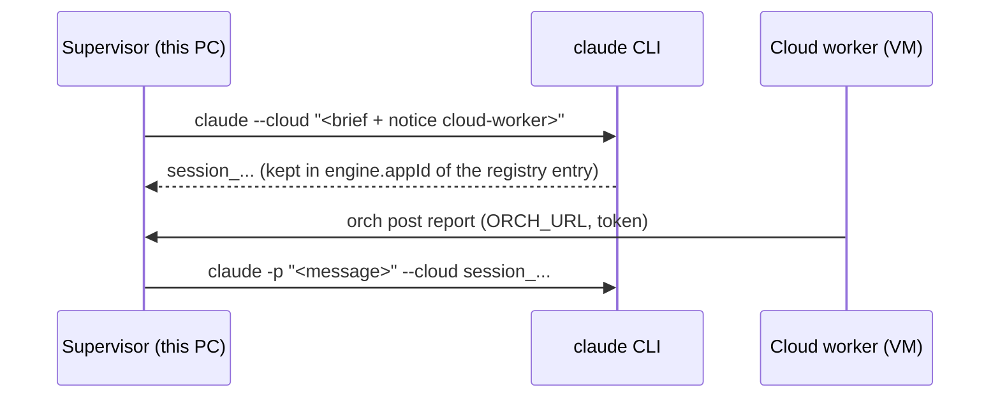

# Know-how

Facts about the engine, the mod, the tests and this computer. The test results that prove them are in `plan.md`.

## Engine limits

| Limit | Rule |
|---|---|
| Hook budget | A `tool.call` hook stops after about 10 s. A `$` call in flight does not count |
| Long wait in a tool | Wait inside `$.process.run`. Its `timeoutMs` is 600 000 maximum, so cap it with `Math.min` |
| `$.prompt.submit` | Resolves when its turn starts, not when it ends. Submit only when the session is idle |
| Stop latch | After the user presses Stop, the engine refuses each plugin submit until the person types. A peer message does not clear it |
| Mod reload | A reload runs `register` and `session.start` again. Module variables start over, so load the state from the store |
| `session.end` | Fires when the app archives a session or an idle app process ends (after about 3 h 45 min in S11) |
| Two writers | Two processes that write one session split the transcript. Two processes that write one log file lose lines |

## Plugin rules

- Write each helper as a top-level `function` that takes `$`. The validator refuses arrow-function helpers.
- Read an environment variable with `$.env.get('LITERAL')`, with a literal name.
- Give each promise a `.catch` handler.
- `tool.describe` can change the description of a tool and move it behind ToolSearch (`isDeferred`).
- A hook module can import a relative `.ts` file (`./state.ts`). The modules of one plugin share their module state.
- Plugin skills and agents reach each session through `CLAUDE_CODE_PLUGIN_DIRS` and through `--plugin-dir`. Their names start with `orch:` (`orch:orch-ask`, `orch:worker`).
- `claude -p --agent orch:worker` starts a session with a plugin agent.
- `$.process.run(argv, { cwd, env, stdin, timeoutMs })` runs a program with no shell. The child gets the environment of the session, so `orch` gets `ORCH_STORE`.
- Auto mode refuses `--permission-mode bypassPermissions` in tests. Use the user settings, or `--permission-mode auto`.
- `tsc` gives TS2589 on `on('tool.call', { tool: 'mcp__...' })`. This is a limit of the type checker. The plugin loads correctly.
- The engine writes `plugin/.claude-plugin/types/` when it loads the plugin. Git ignores that folder. `tsconfig.json` needs it, so `tsc` works only after one load.
- Check the plugin with `claude plugin validate plugin`.

## Node and the SDK (spikes only)

- Node 26 runs `.ts` files directly (type stripping). There is no build step.
- npm scripts fail, because the cmd shell of npm cannot find `node`. Run `node --test test/` in `spikes/supervisor-ts/`.
- `spikes/sdk` has no `node_modules`. Run `npm i` there before `s5.mjs`, `s6.mjs` or `s9.mjs`.
- The Agent SDK (`@anthropic-ai/claude-agent-sdk` 0.3.325) uses the local login of the subscription (`apiKeySource: none`). No API key.
- The supervisor sets `ORCH_HOLDER=supervisor` and `ORCH_STORE` for each SDK turn. `ORCH_PORT` sets the HTTP port (default 7777).

## Live test recipe

1. Make a git repository in the scratchpad. Put an `AGENTS.md` with one rule in it, for the docs check.
2. If the test needs PRs, make a private GitHub repository with `gh repo create --private --source . --push`. Before you delete it, copy the PR bodies and comments into `plan.md`: GitHub holds the only copy. The user allows you to create and delete test repositories without a question. The user also allows a public test repository if a private one is blocked.
3. Copy `config/policy.test.json` into a new store folder as `policy.json` (medium: 30 s).
4. Publish a copy (`dotnet publish src/Orchestrator.Web -o <scratchpad>/sup`), then start it in the background: `ORCH_STORE=<store> ORCH_PORT=7779 dotnet <scratchpad>/sup/Orchestrator.Web.dll`. A supervisor that runs from `bin/` locks the DLLs, and the next build fails. The copy finds the repository through the path that the build embeds.
5. Copy `spikes/p3/root.json` (one repository) or `spikes/p4/root.json` (PR stack) to the scratchpad, change its `cwd`, then send it: `curl -X POST -H 'content-type: application/json' --data @root.json http://127.0.0.1:7779/api/sessions`.
5a. Give the supervisor the `orch` of the branch: `dotnet publish src/Orchestrator.Cli -o <scratchpad>/cli`, then start the supervisor with `ORCH_BIN=<scratchpad>/cli`. The supervisor puts that folder first on the `PATH` of each turn (C3-F5). With no `ORCH_BIN`, it uses its own folder if that folder holds `orch`. The plugin and the sessions call `orch` by name, and the installed tool can be older. For a workflow run, give `type` and `workflow` in the POST body, or use `orch new --type orchestrator --stream S --workflow planning`.
6. Play the user with `orch answer <decision> <text>` and `orch review <decision> approve|change|refuse <text>`, with `ORCH_STORE` set to the test store.
7. Watch `answers/`, `report.json` and `blocked.json` of the session. A POST starts a tick at once, so two close reviews run as two turns.
8. Examine the ledger, the git graph and the PRs. Stop the supervisor.

### Test work next to the real sessions

Real sessions work on the real store all the time. So each test and each validation uses the demo store or a copy, never the real store. Proper environments (real, demo, test) are a later feature: [MgCohen/playground#47](https://github.com/MgCohen/playground/issues/47).

1. Only the root session or the user starts, stops or restarts the real supervisor and the tray. No session runs `install.ps1` or `orch supervisor stop` on the real profile.
2. Each session uses its own `ORCH_STORE` in its scratchpad and its own ports: L 7790 to 7799, V 7800 to 7809, D 7810 to 7819. The real supervisor uses 7777, the demo uses 7791.
3. A test on real data uses a copy, the fake provider (below), `ORCH_IMPORT=0`, a scratch `ORCH_APP_DATA`, and scratch `cwd` and `repo` paths. A copy holds the real worktree paths, and an auto-archive can remove a worktree.
4. Before a session touches a shared item (the real store, the real supervisor, the demo, the tray, an app session), it asks the root.

`orch store migrate` cannot copy a store while sessions write to it: the hash check fails, also with `--force`. For a test snapshot, use the partial copy in `<target>.migrating`.

### Fake provider

`ORCH_PROVIDER=fake` selects the fake provider (`Providers/Fake/`): no model, no `claude` executable, no app. `ORCH_FAKE` names its behavior file. The provider reads the file at each call, so a change applies at once.

```json
{ "turn": { "ok": true, "text": "done", "delayMs": 0 },
  "sessions": { "<id or prefix>": { "ok": false, "error": "boom" } },
  "ask": { "ok": true, "text": "{ \"answered\": false }" },
  "app": { "inApp": false, "archived": false } }
```

| Key | Effect |
|---|---|
| `turn` | The result of each turn. Default: good, with the text `fake turn of <id>` |
| `sessions` | The result for one session. The longest matching id prefix wins |
| `ask` | The reply of the docs check and of the state check. Default: no answer |
| `app` | The app facts of each session. Default: not in the app |

Dummy data (questions, reports, messages) goes in with `POST /api/stream` or `orch post`. Example: `ORCH_STORE=<copy> ORCH_PORT=7810 ORCH_PROVIDER=fake ORCH_FAKE=<file> dotnet <scratchpad>/sup/Orchestrator.Web.dll`.

## App sessions

- To open a supervisor session in the desktop app, run `claude.exe --desktop --resume <id>` with PowerShell `Start-Process`. From bash it gives exit 1.
- Then send one message to the session (`send_message`) to start its process. `set_remote_control` makes it visible on the phone.
### Remote Control at the start (spike R, 2026-11-18, claude 2.1.312)

No CLI command starts or imports a session into the desktop app with Remote Control on. `--desktop` accepts only `--resume` or `--continue`.

| Command | Result |
|---|---|
| `--desktop --remote-control --session-id <new>` | Exit 1: "--desktop only opens the Claude Desktop app; it can't be combined with `--remote-control`." |
| `--desktop --session-id <new>` | Exit 1: "... can't be combined with `--session-id`." |
| `--desktop --remote-control --resume <known>` | Exit 1, same text as `--remote-control` above |
| `--desktop --settings <file> --resume <known>` | Exit 1: "... can't be combined with `--settings`." |
| `--desktop --resume <known>` | Exit 0. The app imports the session. Remote Control stays off |
| `--desktop` | Exit 0. The app opens. No new session |
| `-p --remote-control <name>` | Exit 0. The flag has no effect: no bridge in the debug log, no link (2.1.312 and the app CLI 2.1.325) |
| `--bg --remote-control <name>` | Remote Control is on from the first turn (phone, claude.ai). Not in the app sidebar. `--bg` ignores `--session-id` and gives its own id |
| `--bg --remote-control <name> --resume <known>` | Same id, Remote Control on. The job stays idle after the turn until `claude stop` |
| `claude --remote-control <name> --session-id <new> "<prompt>"` in a console | Same id, Remote Control on from turn 1. The process stays open. Clear `CLAUDE_CODE_CHILD_SESSION` first: a child of a session inherits it, and then the CLI saves no transcript |
| `--desktop --resume <id>` while that console session runs | Exit 1: "open in another terminal. Run /desktop there instead." |
| `claude --remote-control <name> --resume <id> "/desktop"` | The CLI exits, the app imports the session, Remote Control off in the app |
| `--desktop --resume <id of a live --bg job>` | Exit 1: "That session is running in the background ... `claude stop` first" |

- `--desktop` refuses redirected output. To read its error text, run it in a console and read the console buffer.
- The app record (`claude-code-sessions/.../local_<id>.json`) holds `remoteControlUserEnabled` and `bridgeSessionIds` after a Remote Control change.
- The app setting `ccRemoteControlDefaultEnabled: true` applies only to sessions that the app makes. In 130 app records, no imported session (`adoptedFromOtherSurface: true`) has `remoteControlAutoEligible: true`.
- `remoteControlAtStartup: true` is a user, flag or policy setting. Project and local settings cannot turn it on. A user setting changes all sessions, so the orchestrator does not use it.
- So an imported session needs `set_remote_control`: by the session in its first live app turn, or by its parent.

- The app keeps transcripts under `~/.claude/projects/<folder key>/`, keyed to the folder of the session. The spike sessions are under the keys of their folders, for example `claude-orchestrator-spikes-p2`. `dee17212` is under a scratchpad key of the build session. A resume from another folder may not find them (not tested).

## Settings history

| File | State |
|---|---|
| `~/.claude/settings.json` | Plugin env lines (`plugin/`), `defaultMode: auto`, `deny: ["AskUserQuestion"]`, `allow` for `mcp__ccd_session_mgmt__set_remote_control` and `mcp__ccd_session_mgmt__archive_session` (added 2026-11-16: in auto mode these calls run with no prompt, tested. The app still shows its own card to archive a session that is open on screen) |
| `settings.json.bak-m2-plugin` | Before M2: the env line pointed to `mod/orch` |
| `settings.json.bak-askuser` | Before the deny rule (mod path of `claude-orchestrator`) |
| `settings.json.bak-bypass` | Older state, with no mod lines and no `defaultMode` |

## The claude CLI from C#

- `claude -p --output-format stream-json --verbose` writes one JSON object on each line. The last line has `type: result`, `subtype: success` and `result` (the last text).
- `--session-id <uuid>` starts a session with that id. `--resume <uuid>` continues it.
- Give the prompt on standard input. A long brief as an argument breaks on the Windows command line.
- At the end of a `claude -p` process, `session.end` fires, so the mod sets the lease to `none`.
- The process inherits `ORCH_HOLDER` and `ORCH_STORE` from the runner, so the mod writes to the test store.

## Install and start

`install.ps1` installs or updates the orchestrator for this user. Run it again after each merge. Plan and options: `docs/setup-options.html` (https://claude.ai/artifact/TJU9Foq3kBVJptSwMnCCeX).

| Item | Place or rule |
|---|---|
| Tray | `%USERPROFILE%\Apps\Orchestrator\tray\Orchestrator.Tray.exe`, one file |
| Supervisor | `%USERPROFILE%\Apps\Orchestrator\supervisor\Orchestrator.Web.dll` |
| Install record | `install.json` in the install root: commit, store, port. `orch doctor` (check `app`) compares the commit with `src/` |
| Shortcuts | Desktop `Orchestrator.lnk`, Startup `Orchestrator (login).lnk` with `--hidden`. Both start `--live <store> --port <port>` |
| Store and port | The repository `store/`, port 7777 (defaults of `-Store` and `-Port`) |
| Supervisor start | The tray in live mode, if no supervisor answers on the port. Else `orch supervisor start` |
| Supervisor record and log | `%LOCALAPPDATA%\Orchestrator\supervisor-<port>.json` and `.log`. `ORCH_DATA` moves the folder |
| Update | `install.ps1` stops each process that runs from the install root (`taskkill /T`), swaps the folders, updates `orch` and starts the tray |

- The supervisor runs in its own process (`cmd /c dotnet ... >> log`). It stays when the tray exits, so a turn continues.
- The tray starts the supervisor only at its own start. If the supervisor stops later, run `orch supervisor start` or start the tray again.
- `orch supervisor stop` stops only a supervisor that the tray or `orch` started (it has a record). A supervisor started by hand keeps running.
- `orch supervisor start` uses the published copy in `ORCH_APP` (default: the install root). With no copy, it runs `dotnet run` of the source.
- The tray publish needs `-p:ValidateExecutableReferencesMatchSelfContained=false`, because the tray references `Orchestrator.Web` (NETSDK1151).
- `tray.ps1` stays for development: mock mode, the self-test and `-Live` from the source.
- Test install: `install.ps1 -Root <scratch>pp -Store <scratch>\store -Port <port> -Shortcuts <scratch>\links -NoTool`, with `ORCH_DATA=<scratch>\data`. It does not change the real profile, except the WebView2 data and the place file of the tray in `%LOCALAPPDATA%\Orchestrator.Tray`.

### Start a cloud session from a session

- `start_session` with `target: cloud` refuses in a Remote Control turn. A turn that comes from an orch plugin message is such a turn.
- `claude -p --cloud` refuses: "--cloud cannot be combined with --print".
- Use `claude --cloud "<brief>"` in a terminal tab (`run_in_terminal`). Run it from a trusted folder; the brief names the branch. It prints the session id and the view URL, then exits.
- The first run in a folder asks the user to trust the folder. A session cannot answer this prompt and must not change the trust flag in `~/.claude.json`. After the first answer, it does not ask again.
- The cloud session runs in the default permission mode, so the user approves each command. Put the permission rules in the brief or the environment.
- A brief must not contain double quotes when PowerShell starts `claude --cloud`. PowerShell cuts the argument at the first quote. From bash, use `claude --cloud "$(cat brief.txt)"`.
- `claude -p "<text>" --cloud <session id>` sends one more message to a cloud session.
- To read a cloud session, open `https://claude.ai/code/<session id>` in the browser pane. `list_events` reads only local sessions.
- A full team runs in one VM if `orch` is on `PATH`: `dotnet pack src/Orchestrator.Cli` and `dotnet tool update -g`, then `~/.dotnet/tools` on `PATH` and `DOTNET_ROOT` set. Start the supervisor with `ORCH_PLUGIN_DIR=$PWD/plugin`.
- Results: `docs/c0-probe.md`, `docs/c5-probe.md`, and the findings C0 and C5 in `docs/plan.md`.

## Cloud environment

A cloud worker is a cloud session of the engine that works for the supervisor on this PC (G2). The supervisor starts it with `where: cloud` in the brief. The worker calls `orch` in HTTP mode; the plugin stays off when `ORCH_URL` is set.



Files: `src/Orchestrator.Providers/ClaudeCode/Cloud/setup.sh` and `environment.env`.

1. Make the tunnel and the service token of D2 first. A cloud worker cannot reach `*.trycloudflare.com` (G-0.1).
2. Make a long random token. Keep it in 1Password.
3. Start the supervisor with `ORCH_TOKEN=<token>`. Local tools on 127.0.0.1 need no token.
4. In the cloud environment settings, add the variables of `environment.env`. Set `ORCH_URL` to the tunnel address.
5. Add `ORCH_TOKEN` as a network secret for the `ORCH_URL` host, if the environment has network secrets. Else set it as a variable there. Never in the repository.
6. Add the host of `ORCH_URL` to the network allow list of the environment.
7. Set the setup script to `bash session-orchestrator/src/Orchestrator.Providers/ClaudeCode/Cloud/setup.sh`.
8. Run `claude --cloud "hello"` one time in the repository folder on this PC, and trust the folder. The supervisor cannot answer the trust prompt; its cloud start stops after 2 minutes.

The setup script installs .NET 10 and `orch`, puts both in `/usr/local/bin`, and writes `~/.claude/settings.json` in the VM: auto mode and an allow list for `orch`, `dotnet`, `git` and `node` (C0-3). An existing settings file stays.

Known limits:

- A cloud turn ends when the engine takes the prompt, not when the worker ends its turn. The worker reports through the store API.
- The flags and the output of a real cloud start are not checked yet. The end-to-end test comes with D2.

## The orch tool

- Install or update it after a change of `src/Orchestrator.Cli`: `dotnet pack src/Orchestrator.Cli -c Release -o <folder>`, then `dotnet tool update -g Orchestrator.Cli --add-source <folder>` (`install` the first time).
- The build embeds the repository path, so `orch` finds `templates/` and `config/` from any folder. `ORCH_HOME` overrides it.
- `orch` uses `ORCH_STORE`. A supervisor turn sets it, so a session that runs `orch` writes to the store of its supervisor.
- HTTP mode: with `ORCH_URL`, each store command calls the store API of that supervisor, with `ORCH_TOKEN` in `X-Orch-Token`. With no `ORCH_URL`, no `ORCH_STORE` and no folder at the default store root, `orch` calls `http://127.0.0.1:<ORCH_PORT or 7777>`. `orch supervisor`, `orch store` and `orch process` always use the local folder.
- `orch doctor` checks the home, the store, the policy, the templates, `claude`, `gh`, the plugin path and the supervisor.

## Session lifecycle

- `orch stop <id>` ends a running turn: the supervisor cancels it and kills each descendant that it recorded while the turn ran, also an orphan. `orch archive` tries the worktree removal again for about 7.5 s if a process holds the folder.
- `orch archive <id>` removes the `enabled` file. The supervisor never runs the session again. The branch of its worktree stays.
- The app refuses `archive_session` while Remote Control is on ("it still has live work", probe 2a). So each archive turns Remote Control off first: `set_remote_control` with `enabled: false`, then `archive_session`. A parent can do both for a child by its app id (probes 2b, 2c), with no prompt in auto mode.
- A child in a `claude -p` supervisor turn has no app tools. `set_remote_control` on `self` works only in a live app turn (probe 1a); the parent can call it for the child at any time (probe 1b).
- If the session is live in the desktop app, `orch archive` first sends it the notice `archive-self`. The session turns its Remote Control off and calls `archive_session` with `self`, so the app archives it, also while it is open on screen. `orch archive` waits up to 120 s (`--wait`) for `"isArchived": true` in the app record, then archives the store side. `--store-only` skips the app step. A session that is not live in the app stays in the sidebar: archive it from the sidebar.
- A worktree folder is `<repo>.wt/orch-<id8>`, next to the repository, on branch `orch/session-<id8>`.
- `orch open <id>` imports a session into the desktop app (`claude --desktop --resume` with the session folder as working folder). The app starts its process at once, and the plugin takes the lease `live`. The supervisor imports each new session before its work starts, when it uses the default store (`ORCH_IMPORT=1` or `0` overrides): the first turn has only the notice `open-in-app` (reply READY), because the app can import only a session that has a transcript. The import follows at once, and the plugin of the live app session delivers the brief. If the app does not take the lease in 30 s, the supervisor delivers the brief with `claude -p`. The first turn of a new session gets `-n <title>`, so the sidebar shows the title.
- `orch enable [--title T] [--parent ID]` puts the session that runs it under the orchestrator. It reads `CLAUDE_CODE_SESSION_ID`, writes `meta.json` (title, parent, cwd, `started`, `imported`) and `enabled`, and prints the id. The hook activates after the next tool result, in the same turn. Use it in the brief of an app session that `start_session` started: the app links the session to its parent in the sidebar, and `--parent` links it in the store.

## The UI

- The supervisor process serves the UI on `/`: Queue (the start page), Sessions and Timeline. The API stays under `/api`.
- A published copy finds its `wwwroot/` through `ContentRootPath = AppContext.BaseDirectory`, so it runs from any folder.
- Test the phone layout in the browser pane of the desktop app: `preview_start` with the URL, then `resize_window` with the preset `mobile`.
- The browser pane resets the viewport size when the pane width changes. Set `mobile` again before each screenshot.

## The end-to-end script

- `dotnet run --project tests/Orchestrator.E2E -- 7790` runs the live recipe as one command: a test repository, a published supervisor on port 7790, a real session with a `high` and a `medium` decision, two supervisor crashes, and eight checks of the store and the stream. It takes about 3 minutes and prints PASS or FAIL for each check.
- It kills the supervisor process only, not its `claude` child, so the second crash leaves an old process that the recovery must wait for.
- The test folder stays in `%TEMP%/orch-e2e-*` for a later look.
