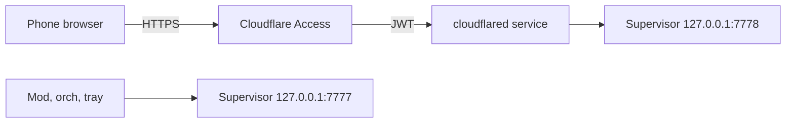
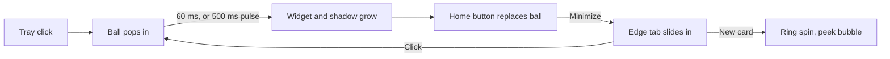
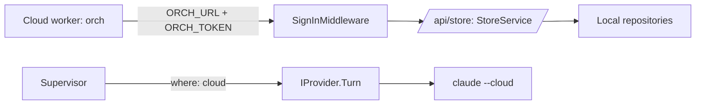
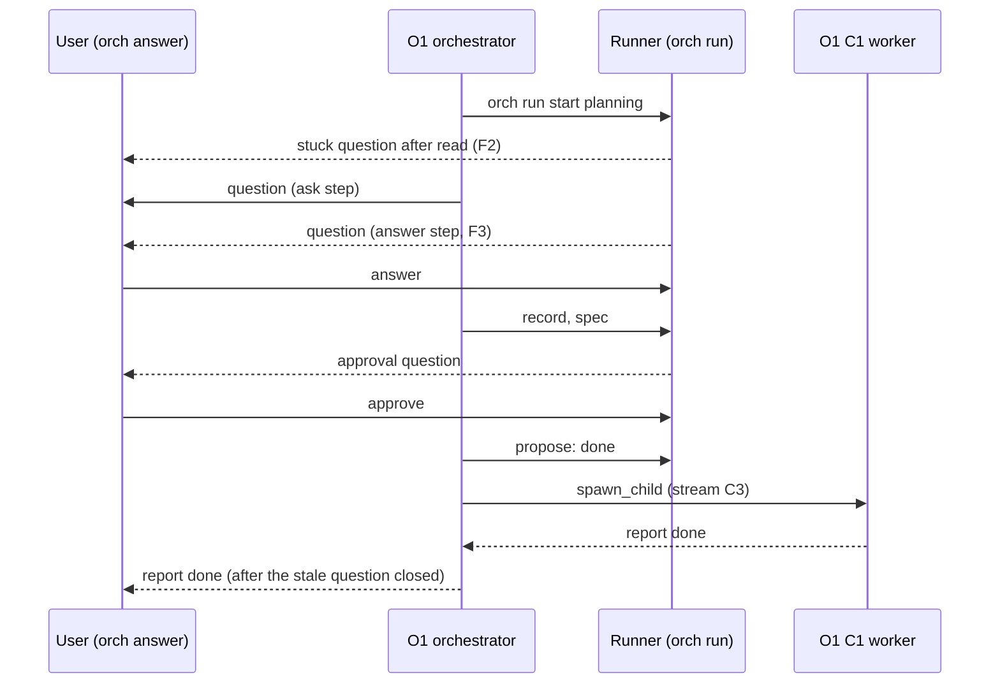
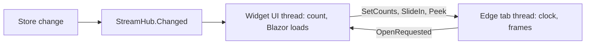
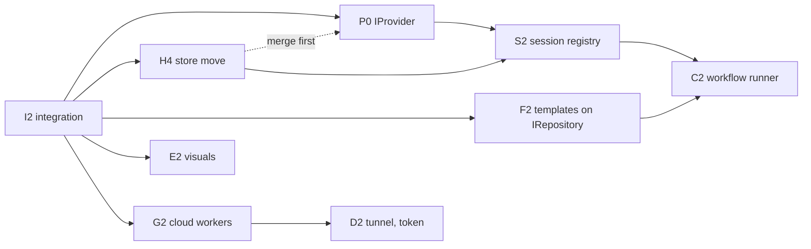

# Session orchestrator: implementation plan

Design page: https://claude.ai/artifact/EggEYH4ivUuPGG9Pw4k1y1 (source `docs/orchestrator-design.html`).

## Goal

One local system controls all Claude Code sessions of the user:

- It starts, nests, watches, stops and archives sessions.
- It delivers each message. No message gets lost.
- It keeps one flat queue of decisions for the user, with the path of each decision.
- It applies a default decision after a timeout, by risk level. It records the decision and puts its work on a stacked draft PR (`onDefault`: `stacked-pr`, `commit` or `none`).
- A phone UI shows the queue (swipe cards) and the state of each session.

The main problem: in nested sessions, decisions get lost in the middle of the tree, and the user does not see them. The tool is local and personal, not a product. It runs on the subscription of the user through the Agent SDK and `claude -p`, with no API key.

## Main rule: one writer for each session (the lease)

The spike `Spike: two writers` showed this fact. If the app process and a CLI process write to one session, the transcript gets two branches, and each writer sees only its own branch.

| Lease holder | Who sends a turn | How |
|---|---|---|
| `live` | The process that has the session open (desktop app, phone through Remote Control, terminal) | The supervisor writes to the inbox. The mod in that process submits the turn |
| `supervisor` | The supervisor | Agent SDK resume of the session id |
| `none` | Nobody | The next writer takes the lease |

A hand-off only moves the lease. The transcript stays one branch.

## Parts

The folders today:

```
session-orchestrator/
├─ plugin/         Claude Code plugin; loads in each session; inert unless the session is enabled
│   inbox → $.prompt.submit, mirror rows, heartbeat, status, lease, tools, skills, agents
├─ mod/orch-spike/ the spike mod of P0 (frozen)
├─ src/            the C# supervisor: Core, Store, Supervisor, Web (see the target folders below)
├─ tests/          NUnit tests
├─ config/         policy.default.json, policy.test.json
├─ spikes/         spike scripts, the test briefs (p2 to p5), m0-cli, supervisor-ts (frozen)
└─ store/          runtime files, ignored by git: sessions/<id>/..., events/, bodies/, ledger.jsonl, policy.json
```

The stack is C# on .NET 10 and the `claude` CLI. The user uses C# for all projects. The UI is Blazor. Only the plugin hooks stay in TypeScript, because the Claude Code engine runs them, and the Blazor UI can have a little JavaScript. The supervisor runs session turns with `claude -p` (`--session-id` for a new session, `--resume` for the next turn, `--output-format stream-json`), because the Agent SDK has no C# version.

The target folders. The design page, tab Build, gives the full tree with the detail of each line, and the project graph:

```
session-orchestrator/
├─ Orchestrator.slnx, global.json, Directory.Build.props, Directory.Packages.props
├─ src/
│  ├─ Orchestrator.Core/        contract records, order, lease, policy, templates, events. No IO
│  ├─ Orchestrator.Store/       file IO: atomic write, read, event stream
│  ├─ Orchestrator.Supervisor/  tick, policy runner, claude -p runner
│  ├─ Orchestrator.Web/         one process: hosts the supervisor, HTTP API, Blazor UI and cards
│  └─ Orchestrator.Cli/         the orch .NET tool
├─ plugin/                      the Claude Code plugin (thin TypeScript hooks, skills, agents, commands)
├─ templates/                   one folder for each message kind: schema.json, render.md, example.json
├─ config/                      policy.default.json, policy.test.json
├─ tests/Orchestrator.Tests/    NUnit: unit, template, contract
├─ tests/e2e/                   the live test as one script
├─ docs/
├─ spikes/                      frozen TypeScript and JavaScript, plus the TypeScript supervisor after the port
└─ store/                       runtime, ignored by git
```

Each message is a filled template. A sender gives the fields, `Orchestrator.Core` validates them against `schema.json`, a session gets the text of `render.md`, and the Blazor UI draws the card of the template. The input schema of each plugin tool is the same `schema.json`. The design page, tab Messages, gives the fields of each template.

| Template | From → to | Sent with |
|---|---|---|
| `decision` | Session → user | `ask_user`: question, context, snippet, options, recommendation, risk, defaultOption |
| `answer` | User, docs, policy → session | UI, `orch answer`, supervisor: text, by, source, note |
| `review` | User → session | UI, `orch review`: verdict, text |
| `report` | Session → parent, user | `report`: state (done, blocked), summary, done, next, blockers, links |
| `update` | Session → user | `update`: step, progress, summary. No action needed |
| `brief` | User, parent → new session | `spawn_child`, `orch new`: title, goal, scope, doneWhen, skills, agent, cwd, worktree |
| `notice` | Supervisor → session | default, review, child-report, blocked |

Each template message, and each change of state, is also an event in one append-only stream, `store/events/<day>/<id>.json`. A reader picks what it needs with a query: the UI queue takes `decision` events, the timeline takes all events of the last hours, and the ledger of today becomes the query `by = docs or policy, or kind = review`. The event envelope is small: `id`, `at`, `session`, `kind`, `from`, `to` (full session ids), `subject` (one line), `body` (the path of the body file with the template fields), `refs`. Rules: one new file for each event, so two writers never write one file; never change or delete an event; `Orchestrator.Store` writes the event first, then the state file. The design page, tab Messages, gives the event kinds and the queries.

The `orch` command (M1), a .NET tool, does each read and write of the store, for the user, the scripts and the sessions: `new`, `send`, `tree`, `status`, `decisions`, `answer`, `review`, `events`, `decision start`, `decision pr`, `stack rebase`, `stack close`, `stop`, `archive`, `open`, `template`, `doctor`. The stack commands replace the 5 steps of the default note.

## Phases

| Phase | Work | Done when |
|---|---|---|
| P0 | Spikes S0 to S11 (below) | Each spike has a result in this file |
| P1 | Mod: inbox, mirror, heartbeat, lease, `ask_user`, `report` | A desktop session gets inbox turns and its rows are in the store |
| P2 | Supervisor: store, SDK runner, lease rules, heartbeat check, `spawn_child` | The supervisor starts a session tree and resumes idle sessions |
| P3 | Decision policy: risk levels, timeouts, default, record, commit or tag | An unanswered low-risk decision gets its default and a record |

After P3, the work continues in milestones to the stable version 1.0:

| Milestone | Work | Done when |
|---|---|---|
| M0 | Port to .NET: Core, Store, Supervisor, Web API, `claude -p` runner | The 16 tests pass in NUnit, and the PR stack live test passes |
| M1 | Templates, event stream, `orch` command, stack commands, decision versions, new PR bodies, `[orch]` tag | The PR stack test runs on `orch` commands |
| M2 | Thin plugin: tool schemas from the templates, skills, agents, commands | Briefs refer to skills, not long texts |
| M3 | Stop, archive, worktrees, restart after failures, app import | Two code sessions run in one repository |
| M4 | Blazor UI (tree, cards, timeline), tunnel, sign-in | You answer and review from the phone |
| M5 | One vsa-template stream under the orchestrator | Start to merge with no lost decision |
| M6 | End-to-end script, crash recovery, store version | A supervisor restart loses nothing |

## Spikes (P0)

| Id | Question | Method |
|---|---|---|
| S1 | Does a mod from `CLAUDE_CODE_PLUGIN_DIRS` load in a desktop app session, in `claude -p`, and in an Agent SDK session? | Mod writes `lease.json` at `session.start` |
| S2 | Does `$.prompt.submit` from a timer start a turn in an idle desktop session? Does the phone show the turn? | Write `inbox/1.txt`, read the transcript |
| S3 | Do `session.append`, `turn.start` and `turn.complete` give the rows and the state? | Read `mirror/` and `status.json` |
| S4 | Can a mod tool wait minutes for an answer file? | `ask_user` with an answer file after 30 s and after 150 s |
| S5 | Lease hand-off: app writes, app closes, supervisor resumes, app opens again. Is the transcript one branch? | Read the parent chain of the transcript |
| S6 | Does the Agent SDK run with the local login, resume by id, and stream events? | Small Node script |
| S7 | Does `session.end` fire when the app closes or archives a session? | Read `lease.json` after an archive |

## Results (2026-11-15)

| Id | Result | Evidence |
|---|---|---|
| S0 | ❌ Two writers break a session. The app keeps the conversation in memory; a CLI turn makes a second branch | Session `dee17212`: app turn 4 lost CHERRY |
| S1 | ✅ The mod loads in the desktop app, in `claude -p` and in the Agent SDK, through `CLAUDE_CODE_PLUGIN_DIRS` in the `env` block of `~/.claude/settings.json` | `lease.json` written in all three |
| S2 | ✅ An inbox file starts a turn in an idle app session after about 2 s. The transcript stays one branch | Session `6ad6c434`, turn 3 CHERRY |
| S3 | ✅ `session.append` gives each row (with `door` and `origin`); `turn.start` and `turn.complete` give running and idle. `session.receive` also shows peer messages | `mirror/`, `status.json`, `log.txt` |
| S4 | ❌ A mod tool cannot wait. The engine stops a `tool.call` hook after about 10 s | The hook waited 152 s; the model got "no tool.call hook answered" |
| S4b | ✅ Non-blocking `ask_user`: it returns PENDING, the session ends its turn, and the answer arrives as an inbox turn | Turn 6 FIG |
| S5 | ✅ Lease hand-off: app → archive → SDK resume → unarchive → app. The app sees the SDK turn, and the transcript has one leaf | Turns 7 GRAPE and 8 HONEYDEW |
| S6 | ✅ The Agent SDK uses the local login (`apiKeySource: none`), takes a fixed `sessionId`, resumes, streams events and loads the mod | `spikes/sdk/s6.mjs` |
| S7 | ✅ An archive stops the app process and fires `session.end` | `lease.json` holder `none` |

### Design changes from the spikes

1. `ask_user` is non-blocking. The supervisor sends the answer as an inbox turn. No process waits for the user.
2. The supervisor takes a lease from the app with an archive, and gives it back with an unarchive. `session.end` and `session.start` move the lease in the store.
3. A mod reload runs `session.start` again, so the mod state must come from the store, not from memory.
4. The mirror must keep only the `prompt`, `response` and `tool-result` doors. The other doors are system rows.
5. `canUseTool` did not fire, because the user settings use auto mode. Approvals go through `ask_user` and the risk policy, not through permission prompts.

### Second round (2026-11-15)

| Id | Result | Evidence |
|---|---|---|
| S4c | ✅ A tool can block for minutes. The mod waits inside `$.process.run`, and a `$` call in flight does not count against the hook budget. `$.process.run` takes `timeoutMs` up to 600 000 | Session `3df803ac`: `ask_user` waited 120 s, `ANSWER: DATE` |
| S8 | ✅ Redirect of the built-in `AskUserQuestion`: the mod writes the questions to the store, waits, and returns `{ questions, answers }`. With no answer in time, it calls `next(e)` and the app card shows | MANGO from the store, no card |
| S9 | ✅ Six SDK sessions in parallel: 17 s, each with a correct lease, state and mirror | `spikes/sdk/s9.mjs` |
| S10 | ✅ The phone (Remote Control) shows each turn live: app messages, inbox turns and the question card. A phone answer to the card reaches the session | FIG and KIWI answered on the phone |
| S11 | ✅ An idle app session process stayed alive for 3 h 45 min. Then it ended cleanly: `session.end` fired and the lease became `none`. The supervisor must expect this and use the SDK or a peer message to wake the session | S2: last turn 16:04, end 19:49:33 |

### Decision modes for the orchestrator

| Mode | Use | Turn |
|---|---|---|
| `ask_user` with `waitSeconds` > 0 | Short decisions, a quick answer is likely | Stays open; the answer is the tool result |
| `ask_user` with `waitSeconds` 0 | Long decisions | Ends; the answer wakes the session through the inbox |
| `AskUserQuestion` redirect | Removed (no click questions) | None |

## P1 result (2026-11-15)

The mod `mod/orch` replaces `mod/orch-spike` in `CLAUDE_CODE_PLUGIN_DIRS`. The store contract is in `docs/store.md`.

| Part | Result | Evidence |
|---|---|---|
| `report` tool, lease, filtered mirror | ✅ In `claude -p` and in the app | Session `989d112c`, `report.json` |
| Inbox turn in an idle app session | ✅ | Session `ff9d65e6`, `inbox/1.txt` to `4.txt` |
| `ask_user` pending, answer by inbox | ✅ | T1: LIME |
| `ask_user` blocking, answer in time | ✅ | T2: CASHEW after 24 s |
| `ask_user` blocking, timeout, then answer by inbox | ✅ The mode changes to `pending` | T4: FLAX |
| `AskUserQuestion` from the store (removed later) | ✅ | T3: ACAI |
| `AskUserQuestion` with no answer (removed later) | ✅ The app card shows after 300 s | Session `989d112c` |
| Hot reload | ✅ The mod loads the cursor and the state from the store | `activate ... cursor=3.txt` |
| `/orch-enable` command | Written, not tested in the app | |
| One branch | ✅ One leaf after all tests | `p1-app.sh` |

Test script: `spikes/p1-app.sh` (it reads the session id from `spikes/p1.id`).

### Findings

1. After the user presses Stop, the engine refuses each plugin submit until the person types. A message from another session does not clear the Stop. The mod keeps the inbox file and the answer, tries again every 3 s, and writes `blocked.json`. The supervisor must show this state to the user, and must not use a peer message to go around the Stop.
2. `$.prompt.submit` resolves when its turn starts. The mod submits only when the session is idle, and the heartbeat has its own timer.
3. `tsc` gives TS2589 (type instantiation too deep) on `on('tool.call', { tool: 'mcp__...' })`. The spike mod has the same error and loads correctly. This is a limit of the type checker.

## P2 result (2026-11-15)

The supervisor is in `supervisor/` (Node 26 runs the TypeScript files directly). Start: `node src/main.ts` in `supervisor/`. The store contract and the HTTP API are in `docs/store.md`.

| Part | Result | Evidence |
|---|---|---|
| Unit tests (fake runner, temporary store) | ✅ 9 tests | `node --test test/` |
| Session tree: root + 2 children with `spawn_child`, a decision through the API, reports to the parent | ✅ About 90 s from start to the root report `done` | Root `b5f12905`, children `249fb7b0` and `48d13d06` |
| Resume of idle sessions: inbox, answers and child reports go to a session that is not live | ✅ | `store/supervisor/log.txt` |
| Hand-off supervisor → app: the session opens in the app, then a supervisor message goes through the mod | ✅ After the fix, one leaf | `249fb7b0` |

### Findings

1. Lease race (fixed). When an app process opened a session, the heartbeat file still had the old time of the SDK run. The supervisor released the new lease before the first beat and started an SDK turn, so the transcript got two leaves (`48d13d06`). Fix: the mod writes the heartbeat at activation and takes back a released lease; a lease younger than 15 s counts as live.
2. Two processes that write one log file lose lines. The mod now writes `log-<holder>.txt`.
3. In an SDK session, the `AskUserQuestion` fallback has no app card. Briefs must tell sessions to use `ask_user`.

### Open for later phases

- P3: the decision policy (risk, timeout, default) uses `risk` and `defaultOption` of each decision.
- A session that the supervisor starts is not in the app sidebar. To show it, open it with `claude.exe --desktop --resume <id>` through PowerShell `Start-Process` (see `docs/know-how.md`).
- The supervisor does not restart a failed turn after `maxFailures` (3) until it restarts.

## Change: no click questions (2026-11-15)

The user answers by voice and in free text, so click questions (A, B, C or other) are not used. The `AskUserQuestion` redirect from S8 is removed. A deny rule in the user settings removes the tool, and the mod refuses it as a fallback. Questions go to the reply text (normal sessions) or to `ask_user` (orchestrator sessions). The decision cards (M4) must show free-text answers, with the options as suggestions only.

## P3 result (2026-11-15)

The policy is configurable (`config/policy.default.json`, copied to `store/policy.json`): any number of levels, a definition and a timeout for each level, and a docs check for each level. See `docs/store.md`.

| Part | Result | Evidence |
|---|---|---|
| Unit tests | ✅ 16 tests (7 new): timeout, no default for `null` or no `defaultOption`, unknown level, docs answer, docs miss then timeout, no docs check for a level without it, review | `node --test test/` |
| Docs answer | ✅ A `low` question that `AGENTS.md` answers got the answer in about 20 s, with the source | Test repo: LIME from "AGENTS.md, Rules" |
| Default after timeout, stacked branch | ✅ A `medium` question got its default after 30 s. The session put the work on `orch/decision-<id>` on top of `main` | Test repo: BLUE |
| Review: refuse | ✅ The session went back to `main`, did the work again with the direction of the user, and kept the refused branch | Test repo: RED |
| Ledger | ✅ One line for the docs answer and one for the default, then one for the review | `store/ledger.jsonl` |

### PR stack test (2026-11-15)

A supervisor session on a private GitHub test repository (`MgCohen/orch-pr-test`). Three `medium` questions, timeout 30 s. In this test, "the user" is the test script: the reviews and their texts came from `curl` calls, not from the real user.

| Step | Result |
|---|---|
| Three defaults | Pass. Three draft PRs: `main` ← #1 ← #2 ← #3, each base the branch below it |
| Approve #1 | Pass. #1 is ready for review, not merged |
| Change #2 ("use SMALL") | Pass. A new commit on #2. #3 is rebased on it and pushed with `--force-with-lease` |
| Refuse #2 | Pass. #2 and #3 are closed with a comment, and their branches stay. New branches `…-v2` start from #1: #4 has the direction of the user, #5 reuses the BLUE commit of #3 |
| Ledger | Pass. One line for each default and each review |

Findings:

- Two reviews that arrive 2 s apart run as two turns, because a POST starts a tick at once. This is correct.
- The rebuilt PRs (#4, #5) use the branches `orch/decision-<same id>-v2` and name the old decision id in their bodies. But `reviewText` names the closed branch `orch/decision-<id>`, not the `-v2` branch. Also, decision #2 already has a refuse review, so a second review of the same id is not clear. #5 holds a default (BLUE) that nobody reviewed. Fix in M1: a rebuild makes a new decision version (`<id>-v2`) in the store, the refuse text names that suffix, and `reviewText` uses the newest version.
- The body of #4 still has the old question ("Which size do we use in size.txt?"), and its title has no "(default decision)". The rebuild must write a new body.
- Each PR comment has the author `MgCohen`, because the session uses the gh token of the user. Fix later: each orchestrator text starts with a fixed tag, for example `[orch]`.
- The `mode` of a decision stays `pending` after an answer. This is correct: `mode` is how the session asked, and `answers/` holds the state.

PR format that the session used (the GitHub test repository is deleted):

- Default PR title: `Set shape to SQUARE (default decision)`.
- Default PR body: one sentence, then `Question: …`, `Default answer: SQUARE (no answer from the user in 30 s)` and `Decision id: toolu_…`. A stacked PR adds its base PR. Each body ends with "Approve or refuse this decision alone."
- Close comment of the refused PR: "Closed: the user refused this decision. … The branch stays. The new work continues from the shape branch."
- Close comment of a PR above it: "Closed: this PR is stacked on PR #2, and the user refused the size decision of PR #2. The branch stays."
- Rebuilt PR body: "It replaces PR #2, which is closed." #5 adds "reuses the commit of PR #3" and "Not reviewed yet."
- The session saw a conflict between the direction of the user and `AGENTS.md`. It followed the user and wrote a comment on the PR. This is the correct order.

## Event stream spike (2026-11-16)

The TypeScript supervisor and the mod write one event file for each message, in each direction, to `store/events/<day>/<id>.json`. `GET /api/events` returns the stream. The first version had the full payload in `data`. The user asked for small events, so each event now has `subject` (one line) and `body` (the path of `store/bodies/<day>/<id>.json`), and `from` and `to` name the full session id. `spikes/p5/events.json` is the first run. `spikes/p5/stream/` is the same run in the new shape (made by `convert.mjs`), and `node timeline.mjs stream` prints it with the session titles.

Test: a root session starts a child, the child asks the user a `high` question, the user answers "GREEN" (not one of the options), the child reports to the root, the root reports done, then the user sends a question to the root. Result: 38 events in 149 s, and each direction is in the stream.

| Direction | Event kinds |
|---|---|
| User → session | `brief`, `message`, `answer`, `review` |
| Session → user | `decision`, `report` (root), `session.output` (live holder) |
| Parent → child | `brief` |
| Child → parent | `report`, `report.forward` |
| Supervisor → session | `turn.start` with the prompt; `answer` by `policy` or `docs` |
| Session → supervisor | `session.output`, `turn.end` with the last text |
| Received by a session | `session.input`: each prompt that the session got, from any sender |

Findings:

- A free-text answer that is not one of the options works: the child used GREEN and told the user.
- `session.output` has empty rows (thinking blocks with no text). Leave them out.
- `session.input` has the origin `unclassified` in an SDK turn. Use the `turn.start` before it to name the sender.
- Tool calls show as `[tool <name>]` in `session.output`. Make them a separate kind, `session.tool`, so a filter can hide them.
- Some events repeat one fact from two sides (`report` and `report.forward`, the last `session.output` and `turn.end`). Keep both, and link them with `refs`, because each side is a different direction.
- The supervisor and the mod write the new shape (16 tests pass, the mod validates). A new live run is not done: the converted sample shows the shape.
- The `orch events` query and the C# port are still to do (M1).

## M0 result (2026-11-16)

The supervisor runs in C#. `spikes/supervisor-ts/` keeps the TypeScript version, frozen. The decisions of the build are in `decisions.md`.

| Part | Result | Evidence |
|---|---|---|
| Spike: `claude -p` from C# | ✅ Fixed session id, resume, stream-json lines, mod loaded | `spikes/m0-cli`: turn 2 knew KIWI |
| NUnit tests | ✅ The 16 tests of the TypeScript supervisor, ported | `dotnet test --solution Orchestrator.slnx` |
| PR stack live test | ✅ Three defaults gave the stack #1 ← #2 ← #3. Approve made #1 ready. Change rebased #3 on #2. Refuse closed #2 and #3 and made #4 and #5 on `-v2` branches | Test repository `MgCohen/orch-m0-stack-test` (deleted), session `67c78a43` |
| Event stream | ✅ 69 events, each direction | `GET /api/events` of the test store |

Findings:

- The TypeScript findings of the PR stack test are still true in C#: the rebuilt PR keeps the old title, and the session writes the PR text by itself. M1 fixes them with the stack commands and the PR templates.
- The session saw a conflict between the direction of the user and `AGENTS.md` again, followed the user, and wrote it in the PR body.
- `session.output` still has empty rows and `session.input` has the origin `unclassified`. M1 fixes them in the mod.

## M1 result (2026-11-16)

| Part | Result | Evidence |
|---|---|---|
| Templates | ✅ Seven kinds in `templates/`. Each example matches its schema, and each render fills its places | `TemplateTests` |
| Session texts | ✅ The defaults, reviews, docs notes and child reports come from `templates/notice/render/` | `PolicyTests` |
| `orch` command | ✅ `new`, `send`, `tree`, `status`, `decisions`, `answer`, `review`, `events`, `decision start/pr/ready`, `stack rebase/close`, `template`, `doctor` | `CliTests` with a local git repository |
| PR stack test on `orch` | ✅ The session used `orch decision start` and `orch decision pr` for each default, `orch decision ready` for approve, `orch stack rebase` for change and `orch stack close` for refuse. The user part used `orch review` | Test repository `MgCohen/orch-m1-stack-test` (deleted), session `a1b09966`, 89 events |
| Decision versions | ✅ The refuse planned `-v2` of the refused decision and of the decision above it. A review after it named the `-v2` branch and wrote `reviews/<id>-v2.json` | Rebuilt PRs #4 and #5 |
| PR texts | ✅ Each title starts with `[orch]` and names its origin: "default decision" or "direction of the user". The body of a rebuilt PR has the new answer, its version and "It replaces PR #2" | PRs #1 to #5 |
| Event fixes, supervisor side | ✅ Each inbox file names its sender. `turn.json` gives the senders of a turn. `report.forward` links `refs.report`, `turn.end` links `refs.output` | `Supervisor.cs` |
| Event fixes, mod side | ❌ Blocked: auto mode could not evaluate edits to `mod/orch/hooks/register.ts`. The fixes go into the plugin of M2 | `decisions.md` |
| Unit tests | ✅ 41 tests | `dotnet test --solution Orchestrator.slnx` |

Findings:

- A supervisor that runs from `src/Orchestrator.Web/bin/` locks its DLLs, so a build fails while it runs. Run live tests from a published copy in the scratchpad.
- The session followed each `orch` instruction with no extra text in the brief. The brief of the test was the same as in P3.
- The title of a rebuilt PR cuts a long direction of the user at 60 characters.

## M2 result (2026-11-16)

| Part | Result | Evidence |
|---|---|---|
| Spike: relative import in a hook | ✅ | `helper.ts` ran at `session.start` |
| Spike: plugin skills and agents | ✅ Through `--plugin-dir` and `CLAUDE_CODE_PLUGIN_DIRS`, with `orch:` names | A session listed `orch:orch-ask` to `orch:orch-stack` and `orch:worker` |
| Thin plugin | ✅ Five hook modules. Each tool takes its schema from its template. `spawn_child` runs `orch new` | `plugin/`, `ContractTests` |
| Event fixes in the plugin | ✅ No empty `session.output`. Tool calls are `session.tool`. Each `session.input` names its sender. `report.forward` and `turn.end` link their pair in `refs` | Session `19d1b782` and its child `99961e91` |
| Short brief with skills | ✅ A five-line brief that names `orch-ask`, `orch-stack` and `orch-report` gave three stacked default PRs | Session `5bec7d79`, test repository deleted |
| Parent and child with agents | ✅ The `orchestrator` root started a `worker` child. The user answered GREEN (not an option), and both reports named GREEN | `summary.txt` = GREEN |
| Settings | ✅ `CLAUDE_CODE_PLUGIN_DIRS` points to `plugin/` | `settings.json.bak-m2-plugin` |
| Unit tests | ✅ 46 tests | `dotnet test --solution Orchestrator.slnx` |

Findings:

- A session loads the skills of its brief with the `Skill` tool before its first step. The events show each load as a `session.tool` event.
- The test supervisor ran the plugin with `--plugin-dir` and `--permission-mode auto`, so the settings stayed unchanged until the end of the test.

## M3 result (2026-11-16)

| Part | Result | Evidence |
|---|---|---|
| Two code sessions in one repository | ✅ "Calc: subtract" and "Calc: multiply" changed `calc.py` at the same time, each in its own worktree and branch. `main` stayed clean | Test repository `m3repo`, sessions `5317be82` and `5e999bf0` |
| Worktrees | ✅ The first turn of a brief with `worktree: true` makes `<repo>.wt/orch-<id8>` on `orch/session-<id8>` | `branch.create` events |
| Stop | ✅ `orch stop` ended a running turn after 67 s. The `claude` process ended, the inbox stayed, and no new turn started | Session `f79426d3` |
| Archive | ✅ `orch archive` removed the clean worktrees and kept the branches. It refuses open decisions and open PRs without `--force` | `LifecycleTests` |
| Restart after failures | ✅ After `maxFailures`, the session waits 5 min (then 10, 20...), gets the `blocked` notice and runs again | `LifecycleTests` |
| App import | ✅ `orch open` runs `claude.exe --desktop --resume <id>` with `Start-Process`, and refuses a session with a running turn. Not run live: it opens the app of the user | `orch open --dry-run` |
| Unit tests | ✅ 51 tests | `dotnet test --solution Orchestrator.slnx` |

Findings:

- A stop ends the `claude` process tree, but a grandchild of the session's Bash tool can live on: the `powershell Start-Sleep` of the test ran to its end. That process kept the worktree folder locked, so `orch archive` removed the worktree from git but not the folder. A Windows job object did not help: the grandchild left the job, probably because the host job allows silent breakaway. Archive a stopped session after its tools end.
- `git worktree add` works from a session folder of any depth: the supervisor finds the repository with `git rev-parse --show-toplevel`.

## M4 result (2026-11-16)

| Part | Result | Evidence |
|---|---|---|
| Queue view | ✅ Each open decision is a card: risk, session, question, context, recommendation, options as suggestions, a free-text field and "Accept default". Each default to review has approve, change and refuse | Phone test, `WebTests` |
| Answer from the phone view | ✅ The free-text answer "GREEN, like the logo" (not an option) reached the session, which wrote GREEN | Session `47991b46` |
| Review from the phone view | ✅ "Change: use SMALL" on a default reached the session, which changed the decision branch to SMALL | Session `29e75a65` |
| Sessions view | ✅ The tree with state, lease, report, update, worktree, a message field, stop, resume and archive | Phone test |
| Timeline view | ✅ The stream, newest first, with filters for time, kind group, session and tool calls. Each template event opens its fields | Phone test |
| Sign-in | ✅ `ORCH_TOKEN`: a token in the link once (then a cookie), or the header `X-Orch-Token` for the API | `WebTests` |
| Tunnel | ❌ Blocked: Cloudflare Tunnel and Access need an account of the user. Plan: section "D1 plan" | `decisions.md`, `docs/tunnel-plan.html` |
| Unit tests | ✅ 56 tests | `dotnet test --solution Orchestrator.slnx` |

The phone test used the browser pane of the desktop app at 375 × 812, not a real phone.

Findings:

- A view reloads every 2 s. An open `<details>` card stays open across a reload, because each card has a `@key`.
- A review notice arrives at the session as `session.input` from `supervisor`, because the supervisor writes the review text. The `review` event before it names the user.

## M5 result (2026-11-16)

A real vsa-template stream ran under the orchestrator on a private copy, `MgCohen/orch-m5-vsa-copy`: issue #140, "a validator is only in the slice of its handler". The run on the real repository waits for the user (`decisions.md`).

| Step | Result |
|---|---|
| Root | An `orchestrator` session (`fddb233c`) started one `worker` child with a worktree |
| Child | `91089ede` asked two design questions (medium). The policy applied both defaults after 120 s. Each default got its own draft PR (#1, #2). The work went to PR #3 to `main` |
| Review and merge | The root read the diff, ran Architecture.Tests (164 passed) and Engine.Tests (22 passed), and merged PR #3. No CI, no full suite |
| Report | The root reported done, with each default to review and the child kept open for its PRs |
| Decisions | 2 of 2 have an answer and a delivery mark. No decision was lost. 106 events |

Findings:

- PR #3 had the top decision branch as its head, so its merge took the commits of the two unreviewed defaults. Fix (user review, 2026-11-16): `orch merge` refuses such a merge in code, and a hook blocks `gh pr merge` in orchestrator sessions.
- The root did not archive the child, because the child has open PRs. This follows the archive rule.
- The default option of a decision can be a long text. The PR title cuts it at 60 characters.

## M6 result (2026-11-16)

| Part | Result | Evidence |
|---|---|---|
| End-to-end script | ✅ `dotnet run --project tests/Orchestrator.E2E`: a test repository, a published supervisor, a real session with two decisions | 8 of 8 checks pass |
| Crash while the session waits | ✅ The user answered while the supervisor was down. After the start, the answer arrived once | "the answer GREEN reached the session once" |
| Crash in the middle of a turn | ✅ The new supervisor waited for the old `claude` process, found the `session.input` of the turn, and marked it sent. No prompt went twice | `recovered turn …: the prompt arrived` |
| Store version | ✅ `version.json`. A newer store stops the supervisor | `RecoveryTests` |
| Unit tests | ✅ 62 tests | `dotnet test --solution Orchestrator.slnx` |

## B1 result (2026-11-16): new session form and mic buttons

The Sessions page has a form for a new session. Each free-text field of the cards has a mic button for dictation.

| Part | Result | Evidence |
|---|---|---|
| Form fields | ✅ Each brief field except `allowDefaults` | `NewSessionFormTests` reads `templates/brief/schema.json` |
| Form start | ✅ The form and `POST /api/sessions` use `Board.NewSession` | `NewSessionFormTests`: meta and `brief` event |
| Parent | ✅ A select of the sessions. An empty folder takes the folder of the parent | `NewSessionFormTests` |
| Refused start | ✅ The form keeps the text | `NewSessionFormTests` |
| Mic buttons | ✅ One for each `textarea` of the cards and the form | `NewSessionFormTests`, `WebTests` |
| No speech support | ✅ 0 of 3 mic buttons show | CDP check, Chrome without `webkitSpeechRecognition` |
| Phone layout | ✅ 390 px wide, no horizontal scroll | `docs/screens/sessions-new-form-phone.png` |
| All tests | ✅ 79 tests | `dotnet test --solution Orchestrator.slnx` |

Findings:

- A `Func` parameter does not render the parent component again. The Sessions page calls `StateHasChanged` after a start, or the toast does not show.
- `dotnet run --project src/Orchestrator.Web` serves `app.<hash>.css` with 0 bytes, because `ContentRootPath` is the `bin` folder. For a screenshot, use a copy from `dotnet publish`.
- Headless Chrome has a minimum window width of about 500 px, so `--window-size=390,…` cuts the page. Use the DevTools protocol: `Emulation.setDeviceMetricsOverride` with `width: 390` and `mobile: true`.
- The tests use bUnit 2.15.2 to render the Blazor components without a browser.
## D2 result: stop and archive (2026-11-16)

| Part | Result | Evidence |
|---|---|---|
| Cause of the M3 finding | ✅ `Process.Kill(entireProcessTree: true)` finds a descendant only through a parent that is alive. If a middle process ends first, its child is an orphan, and the kill misses it | `ProcessTreeTests.The_kill_of_dotnet_misses_a_descendant_whose_parent_ended` |
| Stop ends all descendants | ✅ `ProcessTree` scans the process list each 1 s while a turn runs and records each descendant with its start time. A stop kills each recorded process that is alive, also an orphan. A start time check prevents a kill of a reused process id | `ProcessTreeTests.Kill_all_ends_a_descendant_whose_parent_ended_before_the_kill` |
| Archive with a retry | ✅ `orch archive` tries the removal 5 times in about 7.5 s. If `git worktree remove` ran in this archive and removed the `.git` file but not the folder, the archive deletes the folder | `ProcessTreeTests.Archive_tries_again_while_a_file_in_the_worktree_is_held_for_a_short_time` |
| Stop, then archive, unit test | ✅ A process with an orphan held the worktree as its working folder. After the kill, the archive removed the folder | `ProcessTreeTests.Archive_removes_the_worktree_after_kill_all_ends_a_process_that_held_it` |
| Live test | ✅ A real session ran `powershell -Command "Start-Sleep 300; ..."` with the Bash tool. Chain: `dotnet` → `claude` → `bash` → `bash` → `bash` → `powershell`. `orch stop` ended the turn after 46 s. 5 s later, none of the 5 processes was alive. `orch archive` removed the worktree folder and kept the branch | Session `a834910f`, `ORCH_PORT=7812`, store in the scratchpad |
| Archive safety (review of PR #6) | ✅ The archive removes nothing if the folder is the repository root (full path compare) or if `<worktree>/.git` is not a file. A main checkout and a plain folder stay | `LifecycleTests.Archive_keeps_the_repository_folder_when_the_cwd_is_the_repository_root`, `LifecycleTests.Archive_keeps_a_plain_folder_with_no_git_file` |
| Unit tests | ✅ 78 tests | `dotnet test --solution Orchestrator.slnx` |

Findings:

- In the live test, all processes of the chain were alive at the stop. The old kill can possibly also end this chain. The orphan case of the unit test is the case that the old kill misses.
- A process that starts outside the tree (for example through a service or `Start-Process` of a COM server) is not a descendant. The stop does not end it. This is out of scope.
- A turn that ends normally does not kill its descendants. A background process of a tool can live on after the turn.

## Next steps

Status: the user reviewed the design page and accepted it. The user then asked for the folder structure, the code topology and a roadmap to a stable version. They are on the page (tabs Code and Roadmap) and in this file. The next work is M0, after the user accepts the roadmap. The notes arrive in the chat, or as comments on the page: read them with the `ArtifactComments` tool on the page URL. After a design change, edit `docs/orchestrator-design.html` and publish it with the `Artifact` tool and `url` set to the page URL.

### Agreed details of M1 and M4

- M1: a rebuild after a refuse makes `<id>-v2` in the store, the refuse text names the `-v2` branch, and `reviewText` uses the newest version. A rebuilt PR gets a new title and body.
- M4: the session tree and the decision cards. Each card has a free-text field and voice input. The options show as suggestions only. A default decision has the buttons approve, change and refuse.

### M5 scope

Run one vsa-template stream under the orchestrator from start to merge. The supervisor must copy these habits of the manual orchestrator session:

- A status check every 5 minutes. Examine each session yourself, because messages can get lost.
- If a question has no answer after 2 checks, decide it with the recommendation, and report it later.
- Archive a child session that you started when it is done and nobody needs it. Keep it while its PR is open. Put this rule in each child brief.
- Never archive a session that you did not start (examine its `startedBy`), unless the user names it. Never archive a session that waits for the user.
- One decision group for each session. The title names all of its scope.
- If an archive is refused, turn off Remote Control, then rename the session with `[archive/done]`.
- Detach exploration sessions, and relay their results only when the user asks.

Rules of the vsa-template work that the M5 stream must obey:

- The orchestrator may review and merge PRs, except PR #8 (rules and analyzers).
- Run CI only at the end of a stream, one manual run (no CI on each PR before 0.1.0).
- Run only the tests that a change can affect. The full suite runs in CI.

### Open questions

| Question | Recommendation |
|---|---|
| Use the VSA framework for the orchestrator? | Not now. Plain .NET until 1.0; decide after the VSA 0.1.0 release |
| Tunnel: which tool and which sign-in? | Cloudflare Tunnel with Cloudflare Access |
| Store: files, or SQLite? | Files until M5 shows a real problem |
| `medium` has `checkDocs: true`. The user named the docs answer only for `low` | Keep it, and ask the user at the M4 start |
| Delete the old folder `Projects/claude-orchestrator`? It also holds a stray `session-orchestrator/` subfolder with copied type files | Yes, after the next app restart, when the user says so |
| Which vsa-template stream runs first in M5? | The user decided: no real stream yet (2026-11-16). First define what a stream is. Tests use the private copy `MgCohen/orch-m5-vsa-copy` with copied real issues. Delete the copy at the end |
| What is a stream, and what is its workflow? Does a session start sub-sessions by itself? Is the review flow automatic? Where is the flow defined? | Discuss with the user. Today the flow is in the prompts of `plugin/agents/orchestrator.md` and `plugin/agents/worker.md`, and in the `orch-*` skills |
| Does a Cloudflare account with a domain exist for the tunnel? | The user decided: Cloudflare, as the last step. Until then, local tests on this PC only |
| Which skills and agents does each kind of session get? The supervisor sessions may need other skills than the chat sessions | Discuss with the user. Today all sessions load all of `plugin/` (user review, 2026-11-16) |

### Known gaps

- PR comments show the user (`MgCohen`) as author. Each orchestrator PR title, body and comment starts with `[orch]`, so a reader can tell them apart.
- Supervisor sessions are not in the app sidebar. Open them with the app import (`docs/know-how.md`).

## D1 plan: tunnel for the phone (2026-11-17)

Plan page: https://claude.ai/artifact/XzLhuzJbLrDuD5rtWya3JD (source `docs/tunnel-plan.html`). Status: approved by the user, to build on the user's own PC. No account, DNS record, tunnel or install exists.



| Item | Plan |
|---|---|
| Tunnel | Named, remote-managed Cloudflare Tunnel. `cloudflared` runs as a Windows service with the tunnel token |
| Address | `https://orch.<domain>` → `http://127.0.0.1:7778` |
| Sign-in | Cloudflare Access, Allow policy with one email, session 30 days |
| Supervisor | Second listener on `ORCH_TUNNEL_PORT`. On that port, check `Cf-Access-Jwt-Assertion` (signature, `iss`, `aud`, `exp`) with `ORCH_ACCESS_TEAM` and `ORCH_ACCESS_AUD`. Port 7777 does not change |
| Cost | US$0: the account, domain and sign-in of the runner and the inbox |
| Order | The Access application before the tunnel route. A route with no Access application is public |

Facts from the Cloudflare docs: Tunnel supports WebSockets, so Blazor Server works. `cloudflared` needs only outbound port 7844 and TCP 443. A Quick Tunnel needs no account (`--allowed-mail` adds an email PIN), but its address changes on each start. Tailscale Serve is the private alternative: no domain, but the phone needs the Tailscale app.

Answers of the user (2026-11-17, `decisions.md`): Cloudflare Tunnel + Access, as for the runner and the inbox. No build on this borrowed PC: it has antivirus and IT management. The build runs on the user's own PC, next month. The phone can do the same as the tray app (full control). Each client (tray, web, Android) uses the same interfaces for data, so a local store or a remote server is only a swap of the implementation. One user only, no app accounts: Cloudflare Access is the only gate, with the maximum session length (1 month). Roadmap: the Android app through Access, then a cloud host for more users with their own sessions. Order of the clients: (1) tunnel + web UI in a computer browser, (2) tunnel + installable web app on Android, (3) native Android app, (4) cloud host. Now: plan only. The code is a later task.

The plan uses the Cloudflare account, the domain and the Access sign-in of the runner and the inbox again (user, 2026-11-17). The cost is US$0.

Gap: a cloud worker (G2) has no browser, so it cannot sign in to Cloudflare Access. It needs a service token for the API. D2 builds it after G2.

## Session management requirements (user, 2026-11-16)

| # | Requirement | Weight |
|---|---|---|
| R1 | The orchestrator session starts sessions when it needs them, with the settings and the context they need | Must |
| R2 | The sessions use the orchestrator tools | Must |
| R3 | The orchestrator session controls, adds and archives them | Must |
| R4 | They show in the desktop app, so the user can read their data and talk to them directly | Must |
| R5 | They show as attached child sessions in the app | Strong wish |
| R6 | One writer at a time (the lease). This is a limitation that we found, not a rule of the user. A shared session would be better. Review it later | Limitation |

The custom UI is out of scope for now. The two ways in are: the orchestrator session, or the user in the Claude Code app.

Findings of the probe tree:

- An app session starts an attached session only in a turn that a message of the user started. In a turn that an event or another session started, the app refuses the start. The session can propose a card, and the click of the user starts it.
- `orch enable` from the brief of a `start_session` session works: the tools, the inbox and the `live` lease come in the same turn, with no typed command.
- The store id (`CLAUDE_CODE_SESSION_ID`) of an app session is not its app id (`CLAUDE_CODE_HOST_SESSION_ID`). The store must record the app id.

## App session probes (2026-11-16)

Two app sessions, started from an app session with `start_session`, tested the plugin in the desktop app.

| Check | Result | Evidence |
|---|---|---|
| A child app session loads the plugin | ✅ The 4 `orch:` skills and the 3 `orch:` agents load. The old mod does not load. `orch` and `CLAUDE_CODE_PLUGIN_DIRS` work | Probe `plugin-probe` |
| `/orch-enable` from a message of another session | ❌ It arrives as plain text, not as a command. Only text that the user types runs a command | Probe `enable-probe` |
| `/orch-enable` typed by the user | ✅ `enabled`, lease `live`, heartbeat, and the 4 `mcp__orch__*` tools | Store session `a3f17453` |
| Inbox delivery in a live session | ✅ `orch send` PING reached the idle chat in about 2 s | `session.input` from `plugin` |
| `ask_user` and the answer | ✅ The decision showed in `orch decisions`. The free-text answer MANGO (not an option) arrived as "Answer to decision" | `decision`, `answer`, `delivered/` |
| `report` | ✅ `report.json` with state `done`, and a `report` event | `orch status a3f1` |

Findings:

- `/orch-enable` writes no `meta.json`. The session has no title (the queue shows its id) and no `cwd`. If its lease becomes `none`, the supervisor fails its turns with "no cwd".
- The reply of `/orch-enable` starts with `orch:` two times.
- An app session can be the root of a run only if the user types `/orch-enable` in it.
- Fixed the same day: `/orch-enable [title]` writes `meta.json` (title, cwd, `started: true`), the reply has no double prefix, and the hooks of a live session stop and release the lease when `orch archive` removes `enabled`. Not tested live yet.

## Sum test, run 1 (2026-11-16)

A root ("Sum test: root", `de4325e9`) got N = 4 from the user in the app and started 4 children with `spawn_child`. The supervisor started all sessions and imported each one into the app after its first turn. The policy level `test` (90 s) was added for this run.

| Child | Mode | Value | How the value came |
|---|---|---|---|
| 1 | auto | 47 | Random, no user action |
| 2 | ask | 7 | The user typed 7 in the child chat |
| 3 | chat | 13 | The user typed 8, 5 and "done" in the child chat |
| 4 | approve | 16 | Both steps took the default "yes" after 90 s |

The root summed 83 and reported done. Each child report reached the root inbox while the root was live in the app.

Findings:

| # | Finding | State |
|---|---|---|
| F1 | `ask_user` writes the question to the store only. In the app the user saw no question, and the child said "answer elsewhere" | Fixed: the tool tells the child to write the question in its reply text |
| F2 | An answer in the child chat did not close the decision in the store. `orch tree` showed "1 open" after the run | Fixed: a `composer` prompt in a session with an open decision answers the latest open decision with `orch answer` |
| F3 | The root did not see the questions of its children | Fixed: the supervisor sends each open question of a child to the parent inbox once (notice `child-question`, event `question.forward`). The root writes it in its reply. The new tools `mcp__orch__answer` and `mcp__orch__questions` let the root answer and list questions |
| F4 | An imported session has no Remote Control. The app setting "Connect new sessions to Remote Control" applies only to sessions that the user starts in the app | Open. `claude --desktop --resume <id> --remote-control` does not import: the process exits and the app gets no record. Only the app tool `set_remote_control` works, from an app session |
| F5 | Child 4 sent an extra "Step 1 is done" report before its final report | Open: the brief or the `orch-report` skill must say that a step is an update, not a report |
| F6 | The brief and the skill texts make the start of each transcript long in the app | Open: put the steps in a skill and keep the brief short |
| F7 | The user told the root "we are done with those four", and the root did not archive. The test brief said "Do not archive children" | Brief error. A test brief must not forbid what the user can ask for |
| F8 | `orch archive` archives the store side only. The app keeps the session in the sidebar. Only the app tool `archive_session` removes it | Open. Not known yet if an imported root has the app tools |
| F9 | The app refuses `archive_session` while Remote Control is on ("live work"), and while the session is open on screen | Turn Remote Control off first. The user closes or archives an open session |

## Sum test, run 2 (2026-11-16)

A new root ("Sum test 2: root", `ca72efff`) ran with the question relay. The 4 children gave 37, 5, 8 and 16. The total is 66. The user said that the flow works.

| Check | Result |
|---|---|
| The questions of children 2 and 4 reached the root inbox | ✅ notice `child-question`, event `question.forward` |
| The root showed each question in its reply | ✅ |
| The user answered child 2 in the root chat | ✅ the root called `mcp__orch__answer`. Child 2 got "use 5" and reported 5 |
| Child 4 took the default after 90 s | ✅ |

Findings:

| # | Finding | State |
|---|---|---|
| F10 | The policy answered step 1 of child 4. Then the root sent a user answer to the same decision. `orch answer` replaced the default answer, so the store lost the record of the default | Fixed: `orch answer` refuses a decision that has an answer (commit `b967593`) |
| F11 | The root does not know when a question closes (a default, or an answer in the child chat). Its list of open questions in its replies becomes old | Fixed: the supervisor sends a "Question closed" notice (event `question.close`). A question with no default that will apply gets a "Reminder" notice after 10 min, then each hour (event `question.remind`). Not tested live |
| F13 | The app asked the user to approve each `set_remote_control` and `archive_session` call. The app adds a field to these calls, so auto mode gave no verdict | Fixed: allow rules for the two tools in `~/.claude/settings.json`. In auto mode, both run with no prompt. The app still shows its own card to archive a session that is open on screen |
| F15 | `set_remote_control` with `enabled: false` shows a prompt: "A hook requires confirmation for this tool". It is a hook of the app, and the allow rule does not stop it. `enabled: true` shows no prompt. The app refuses to archive a session while Remote Control is on | Rule: turn Remote Control on for the root only. Turn it on for a child only when the user asks. Test with probes 2, 3 and 4: in auto mode with the allow rules, archive gave no prompt. Only Remote Control off asked, and only the session on screen was refused |
| F14 | An import (`claude --desktop --resume`) opens the session in the main window of the app and takes the focus. No CLI flag stops it. `open_session_in` acts only while the calling session is on screen | Workaround tested with probe 5: the focused session itself calls `archive_session` with `self`, and the app archives it while it is on screen. A message through the inbox (`orch send <id> ARCHIVE`) started the call. Built into `orch archive` (notice `archive-self`): probe 6, open on screen, was archived in the app and the store in 12 s |
| F12 | The format of the root replies is not fixed. It is not clear which items wait for the user and which are done. There is no rule for repeated notices of open questions | Fixed: the skill `orch:orch-reply` has a template for each reply (status block, short status, question). The agent, the notices and `ask_user` point to it. To change a format, change the skill. Not tested live |

## Test sessions in the app sidebar

None of these is archived. Archive them only when the user says so.

| Title | Session | State |
|---|---|---|
| Spike: two writers | `dee17212` | Split transcript (S0) |
| Spike S1 cli | `f5034f63` | Done |
| Spike S2: inbox | `6ad6c434` | Remote Control on |
| Spike S8: ask | `3df803ac` | Remote Control on |
| Test P1: orch mod | `989d112c` | In the Stop state |
| Test P1: orch mod 2 | `ff9d65e6` | Done |
| Test P2: child A hand-off | `249fb7b0` | Done |
| Test P2: child B hand-off | `48d13d06` | Split transcript (lease race) |

The store folders of the P2 sessions (`b5f12905`, `249fb7b0`, `48d13d06`) are in `store/old-spikes/`, so the supervisor does not watch them. The build session of this project is `15fac584` (a vsa-template worktree).

## Watch notes (root "Orchestrator: root", `ab9acae5`, started 2026-11-16)

The session "Orchestrator watch" (`dc99fc00`) gets the framework problems of the root through its inbox. It records each one here and changes no code until the user decides.

| # | Problem | Analysis | State |
|---|---|---|---|
| W1 | `orch enable` in the old build session (`dc99fc00`) wrote `enabled`, but the plugin did not activate: no lease, no heartbeat | The session started before the current plugin hooks. Hot reload did not run `activateIfEnabled` in it. With lease `none`, a message in its inbox would make the supervisor run `claude -p --resume` on a live app session: two writers | Mitigated: `orch stop dc99fc00`, so the supervisor never runs it. A watcher reads its inbox |
| W2 | A chat answer in child `06ade234` (A4) recorded about 19 KB: an app `<system-reminder>` block (desktop app guidance) and then the user's words, as the answer to `toolu_01Pi143F86RUZPZaoh6e3Vie` | `promptText` in `plugin/hooks/tools.ts` joins all text parts of the composer message. The first prompt after an import has an extra text part with the app guidance. `answerFromChat` sends all of it to `orch answer`. The session got the correct words, because it reads the chat itself. The store answer, the close notice to the root and the UI show the noise. Possible fix: remove `<system-reminder>...</system-reminder>` blocks in `promptText`, or use only the last text part. Add a test | Fixed in PR #27: `chatAnswer` removes the `<system-reminder>` blocks before the prefix check |
| W3 | Child `06ade234` (A4) lost the plugin at 00:34 UTC. The heartbeat stopped at 00:34:40, the supervisor set the lease to `none` at 00:34:55, and `status.json` stays `running`. The app session worked on until 02:04 and opened PR #15, but its done report never reached the root | Transcript: at 00:34:28 the app put a "This conversation is now continuing in the Claude desktop app" reminder in the prompt (this is also the W2 text), and at 00:34:32 an interrupt came. After that the session made no `mcp__orch__*` call in 1.5 h; before, it used them often. `log-live.txt` has no new `activate` line. The engine version also changed at 00:09:57 (2.1.312 to 2.1.321), and the plugin survived that. Conclusion: the app moved the session to a new engine host, and the plugin did not activate there. This is the same family as W1. Risk: with lease `none`, a new inbox message (for example from the root) makes the supervisor run `claude -p --resume` on a live app session: two writers. Possible fixes: activate the plugin on each host start, not only on `session.start`; mark a stale heartbeat of an imported session as `lost`, not `none`, so that the supervisor does not resume it; tell the parent when a child loses its heartbeat | Open: wait for the user |
| W4 | At 03:36 UTC the app moved the watch session (`dc99fc00`) to a new engine host. The old host stopped its background tasks, so the supervisor (`sup6`) and the inbox watcher stopped too | In this move the plugin activated: `log-live.txt` has an `activate plugin holder=live` line with `session.start`, the lease is `live`, and the plugin sent the W2 inbox message as a prompt. So a host move can give `session.start` (here) or not (W3). This also closes W1 for this session. Problem: a supervisor that runs as a background task of a session stops when that session moves. Possible fix: run the supervisor as its own process, not as a task of a session On 2026-11-17 the restarted background task stopped again with exit code 127 and no shutdown line in the log (last start about 03:37, found down at 14:04) | Mitigated: the supervisor now runs as its own hidden process (`Start-Process`, log `sup7.log` in the scratchpad), not as a task of a session |
| W5 | In child `72f859bc` (C1, design), the user typed a new question in the chat ("Before we even start - i realized something, Where is the event stream and event store stored?"). `answerFromChat` recorded it as the answer to decision `toolu_018eLJKjbcGZJXyLnwMCvEFn` (Q8, three options) and closed Q8 | `answerFromChat` treats each composer prompt as the answer to the latest open decision, with no check of the content. The child had 6 open decisions at that time, so the rule "latest open decision" is weak too: an answer to Q5 would close Q8. W2 is the same code path. Possible fixes: (a) the hook closes nothing; it adds a line "Open decisions: ... If this message answers one, call `mcp__orch__answer_own`" and the session decides; (b) close only when the text names the decision, for example "Q8: A"; (c) keep the automatic close only when exactly one decision is open and the text matches an option. Recommendation: (a), because the session reads the meaning. Also give a way to open a decision again. Second case, same child: "What do you mean by plan card? We don't have a card anywhere, do we?" closed Q7 (`toolu_01FSByYF8yD5WguzGvkVbTmz`). After each wrong close, the child asked the same question again as a new decision (Q7 and Q8 exist two times each), so the queue fills with copies. Third case, same child, 10 min later: `toolu_01PsXdiS7H18ckQ6x77FoLBq` (Q7 copy). Workaround of the root: C1 discusses in the chat with no open decision. Fourth case, a second child: `09462c4b`, `toolu_01Ps9xPV6krGuL1qsbUQHnS8`, a long request of the user. Fifth case, `09462c4b`, `toolu_016c5Af2XN5D3PSTkjLEgeQ9`: W5 and W2 together (a request with the app `<system-reminder>` text). Sixth case, a third child: `ff65da95`, `toolu_01KqH1usb51VG2XrkBCzR4oZ`, W5 and W2 together. Seventh case, a fourth child: `1c713ac8`, `toolu_012Rwg3B4mQsm5N4f9JcDww2`, risk **high**, closed by "Let's go one by one through the questions". The root suggests: turn the automatic chat answer off until it can tell an answer from a question. A high-risk decision must never close from this path. Eighth case: `09462c4b`, `toolu_01MfN2AyTr6UxkjyhZ4vMUEk` and 13 s later `toolu_013dpm9tK8rDE6LVCzxiAygY`. The root then relayed a request of the user: note the bug, and turn the automatic chat answer off or fix it | Fixed in PR #27: `answerFromChat` closes a decision only for a chat message that starts with `answer:` (any case). It removes the prefix and the `<system-reminder>` blocks. Any other chat message leaves the decision open, so questions and requests never close a decision, at any risk level. The `ask_user` result and the skills `orch-ask` and `orch-reply` tell the user: "In the chat, start the answer with `answer:`". Tests: `plugin/hooks/test/chat-answer.test.ts` (node, fake engine; `PluginLeaseTests` runs it in `dotnet test`) and `StreamTests.A_chat_line_answers_only_when_one_decision_is_open_and_the_answer_has_an_ack`. Option (a) of the analysis (the session decides) stays possible later. On the stream design (A2), `orch chat-answer` closes a question only when exactly one question is open, and its ack stops the echo |
| W6 | Request of the user through the root: no hourly `question.remind` notices in the root. There is no setting for `FirstReminder` and `NextReminder` (`Runners.cs`, fixed 10 min and 1 h) | Workaround of the root: it wrote `remindedAt` in 2027 in the open `forwarded-questions` records. The records stay valid JSON, but a question that comes later still gets reminders, and a session that edits store files by hand is outside the store contract. Possible fix: a `reminders` block in `store/policy.json` (`firstSeconds`, `nextSeconds`, `null` = off), read by the supervisor on each tick, with a row in `docs/store.md`. Default: off in the root, because the root shows each question once when it arrives | Open: wait for the user |
| W7 | The user sees chat text come back in the child as "The orch plugin sent a message" (reported as an echo, `09462c4b`) | It is not an echo of the chat answer. The child inbox has three `orch send` messages from the root (16:15 to 16:17), each one starts "Root: your ... question closed with a chat message of the user" and quotes the user text. These are the root's W5 repairs. The plugin submits each inbox file as a prompt, and the app shows all such prompts with the same header, "The orch plugin sent a message". So the user cannot see who sent it, and the quote looks like an echo. The inbox file has `from: user`, because `orch send` from a session does not set the sender. Possible fixes: `orch send` sets `from` to the sender session; the plugin starts the prompt with the sender, for example "From root (ab9acae5):". W5 removes the cause of these repairs | Analysis confirmed in PR #27: the plugin writes `delivered/<id>.json` (`by: chat`) before `orch answer`, so neither the inbox tick nor the supervisor sends a chat answer back to its session. A test covers it. With W5 fixed, the root has no wrong closes to repair, so these quotes stop. The sender header of plugin messages is not changed |

## A2 result: communication code (2026-11-17)

The code follows the communication design, version 6 (`docs/communication-design.html`, tab "Changes A2"). All communication goes through the Stream API. `docs/store.md` has the new contract (store version 2).

| Part | Result |
|---|---|
| Stream API | `EventStream` (C#) and `plugin/hooks/stream.ts`: post, forward, ack, subscribe, query, read, nudge |
| Push | `StreamWatcher` (file watcher on `events/` and `nudges/`) with a 60 s sweep. The plugin runs a child `orch watch`; the supervisor and the UI use `StreamHub` |
| Ack and watchdog | Each delivery gets an ack. A live idle session with no ack gets a nudge after 15 s, then `delivery.blocked` after 60 s more |
| Types | New types `message`, `query`, `plan`, `ack`; `meta.json` in each type folder; new tools `send`, `query`, `plan`; skill `orch:orch-messages` |
| Removed | `inbox/`, `answers/`, `delivered/`, `reviews/`, `decisions/`, `report.json`, `reports/`, `update.json`, `cursor.txt`, `forwarded*`, the relay kinds and `unblocked` |
| Unit tests | 129 pass (`dotnet test --solution Orchestrator.slnx`) |

### Live sum test (scratchpad store, port 7791)

A root started 3 children with `spawn_child`. Child 1 picked 27. Child 2 asked the user; the test sent "my answer is: 9" to the root, and the root called `mcp__orch__answer` (`refs.via` = the root). Child 3 got the default 8 after 30 s. The root reported the total 44. Then `POST /api/inbox/<id>/accept` approved the default (a review to child 3) and acknowledged the root report.

| Check | Result |
|---|---|
| Each envelope to a session got an ack | ✅ 16 deliveries, 0 with no ack, no double ack |
| Question relay and closed notices | ✅ two forwards, two `question-closed` notices |
| Answer through the root | ✅ answer from `user` with `via: session:<root>` |
| Default for review in the inbox | ✅ card `answer [review]`, accept posted `review approve`, the child ran `orch decision ready` |
| Root report card | ✅ card `report [ack]`; the child reports closed when the root got their forwards |
| SSE | ✅ `GET /api/stream/live` sent the review envelope |

### Decisions on the open questions of the page

| Question | Decision |
|---|---|
| Sweep interval | 60 s, `delivery.sweepSeconds` in `policy.json` |
| Peer nudge from the supervisor | None. The supervisor nudges with the file `nudges/<party>`. A session sends a peer nudge after `send` to its parent |
| Render through `orch read --for` | One renderer in C#. `orch watch` puts the text in each line, so the plugin needs no extra call for the text |
| Chat line with two open decisions | No answer. `orch chat-answer` answers only when exactly one decision is open |
| Nudge of an app session whose process ended | Not built here: stream B owns the lease. The watchdog posts `delivery.blocked` |
| Wait times | 15 s and 60 s, `delivery` in `policy.json` |
| Old stores | No migration. The supervisor refuses a version 1 store |

### Findings

| # | Finding | State |
|---|---|---|
| A2-1 | `:` is not allowed in a Windows file name, so `subscriptions/session:<id>/` is `subscriptions/session-<id>/` | Decided, in `docs/store.md` |
| A2-2 | The envelope files had the computed fields `of`, `reply`, `via` and `isForward` | Fixed: `JsonIgnore`, and a test of the envelope fields |
| A2-3 | Envelopes of two writers in one millisecond can sort in any order | The ids of one writer always grow; a subscription keeps the done ids of the last 30 s |
| A2-4 | A child report goes to the user and is forwarded to the parent. The design did not say when its user card closes | It closes when the forward to the parent has an ack. A root report waits for the ack of the user |
| A2-5 | The live path (plugin deliverer with `orch watch`, stop latch, peer nudge) was not tested live: the test used supervisor turns only | Open: test it in an app session (A3 or A4) |
| A2-6 | `session.input` of a turn with several senders shows them joined by a comma | Open, cosmetic |

### Review of PR #11 (root, 2026-11-17)

| # | Item | Result |
|---|---|---|
| R1 | The delivery cursor passed an open envelope when a later envelope got an ack (for example in `ask_user` wait mode) | Fixed: the cursor moves only over acked envelopes before the first open one. Test `The_cursor_does_not_pass_an_open_envelope_when_a_later_one_has_an_ack` |
| R2 | "First answer wins" worked only in one process | Fixed: exclusive create of `claims/answer/<thread>` before the post. Tests with a claim of another process and with two stores in parallel |
| R3 | The TS post check accepted an unknown kind | Fixed: the plugin refuses an unknown kind and a message kind with no `meta.json`. The plugin posts no answer and no review, so the reply-type and first-answer checks stay in C#. Contract test through node |
| R4 | The watchdog ladder has no step 2 (peer message) | Known gap. The supervisor is not a Claude session, so it cannot send a peer message (decision on the design page: only sessions send peer nudges). The watchdog nudges with the file, then posts `delivery.blocked` after `peerSeconds`. A peer nudge from a live session that wakes an ended app process needs the lease rules of stream B |
| R5 | A late writer can lose an envelope: the id time is taken before two writes | The grace window is now 120 s, with a test for an envelope 60 s late. Limit: an envelope that appears more than 120 s after its id time can be missed. Recorded in `docs/store.md` |
| R6 | `docs/store.md` and the computed envelope fields | `docs/store.md` lists only the file fields, and says that the computed helpers are not in the file. A test checks the fields of an envelope file |
| R7 | Only `orch init` and the supervisor checked the store version | Fixed: each `orch` command except `doctor` and `template` checks it; the plugin stays inactive with a version that is not 2. Tests for the CLI and for the plugin constant |

Low items (recorded, accepted):

| Item | State |
|---|---|
| Redelivery after a crash of the hook between submit and ack (`deliver.ts`) | Accepted: delivery is at least once |
| Lost updates of `deliver.json` with no lock (two writers of the cursor) | Accepted: the ack is the truth, so a lost update only moves the cursor back and costs one more scan |
| The watchdog copied the full stream for each open envelope | Fixed: one set of blocked envelopes for each run |

Unit tests: 136 pass.

## A3 result: event stream code shape (2026-11-17)

Each reader asks the stream with one typed query, `StreamQuery`. No C# reader reads a session file for a message. `docs/store.md` has the contract (section Query).

| Part | Result |
|---|---|
| Typed query | `StreamQuery` (Core): since, until, after, kind, session, party, from, to, thread, needs, open, ledger, forwards, heads, newest, limit |
| Named queries | `StreamQueries.Inbox`, `OpenDecisions(session?)`, `Timeline(filter, limit)`, `Thread(thread)`, `Ledger` |
| Text form | `StreamQueryText.Parse`: one set of keys for the HTTP query string and for `orch events`. `view=<name>` starts from a named query |
| Routes | `GET /api/stream`, `GET /api/stream/inbox`, `/decisions`, `/timeline`, `/ledger`, `GET /api/stream/threads/<thread>`. `GET /api/stream/live` takes all keys |
| Kept routes | `/api/inbox`, `/api/events`, `/api/events/<id>`, `/api/stream/live`, `/api/decisions`, `/api/ledger` do not change their result |
| Readers moved | Inbox cards, open decisions (UI, API, `orch decisions`), timeline, tree, `orch status`, `GET /api/sessions` |
| Blocked | The newest `blocked` envelope about the session. `SaveBlocked` posts it when the reason changes and writes no `blocked.json` |
| Indexes | By kind and by sender. The watchdog, the question follow, `Report`, `Update` and `Decisions` do not copy the full stream |
| Cursor lock | `Done` reads, merges and writes the cursor under `<name>.json.lock` |
| Unit tests | 145 pass (`dotnet test --solution Orchestrator.slnx`) |

### Live sum test (scratchpad store, port 7793)

A root started 3 children with `spawn_child`. Child 1 picked 27. Child 2 asked (`high`, no default); the test sent "My answer for Sum child 2 is: 9" to the root, and the root called `mcp__orch__answer`. Child 3 got the default 8 after 30 s (`config/policy.test.json`). The root reported "Total: 44 (27 + 9 + 8)". Then `POST /api/inbox/<id>/accept` approved the default and acknowledged the root report.

| Check | Result |
|---|---|
| Each envelope to a session got an ack | ✅ 16 deliveries, 0 with no ack, no double ack |
| `GET /api/decisions` and `GET /api/stream/inbox` | ✅ the two open decisions, then the two cards `answer [review]` and `report [ack]` |
| `GET /api/stream?kind=report&from=session:<root>` | ✅ the root report |
| Answer through the root | ✅ answer from `user` with `via: session:<root>` |
| Inbox after the accepts | ✅ empty; a `review approve` went to child 3 |
| `GET /api/stream/live?kind=answer,report&needs=any` | ✅ the report envelopes |
| `orch tree`, `orch events --view ledger`, `--view timeline --limit 3`, `orch decisions` | ✅ |
| Cursor lock files | ✅ `<name>.json.lock` next to each subscription; no `blocked`, `delivery.blocked` or `turn.fail` |

### Findings

| # | Finding | State |
|---|---|---|
| A3-1 | The plugin still writes `blocked.json` in `deliver.ts`. No reader uses it | Done in Q1: the two writes are removed |
| A3-2 | `status.json`, `lease.json`, `heartbeat.txt`, `control.json` and `stack/` are lifecycle or git state, not messages | Kept as files. Stream B owns them |
| A3-3 | The global `orch` tool on this computer is older than A2 (no `orch init`). A live test must put its own `orch` first in `PATH` | Recorded. The live test used `dotnet tool install --tool-path` in the scratchpad. Install the global tool again after the merge |
| A3-5 | Request of A4: a card must show when its default applies | Done: `defaultAt` on each card of `GET /api/inbox` and on `Card.DefaultAt`. `DefaultRule.At` is the one rule; `IsDue` uses it. A docs check can still answer before that time |
| A3-6 | `dotnet test` stopped two times after 22 and 40 tests with "error: 1" and no failed test. The next 3 runs passed (145). A supervisor of the user listens on port 7777 during the runs | Open: watch it. Not reproduced |
| A3-4 | The inbox order changed a little: the cards are in the id order of the newest envelope of each thread | Accepted |
| A3-7 | Decision of the user: one message shape for a question. The kinds `decision` and `query` become one kind `question`. The target (`to`) gives the direction. A decision is a possible answer to a question | Done in Q1 (below) |

## B2 result: lifecycle code (2026-11-17)

The code follows the lifecycle design (`docs/lifecycle-design.html`, tab "B2 changes"). All lifecycle messages use the Stream API of A2: `session.state` and `state.conflict` events, notices to a session, and a `message` to the user for a root. `docs/store.md` has the contract.

| Part | Result |
|---|---|
| State machine | `Core/Lifecycle`: nine states, a detect check for each state, four global and 19 local guarded transitions with priorities and kinds, requests, the loop rule. No IO |
| State file | `state.json` and a `session.state` event for each change, request, cancel and escalation |
| Requested transitions | Stop, archive and auto-archive wait for their signals. A deadline escalates and does not change the state |
| Fallback | `orch:state-checker` (`claude -p`, read only) for a `state.json` that is not valid or a conflict. The result has `inferred: true` and starts no action |
| Lease process | The plugin writes `pid` and `started` from `orch process`. The supervisor releases a stale lease only when that process is gone, and runs no turn while the holder is `live` |
| Stop in the plugin | No delivery while `control.json` is not `active` |
| Not responding | Failed turns, stop latch, input not taken, hung turn, hung process; notices on enter and leave |
| Forgotten | One nudge (`report-missing`), then one `child-forgotten` notice (`forgotten.json`) |
| F5 | The report goes to the parent at the end of the turn, the last one only. The report tool refuses done with an open decision |
| F8 | Sidebar archive watch (`child-archived-in-app`); parent path at the archive deadline (`archive-child` with the app id); then the user |
| F4 | `background` in the brief and `meta.json`; `remote-control-self` notice after the import; the plugin records `remoteControl`; `remote-control-child` to the parent after `remoteControlSeconds` |
| Policy | `lifecycle` timers and `autoArchive` (off) in `policy.json` |
| API | `state`, `waitReason`, `requested`, `fault`, `inferred` in `GET /api/sessions` |
| Unit tests | 174 pass (`dotnet test --solution Orchestrator.slnx`). `LifecycleMachineTests` has the guard overlap test on 20 000 sample snapshots |

### Live test (scratchpad store, port 7823, plugin of the worktree)

A root and five children. Test policy: forgotten 1 min, stale process 30 s, reminder 1 min, auto-archive on after 2 min. `ORCH_IMPORT=0`, so no session went into the app.

| State | Path and action | Evidence |
|---|---|---|
| start, running, idle | `none → start (detect)`, `start → running (first-turn)`, `running → idle (turn-end)` | Each session |
| forgotten | `idle → forgotten` after 1 min; nudge `report-missing`; `forgotten → running (nudge-turn)` | Forgotten child `84d264f2` |
| done | `running → done (report-done)`. Two done reports in one turn: the first got an ack `superseded`, the second went to the root | Forgotten child |
| done, archived | `archive-reminder` to the root after 1 min; `done → archived (auto-archive)` after 2 min; `child-archived` | Forgotten child |
| stopped | `orch stop` in a running turn: `running (requested: stopped)`, then `running → stopped` 0.3 s later; `child-stopped`. `orch resume`: `stopped → idle (resume)`, `child-resumed`, the inbox went at once | Stop child `dc3a422c` |
| archived | `orch archive --store-only` in a running turn: `running → archived (archive)`, `child-archived`, the turn stopped | Stop child |
| stale, not responding | Live lease with the id of a running `powershell`: `idle → stale`, `stale → not-responding (process-hangs)` after 30 s, `child-not-responding`. The state stayed. After the kill: `not-responding → stale`, `stale → idle (process-gone)`, `lease.release` | Stale probe `11111111-b200-4000-8000-000000000003` |
| unknown | A `state.json` with state `sleeping`: the real `orch:state-checker` inferred `idle` in 14 s; `state-inferred` to the root | Fallback probe `11111111-b200-4000-8000-000000000004` |
| F5 refusal | A child called `ask_user`, then `report` done: the tool returned the refusal text, and no report was posted | Early done child `856cb929` |
| Lease process | During a turn, `lease.json` had `pid` 185876, the process `claude.exe` | Root `c325cfbd` |

### App probes

| Probe | Result |
|---|---|
| Can a session call `set_remote_control` on itself, and can the root call it for a child? | Run by the root (decision of the user): see "App probes (root, 2026-11-17)" below |
| Can the root call `archive_session` for a child by its app id? | Yes, after Remote Control off: see below |

The F4 and F8 code works with both probe results: the self path is the first step, and the parent path is only an escalation after a deadline. If a parent call fails, the parent tells the user.

### Findings

| # | Finding | State |
|---|---|---|
| B2-1 | From `not-responding` (hung process), the global `stale` fired again, so the state flipped at each tick, and each flip sent a notice | Fixed in the live test: `stale` excludes a hung process. Tests `A_hung_process_stays_not_responding…`, `A_loop_from_not_responding…` |
| B2-2 | The loop rule then gave `not-responding → not-responding` at each tick | Fixed: a loop in `not-responding` changes nothing |
| B2-3 | An archive committed while the supervisor turn still ran | Fixed: an archive also waits for "no supervisor turn" |
| B2-4 | The design counts each transition for the loop rule. A normal session takes `idle → running` many times in one hour | The main path does not count (`decisions.md`) |
| B2-5 | A supervisor turn can start and end between two ticks, so the machine sees no `running` | Extra local transitions: `idle → done`, `done → idle`, `forgotten → done`, `forgotten → idle`, `not-responding → idle` (`decisions.md`) |
| B2-6 | A state that the detect checks find after a supervisor restart sends no notice (no "from" state) | Open. A restart does not repeat old notices, but a new fault found at a restart is not told to the parent |
| B2-7 | Each fallback is a finding: the supervisor log has a `FINDING:` line | One in the live test, made by hand. No conflict happened |
| B2-8 | The new session form has no `background` field | Open for A4 (UI). A form session has Remote Control on, the default |

### Process tree: the test abort of the root review (2026-11-17)

The root review saw `dotnet test --solution Orchestrator.slnx` end with no error and no failed test (after test 3, 39, 65 or 107 of 144, on the A2 and A3 branches). The suspect was a kill of a wrong process by `ProcessTree`.

| Check | Result |
|---|---|
| Reproduction on B2, old tree code | Not reproduced: 6 runs of the test exe and 5 runs of `dotnet test --solution`, each 174 of 174 |
| Can the old tree record the test process or its parent? | No. A recorded process must start after a recorded parent, and the test process and its parent are older than each root of a tree. Test `A_real_tree_never_records_the_test_process_or_its_parent` |
| Can the old tree record a wrong process? | Yes, by two races of pid reuse (below). Each one can end an unrelated new process at a stop, also in production |
| Can the test teardown end a wrong process? | Yes. `EndLeftovers` ended the pid from the pid file with no identity check, after `KillAll` had ended that process. A new process with that pid was ended |

The two races of the old `Scan`:

1. The snapshot lists a child C of a recorded process. C ends, and a new process takes the id of C before `Scan` reads the start time. The new process was recorded, because its start time is later than the parent.
2. A recorded process K ends. A short-lived process takes the id of K, starts a child and ends. The child names K as parent and started after K, so it was recorded.

Fix:

| Part | Change |
|---|---|
| `Processes.Open` | Opens a handle and reads the parent id and the start time from that handle, not from the snapshot |
| `ProcessTree` | Keeps the handle of each recorded process until `Dispose`. Windows does not give the id of a process to another process while a handle to it is open, so race 2 cannot happen. A new child is recorded only when its own handle names the parent and its start is not before the parent (race 1). A kill uses the held handle, so it cannot end another process |
| `IProcessTable` | The tree reads a process table. The tests give a fake table that gives an ended id again, as Windows does, but never while a handle is open |
| `ProcessTreeTests.EndLeftovers` | Ends the orphan through a handle that the test opened while the orphan was alive |

| Test | Result |
|---|---|
| `ProcessTreeRaceTests` (6 tests: stale snapshot, older process with the parent id, orphan and held handle, quick process with a reused id, real tree and the test process, handle values) | Pass |
| The 4 old `ProcessTreeTests` | Pass |
| Full suite after the fix, 4 runs of `dotnet test --solution` | 180 of 180 in each run |

Limit: a process that ends before the first scan that sees it is not recorded, and its children are not found. This is the same as before (scan each 1 s). A Windows job object would find each descendant with no scan; it is not built.

Probable cause of the abort: the old kill code of the tree, now fixed. The Windows Application log has no crash event of `Orchestrator.Tests.exe`, so the test process ended by a kill, not by an unhandled exception. The races above could end a wrong process, and the test teardown ended a pid with no identity check. After the handle fix, the root saw 2 full runs with no abort (184 of 184). An earlier guess, a timeout kill of the Bash tool after 120 s, does not fit: the root runs used a timeout of 600 s.

Open: the cause is not proved by a reproduction. If the abort comes again, run the test exe with `--output Detailed` to see the last test, and look in the Windows event log (Application) for a crash of `Orchestrator.Tests.exe`.

### Child sessions in the app from their start (user decision, 2026-11-17)

The user cannot follow a child before its first turn ends, because the supervisor imported a session only after its first good turn. The user decided: show each child in the app by default, from its start, with Remote Control on (off only for a background brief).

| Part | Change |
|---|---|
| Opening turn | With `ORCH_IMPORT` on, the first turn of a new session has only the notice `open-in-app`: reply READY, no work, no tool. The app can import only a session that has a transcript, so this short turn is the earliest point |
| Import | Right after the opening turn. The brief and the other envelopes stay undelivered |
| Brief | The plugin of the live app session delivers it, so the work runs in the app. If the app does not take the lease in `ImportWait` (30 s), the supervisor delivers it with `claude -p --resume` |
| Remote Control | `remote-control-self` after the import, as before. A background session is in the app too, with Remote Control off |
| Tests | `ImportTests`: the opening turn, the import before the brief, the fallback delivery, no opening turn with no import. 182 of 182 pass |

Not tested live: the import opens the session in the main window of the app and takes the focus (F14), so a live test disturbs the user. The root can run it with the app probes.

### App probes (root, 2026-11-17)

Probe session "Probe: archive target" (`6850a633`): started with `spawn_child`, imported after its first turn, Remote Control off after the import.

| # | Probe | Result |
|---|---|---|
| 1a | A child, live in the app, calls `set_remote_control` on itself | ✅ `{"remoteControlState":"on"}`, no prompt |
| 1b | The root calls `set_remote_control` for a child app id | ✅ 6 times today (A1, B1, A2, A3, A4, probe), each "on", no prompt |
| 2a | The root calls `archive_session` for a child with Remote Control on | ❌ Refused: "it still has live work (an agent run, a Remote Control client, a queued message or a background task)". Confirms F9 |
| 2b | The root calls `set_remote_control` with `enabled: false` for the child | ✅ "off", at once (auto mode, allow rule) |
| 2c | The root calls `archive_session` for the child with Remote Control off | ✅ "Archived session local_6850a633-…" |
| 2d | `orch archive 6850a633` | ✅ Archived the store side |

Changes from the results:

| Part | Change | Probe |
|---|---|---|
| `archive-self` | The session turns its Remote Control off, then calls `archive_session` on `self`. Before, it called only `archive_session`, which fails now that Remote Control is on by default | 2a |
| `archive-child` | The parent turns the Remote Control of the child off, then calls `archive_session` with the app id | 2a to 2c |
| Parent path of F8 | A session that the app shows but that is not live gets `archive-child` to its parent at once, not at the deadline of 120 s: it cannot archive itself. Test `A_child_that_the_app_shows_but_that_is_not_live_gets_the_parent_archive_path_at_once` | 2c |
| `remote-control-self` | Says to ignore the notice when the session has no app tools (a `claude -p` supervisor turn): the parent path follows after `remoteControlSeconds` | 1a, 1b |
| Plugin record | A `set_remote_control` call with a child app id (`local_<id>`) writes `remoteControl` in the `meta.json` of the child | 1b |

Open: the self call `set_remote_control` with `enabled: false` on `self` showed the prompt "A hook requires confirmation for this tool" in F15. Probe 2b ran from the root on a child and had no prompt. The `archive-self` path can still show the prompt in the child. The parent path does not.

### Review of PR #14 (root, 2026-11-17)

| # | Item | Fix | Test |
|---|---|---|---|
| 1 | High: the brief went two times, with two writers, when the user opened the app session while a `claude -p` turn ran with the brief | The plugin does not take the lease and does not deliver while `turn.json` has no end and the lease is `supervisor` (or the turn is less than 120 s old) | `PluginLeaseTests` (node, fake engine): the scenario of the review, then the normal path after the end |
| 2 | High: the parent plugin wrote the `meta.json` of a child, and the child plugin wrote its own `appId` | The plugin posts `meta.update`; only the supervisor writes `meta.json` (`appId` of the sender, `remoteControl` of the sender or its child) | `Only_the_supervisor_writes_meta_and_it_applies_the_allowed_meta_updates`, `The_plugin_writes_no_meta_of_another_session…` |
| 3 | Medium: forgotten went back to idle before the nudge turn | `remembered` waits while an input has no ack | `A_forgotten_session_waits_for_the_turn_of_its_nudge…`, `The_nudge_turn_goes_forgotten_to_running…` |
| 4 | Medium: `forgotten.json` was never cleared | A new report or a new input from another party starts a new episode; the file goes when the session leaves forgotten for done, stopped or archived | `…a_new_input_starts_a_new_forgotten_episode` |
| 5 | Medium: a user ack hid a report from the parent | The relay uses one subscription for each session and ignores the user ack | `A_user_ack_of_a_report_before_the_turn_ends_does_not_hide_it_from_the_parent` |
| 6 | Medium: the tree kept each handle until `Dispose`; `KillAll` and `Dispose` could run at the same time | The handle of a process that ended before a scan snapshot goes after that scan; one lock for the kill and `Dispose` | `An_orphan_is_killed…`, `A_parent_that_ends_after_the_snapshot…`, `Kill_all_and_dispose_at_the_same_time…` |
| 7 | Low: a stopped opening turn kept `Started`, so the import waited for the brief turn | The `open-in-app` notice with no ack gives the opening turn again, as a resume | `A_stopped_opening_turn_is_followed_by_the_opening_turn_again…` |
| 8 | Low: F5 forwarded a report in the middle of a live turn with an old heartbeat | The turn stays open while `status.json` says running and the lease is `live` | `A_report_of_a_live_turn_waits_while_the_heartbeat_is_old…` |
| 9 | Low: the lifecycle code read all events for each session at each tick | Reports by subscription, the Remote Control check by thread, the snapshot by `Since` windows (24 h maximum). A turn with no own event yet is not hung | `The_remote_control_notice_has_its_own_thread…`, `A_supervisor_turn_with_no_event_yet_is_not_hung…` |
| 10 | Docs: the design page said "first turn with the brief, then import" | The state `start` describes the opening turn. Page published again | |
| 11 | Docs: the guess of a 120 s tool timeout | Changed: probable cause is the old kill code, now fixed | |

Regression found in the fix of item 9, and fixed: the snapshot used the hung time as the default when the hung window had no event of the session. A supervisor turn that counted as running before its `turn.start` was posted looked hung (`not-responding`), in about 2 of 7 runs of one test. Now an empty hung window falls back to the 24 h window, and no event at all gives no hung fault. Test `A_supervisor_turn_with_no_event_yet_is_not_hung_and_a_turn_with_old_events_is`.

Finding B2-9 (fixed in H4, see "H4 result"): `FileStore.Report` and `FileStore.OpenDecisions` still copy the full stream (`Events.All()`) at each call, and the snapshot calls them for each session at each tick. An index by session in `EventStream` would fix it. This is the transport of A2, so B2 does not change it.
Unit tests after the review fixes: 197 of 197 pass (`dotnet test --solution Orchestrator.slnx`).

## Q1 result: one question kind (2026-11-17)

Branch `orch/session-913e5c4c` on top of `orch/integration-a3-b2` (PR #17: A3 + B2, 206 tests pass).

| Part | Result |
|---|---|
| Template | `templates/question` replaces `templates/decision` and `templates/query`. The PR renders moved to `question/render/` |
| Field rule | Only `question` is required. `dependentRequired: { defaultOption: [risk] }` in `schema.json`: the C# post check and the plugin check read it there |
| Kinds | `EventKinds.Question`; `EventKinds.Questions` = { question }. The stream reads the old kinds `decision` and `query` as `question` (`EventKinds.Current`), so the store version stays 2 |
| Policy form | `Decision.Kind` is `ask_user` for a question with a risk or a default, else `query`. Only `ask_user` gets a docs check and a default. No risk reads as `high` |
| Tools | `mcp__orch__ask_user` takes both forms. `mcp__orch__query` is removed. A refused post returns the error text as the tool result |
| A3-1 | The plugin writes no `blocked.json`. The blocked state is the newest `blocked` envelope; `Blocked.By` comes from its sender |
| Inbox fields for A4 | No field removed: `id, kind, needs, session, title, envelope, fields, defaultAt`. The value of `kind` is now `question` (was `decision` or `query`). `meta.json` quick fields add `context` |
| Unit tests | 205 of 205 pass. Two per-kind template cases fewer (one kind fewer), one new test for the field rule |

### Live sum test (scratchpad store, port 7795, plugin of the worktree)

A root started 3 children with `spawn_child`. Child 1 picked 27. Child 2 asked with only `question` and `context` (no risk, no default); the test sent "My answer for Sum child 2 is: 9" to the root, and the root called `mcp__orch__answer`. Child 3 first called `ask_user` with `defaultOption` and no risk, then again with risk `medium`; the policy applied the default 8 after 30 s. The root reported "Total: 44 (27 + 9 + 8)".

| Check | Result |
|---|---|
| Only the kind `question` in the stream | ✅ 4 `question` envelopes (2 posts, 2 forwards), no `decision` or `query` |
| A default with no risk is refused | ✅ tool result "orch: the question was not recorded: question: defaultOption needs the fields risk." No envelope was posted |
| A question with no default | ✅ no docs check and no default; open until the answer through the root (`via: session:<root>`) |
| A question with a default | ✅ `answer` from `policy` to the child and to the user; `defaultAt` on the inbox card |
| Relay and closed notices | ✅ two forwards to the root, two `question-closed` notices |
| Each envelope to a session got an ack | ✅ 14 of 15; the one with no ack was the `archive-reminder` notice of the last second |
| Inbox accept | ✅ a `review approve` to child 3, an `ack` for the root report; the inbox is empty after |
| `blocked.json` | ✅ no file in any session folder |


## T1: Desktop tray app (visual only)

- `src/Orchestrator.Tray`: a WinForms tray icon and a widget with a BlazorWebView, one instance at a time. The design is the same as the runner widget.
- Widget: 350 × 720 logical pixels scaled to the DPI (lower if the work area is smaller), no title bar, rounded corners, a 1-pixel border, not in the taskbar. It opens at the home location in the corner above the tray.
- Tray icon: a left click shows or hides the widget. The menu has Show, Pin on top (TopMost) and Exit. `--pin` starts the widget pinned. `--hidden` starts with the widget hidden.
- Drag: a drag of the page header moves the widget (the runner code: `ReleaseCapture` and `WM_NCLBUTTONDOWN` with `HTCAPTION`). The new place goes to `%LOCALAPPDATA%\Orchestrator.Tray\place.json`. The next show and the next start use it, if the full widget is on a screen. Else the widget uses its home location.
- Pin: a pin button in the page header sets or removes TopMost. The tray menu item and the header button show the same state (`IWidgetWindow.PinnedChanged`).
- A4 change for the header icon only: `PageHeader.razor` replaces the header of Home, Cards, Stream, Sessions and Settings. It also adds the `pin` icon to `Ui.Icons`. On the web server there is no `IWidgetWindow`, so the header has the same markup as before. The pin style is in the tray `tray.css`, not in `app.css`.
- The widget shows the A4 views of `Orchestrator.Web` (PR #15, merged into this branch) through a project reference. No change in `Orchestrator.Web`.
- Mock data: a new store in a temporary folder (`MockStore`). The real store does not change. No tick service, no claude process (`NoRunner`).
- Self-test (`.\tray.ps1 -SelfTest`): PASS for 8 views and the widget check: size 525 × 840 pixels at 144 DPI, at the home location. It also copies the screen corner to `tray-desktop-corner.png`.
- Self-test of the behaviors: PASS. Pin: two clicks set TopMost off, then on. Drag: a real mouse drag (SendInput) moves the widget from 2017,670 to 1777,490, and the place file has 1777,490. Toggle: hide, then show again at the saved place. The drag check moves the mouse pointer for about one second.
- `dotnet test --solution Orchestrator.slnx`: 159 passed, 0 failed.
- Screenshots: `docs/screens/tray-*.png` and `docs/screens/tray-desktop-corner.png`.
- Finding: in the corner screenshot, the tray icon is in the hidden icons area (^) of Windows. To show it next to the clock, drag it out of that area once.
- Finding (A4): at the old widget height of 560, the Cards page puts the action buttons behind the bottom app bar. The self-test opens the answer sheet with a script click on the left button.
- Finding (A4): on Session status, the sticky Message and Event stream bar covers Stop and Archive until the user scrolls.
- `install.ps1` is not run yet. It needs the approval of the user.
## I1 result: T1 + Q1 integration, live tray (2026-11-17)

Branch `orch/integration-t1-q1`: Q1 (`orch/session-913e5c4c`) with T1 (`orch/session-88155eec`, the tray widget and the A4 views) merged in.

| Part | Result |
|---|---|
| Merge conflicts | `docs/plan.md`: both sides kept. `EventCard.razor` and `Timeline.razor`: deleted, as in T1 (the A4 views replace them) |
| A4 views on the kind `question` | `Ui.cs`, `Open.razor`, `EventRow.razor`, `MockStore.cs`, `DemoSeed.cs` and `InboxUiTests.cs` use `EventKinds.Question`. `DecisionKinds.Of(fields)` gives the sub-type: `ask_user` with a risk or a default, else `query`. The label is "Decision" or "Question", and the field rows and the card actions follow the sub-type. The look does not change |
| Scroll bar | `tray.css` hides the browser scroll bar in the widget. The page scrolls with the wheel, touch and keys |
| Height | Request of the user: a taller widget with the same width. 350 × 720 logical pixels (525 × 1080 at 144 DPI). On a smaller work area the height is the work area height less the two gaps |
| App bar backdrop | Request of the user: content under the bottom app bar mixed with it (the "WAITING · NEWEST FIRST" list). A fixed layer (`body::after`, 92 px, z-index 9) under the app bar fades the content into the canvas. It lets clicks through and stays below the sheets and the toast |
| End of each view | The app bar is sticky in the page flow, so its own space is the bottom padding of the page. At full scroll the last content ends at 619 px (home, cards, stream) of a 719 px view: above the backdrop (627 px) and the home button (634 px). On Cards the actions Other, skip and Accept show above the bar. Self-test check `scroll-end` |
| Taskbar gap | The home location has a gap of 12 logical pixels above the work area (18 px at 144 DPI), as the runner. A saved place or a drop on the edge moves in to the same gap (`WidgetForm.Fit`) |
| Live mode | `Orchestrator.Tray --live <store> [--port <port>]` (`tray.ps1 -Live <store> -Port <port>`). The tray writes with the writer id `tray` and runs no tick (`SupervisorOptions.Ticks` false). The supervisor process of the store delivers. Mock mode stays the default |
| Unit tests | `dotnet test --solution Orchestrator.slnx`: 221 passed, 1 skipped (`Seed_a_demo_store`, explicit) |
| Tray self-test | 17 of 17 PASS: 8 views and the checks widget (525 × 1080), taskbar-gap (18 px), no-scroll-bar (0 px), app-bar-backdrop, scroll-end, desktop-corner, pin, drag and toggle. Desktop corner screenshots at the new height (mock data): `docs/screens/tray-corner-home.png`, `tray-corner-cards.png`, `tray-corner-stream.png` |

### Live test (scratchpad store, port 7841, plugin of the worktree)

A supervisor of this branch (published copy, `ORCH_IMPORT=0`, the `orch` tool of this branch first in `PATH`) and the tray in live mode on the same store. The policy level medium had a timeout of 420 s, so the timer shows on the card. The root started 3 children with `spawn_child`.

| Check | Result |
|---|---|
| Real question cards in the widget | ✅ "Question · Sum child A" (no default, the context row "Why") and "Decision · Sum child B" (options 8 and 12, default 8) |
| Default timer (`defaultAt`) | ✅ The card of child B showed the ring with 6:19 left. The policy answered 8 at 05:47:02 |
| Answer from the widget | ✅ Type, "9", Send. Envelope `1794890478426-cb7773ae-tray`: `answer` from `user` to child A, reply to the question |
| The answer reached the child | ✅ Child A ran a turn at once and reported "Child A: 9". The session stream shows question, answer and report |
| Sum | ✅ The root reported "Total: 44 (9 + 8 + 27)" |
| Default for review | ✅ The card "Review · default" for child B: "8 · level medium, no answer in 420 s" |
| No tick in the tray | ✅ All turns, relays and the default came from the supervisor process |

The live screenshots show the widget at the earlier height of 560. Screenshots (desktop corner, live data): `docs/screens/tray-live-home.png`, `tray-live-card-a.png`, `tray-live-card-b.png`, `tray-live-answer-sheet.png`, `tray-live-answer-sent.png`, `tray-live-stream.png`, `tray-live-sessions.png`, `tray-live-session-status.png`, `tray-live-session-stream.png`, `tray-live-card-review.png`.

### Findings

| # | Finding | State |
|---|---|---|
| I1-1 | A Git Bash `PATH` entry with a drive letter (`C:/...`) splits at the colon. The first root used the old global `orch`, which needs `templates/brief/render.md`, and `spawn_child` failed. With `/c/...` the test `orch` was first | Test note: use the `/c/...` form. Install the global tool again after the merge (A3-3) |
| I1-2 | The tray in live mode does not know the turns of the supervisor process, so `IsRunning` is false in the tray. The views show the lease and the state files | Accepted |
| I1-3 | A script drove the widget through the WebView2 debug port (`WEBVIEW2_ADDITIONAL_BROWSER_ARGUMENTS=--remote-debugging-port=<port>`) with clicks on the real buttons. No code change | Test note |
| I1-4 | The supervisor sent "Archive ... from the app sidebar" messages for the done children, with `ORCH_IMPORT=0` | Open: examine if these messages are necessary when no session was imported |

## A4 design: inbox UI (2026-11-17)

The user approved the design after four rounds. The design page is `docs/inbox-design.html` (https://claude.ai/artifact/RbSF83MgxWHbWo5V3JsGEE).

| Part | Decision |
|---|---|
| Theme | Porcelain Orange of Runner Studio: raised cards, carved wells, arc rings. Doto for titles and numbers, Inter for text, JetBrains Mono for ids and times. Light and dark |
| App bar | A floating pill: Cards, Stream, Home (raised orange circle in the center), Sessions, Settings. A dot under the active side item |
| Home | A deep ring of the waiting cards by type (bright colors, carved ring, raised center), active sessions that fold open with "See all", events of the last 24 h as dots, and the waiting items as a list that grows. An empty state for each block |
| Cards | One pile in arrival order. Right and left actions come from the card type. Down skips: the card goes to the end of the pile, and a new card goes after it. A tap opens the full document |
| Card types | Yes or no: Yes / No. Default: Accept / Other. Opinion and question: Speak (mic on) / Type. Review and plan: Approve / Change. Report and blocked: Got it / Reply |
| Undo | The UI waits 5 s before it sends an act. A toast shows Undo |
| Filter and order | One sheet for Cards and Stream: order, date, sessions, source |
| Open | The full render of the template. A closed item opens the same way; its actions are off and the result shows who closed it |
| Stream | All events, newest first, on a timeline with ring nodes. The session stream is the same view, locked to one session and its children |
| Sessions | One foldable tree. A status page for each session: state, numbers, children, related artifacts, details, and the event stream |
| Version 2 | A form for each message type, made from its schema |

Findings:

| # | Finding | State |
|---|---|---|
| A4-1 | The Design canvas type is slow for small changes. A plain HTML page with static frames was faster for the review rounds | Decided: plain page |
| A4-2 | The skip order stays in the UI session. On another device the pile goes back to arrival order | Accepted |
| A4-3 | A card shows the preview of its template, Open shows the full render. The templates have no preview render file; the UI uses the card fields of `meta.json` and fixed fields for each type | Open: a preview render for each template (templates are not in the A4 scope) |

## A4 result: inbox UI build (2026-11-17)

The Blazor UI follows the approved design. It is stacked on A3 (`orch/session-5b4701b7`) and uses `defaultAt` of the inbox cards for the timer ring.

| Part | Result | Evidence |
|---|---|---|
| Home | ✅ Deep ring of the waiting cards by type, active sessions that fold open, events of 24 h as dots, the waiting list, empty states | `InboxUiTests`, `docs/screens/inbox-home-phone.jpg` |
| Cards | ✅ One pile in arrival order. The card type sets the right and left actions. Skip puts the card at the end; a card that arrives later goes after it | `InboxUiTests`, `docs/screens/inbox-cards-phone.jpg` |
| Undo | ✅ An act waits 5 s; Undo cancels it. A view that closes sends the waiting act | `InboxUiTests` |
| Answer sheet | ✅ Suggestions, free text, mic. Speak starts the mic | `InboxUiTests`, `docs/screens/inbox-answer-sheet-phone.jpg` |
| Gestures | ✅ Pointer swipe right, left and down on the top card (small JavaScript, `swipe.js`). A tap opens the document | Browser pane, a pointer sequence: skip moved the card to the end |
| Stream | ✅ Timeline with ring nodes, views Messages / All events / Waits, filter and order sheet. `?session=` locks it to a session and its children | `InboxUiTests`, `docs/screens/inbox-stream-phone.jpg` |
| Sessions | ✅ Foldable tree, search, new session form | `NewSessionFormTests`, `docs/screens/inbox-sessions-phone.jpg` |
| Session status | ✅ Progress ring, counts, children, related artifacts (report links), details, stop, resume, archive, message, event stream | `InboxUiTests`, `docs/screens/inbox-session-status-phone.jpg` |
| Open | ✅ The full render of each envelope. A closed item shows its result, and its actions are off | `InboxUiTests`, `docs/screens/inbox-open-closed-phone.jpg` |
| Unit tests | ✅ 159 pass, 1 explicit seed test skipped | `dotnet test --solution Orchestrator.slnx` |

The live test used a scratchpad store and port 7795 with demo data from the explicit test `DemoSeed` (`ORCH_SEED=<folder> dotnet test --project tests/Orchestrator.Tests --filter "FullyQualifiedName~DemoSeed"`), and a fake `claude` (`ORCH_CLAUDE`) that prints one success result line. The browser pane emulated 390 × 844.

Findings:

| # | Finding | State |
|---|---|---|
| A4-4 | `.card` was the class of the pile card and of the new session form, so the form took the absolute position of the pile card | Fixed: the pile card is `.pcard` |
| A4-5 | A toast at the bottom covered the action buttons, so a tap hit the toast | Fixed: the toast is at the top |
| A4-6 | The Messages view showed each forward to the root as a second row with another state | Fixed: Messages hides forwards; All events shows them |
| A4-7 | The drag tool of the browser pane sends too few pointer moves for a swipe. A pointer event sequence works | Test note |
| A4-8 | The supervisor runs a turn in the `Cwd` of the session. A demo store needs a folder that exists | Test note: the seed uses the temp folder |
| A4-9 | A child report card closes when the root gets its forward (A2-4). With a working root, the user sees few report cards | Open: confirm with the user that a child report needs no card when the root got it |
| A4-10 | The pile order, the skip order and the filter stay in the UI circuit. A reload goes back to arrival order | Accepted (A4-2) |

## R1 result: document render and preview, first setup (2026-11-17)

Branch `orch/session-d7cf20ac` on top of Q1 (`orch/session-913e5c4c`). This is a first setup for review with the user, not a final design. Design page: `docs/render-design.html` (https://claude.ai/artifact/VvGbvARDGC1gxmfUqT99af).

| Part | Result |
|---|---|
| Render spec | `templates/<kind>/view.json` for each of the 10 kinds: `label`, `icon`, `tone`, optional `toneBy`, `document` (title, subtitle, facts, blocks) and `preview` (title, line, well, chips, list, pill, progress) |
| Render model | `Orchestrator.Core.Templates.Views`: `Document(set, kind, fields)` gives a `DocumentModel`, `Preview(set, kind, fields)` gives a `PreviewModel`. `TemplateSet` reads `view.json` into `Template.View` |
| Looks | A field spec has `as`: `text`, `code`, `well`, `list`, `steps`, `chips`, `links`, `pill` or `progress`. A pill maps each value to a color token (`tones`) |
| Titles | A title is a list of templates in the `render.md` syntax. The model uses the first one that has all its fields. `{{render:kind}}` is the first line of the render file that the field names (for a notice) |
| Unit tests | `ViewTests`: one test for each kind with its `example.json`, plus checks that each view names only schema fields and gives a title. 250 of 250 pass |
| Design page | `docs/render-design/page.html` is the source, with the inbox tokens of `docs/inbox-design.html` (branch `orch/session-06ade234`). `DesignPageTests` builds `docs/render-design.html` from it and each `view.json`, `example.json` and purpose, and fails if the page is not current. To write the page again: `ORCH_WRITE_DOCS=1 dotnet test --solution Orchestrator.slnx` |

### Render of each kind

| Kind | Document: title · facts · blocks | Preview: title · well or list · pill |
|---|---|---|
| question | question · Risk, Default · Context, Snippet, Options (default marked), Recommendation | question · Recommendation, else Context · options chips, Risk |
| answer | text, subtitle question · By, Then · Reason, Source | text · Reason, else Source · By |
| review | question, else "Review of <decision>" · Verdict, About · Direction, Branch, Base, Next branch | question · Direction · Verdict |
| report | summary · State · Blockers (failed tone), Done, Next, Links, Details | summary · Blockers, else Done, else Next · State |
| update | summary, subtitle step · Progress | summary · progress bar |
| brief | title · Agent, Folder, Worktree, Background, Allow defaults · Goal, Scope, Done when, Skills | title · Done when |
| notice | first line of `render/<kind>.md` · Kind, Session, Child · full render text | first line · Kind |
| plan | title · none · Context, Steps | title · first 4 steps |
| message | text · none · none | text |
| ack | "<state> · <by>" · State, By | "<state> · <by>" |

A report with state `blocked` uses the tone `failed` and the icon `alert` (`toneBy`). The stream row uses the preview title and `line`.

### Findings and notes

- The A4 views do not use the model yet. The integration child replaces `Open.razor` `Rows`, `CardPreview.razor` `Well()` and the kind part of `Ui.Look` with `Views`.
- `meta.json` `card.quick` and the preview spec overlap. Keep `card` for the actions (accept, refuse) only, and remove `quick` after the views use `Views`.
- The first sentence of a notice render is not a good title: the question text has a `?`. The model uses the first line.
- Review of PR #20 (root): no Python build script; the stack allows no new script language. The build step is the C# test `DesignPageTests`.
- Forms (later part): a form can use the same `view.json` field order and labels, with the input type from `schema.json`.

### Review decision (user, 2026-11-17)

Decision `toolu_01N98MJeeSqHZoy8YUVVZEN5`: the user approves the system. Each kind defines its full document and its preview in `view.json`, and the app shows both through `Views`. The look of the blocks is not final. Change it later in `view.json` and in the views, with no change to the system.

### Open questions

- The detailed design review of the blocks (labels, order, wells, notice and ack titles) comes later. It does not stop the integration child.

## R2 result: views on the render model (2026-11-17)

Branch `orch/session-662a3f1d`: I1 (`orch/integration-t1-q1`) with a merge of R1 (`orch/session-d7cf20ac`). The PR base is `orch/integration-t1-q1`.

### What renders from `view.json`

| View | Component | Model | Parts |
|---|---|---|---|
| Open | `Pages/Open.razor` with `Ui/DocBody.razor` | `Board.Document(e)` → `Views.Document` | title, subtitle, facts table, blocks in the order of the view |
| Card in the pile | `Ui/CardPreview.razor` | `CardView.Preview` → `Views.Preview` | title, pill, well (else line), list, progress, chips with the marked default |
| Stream row | `Ui/EventRow.razor` | `Board.Preview(e)` → `Views.Preview` | title, line, pill, progress |

- The hand-made lists are gone: `Open.razor` `Rows` and `CardPreview.razor` `Well()` and its plan steps.
- Each look of a block has one case in `DocBody.razor`: text, code, well, list, steps, chips, links. `FactValue.razor` shows a fact or a pill.
- A kind with no template (for example `blocked`, `pr.open`) has no `view.json`. `Board` makes a model with each field as a text or list block.
- These parts stay as they were: the card actions and labels by sub-type (`Ui.Classify`), the head label "Decision" (`Ui.KindLabel`), the ring icon and color (`Ui.Look`), the status pill of the row (waits, answered, sent), the default timer ring and the Result list of Open.

### Test results

| Test | Result |
|---|---|
| `dotnet test --solution Orchestrator.slnx` | 297 pass, 1 skip, 0 fail |
| `RenderViewTests` (bUnit) | 31 pass: Open, card and row for each of the 10 kinds with `templates/<kind>/example.json`, and the fallback for a kind with no view |
| Tray self-test (`tray.ps1 -SelfTest`) | 23 of 23 PASS. New: `open-question`, `open-report`, `open-notice`, `row-notice`, `card-question`, `card-report` |

Screenshots (mock mode, desktop corner): `docs/screens/r2-corner-open-question.png`, `r2-corner-open-report.png`, `r2-corner-open-notice.png`, `r2-corner-card-question.png`, `r2-corner-card-report.png`, `r2-corner-row-notice.png`.

### Blocks that look different (accepted, the user tweaks them later)

| Kind | Before | Now |
|---|---|---|
| question | Rows: Question, Context, Snippet, Recommendation, Options, Default, Risk, each in its own card | Facts table: Risk (pill), Default. Blocks: Context, Snippet (code), Options (chips, default marked), Recommendation (well in a card) |
| question (no risk) | Well "Why" on the card | Well "Context" |
| answer to review (card) | Title: the question. Well "Applied": text and reason | Title: the answer text. Well: Reason, else Source |
| report | State not shown on Open | State pill in the facts table and on the card |
| notice | Rows of each field | Title: first line of the render. Facts: Kind, Session, Child. Block: full render text. The title repeats the first line of the block |
| stream row | Line 2: the envelope subject | Line 2: preview title. Line 3: preview `line`. Pill of the view next to the status pill. Progress bar for an update |
| links | Plain list | Links open in a new tab and break at any character |

### Findings and notes

- R2-1: a notice goes to a session, never to the user inbox. So a notice has no card in the pile. The screenshot shows its stream row (`r2-corner-row-notice.png`).
- R2-2: the mock store now has a report with done, next and links, and a `question-closed` notice. The self-test needs them for the render screenshots.
- R2-3: the well block of Open is a well in a card. It shows a double frame. Accepted for the later block review.
- R2-4: `Ui.Look` and the `icon` and `tone` of `view.json` overlap. The ring still uses `Ui.Look`, because it also covers kinds with no template. Open question for the block review.

## H1 plan: storage options (2026-11-17, answered 2026-11-18)

Page: `docs/storage-options.html` (https://claude.ai/artifact/Qs363bVsydmVxf7Tm1S6FA). Plan only: no code change, no database, no Notion page.

Answers of the user:

| Question | Answer |
|---|---|
| Storage direction | Each store uses the VSA `IRepository<T, TId>` (`vsa-template/packs/Vsa/Kernel/Infrastructure/IRepository.cs`, copied into the project). Version 1: a local folder implementation. Version 2: probably a Notion implementation, read through the API and parsed, with an in-memory cache with a timer for the life of the process |
| Store location | One store root for all data kinds: `%LOCALAPPDATA%\orch\store` (default `ORCH_STORE`). H4 moves the store there and changes the defaults of `backend.ts` `storeRoot` (H3) and `install.ps1 -Store` (G1) |
| Backup | Definitions (templates, policy defaults, mode presets) keep their source files in this repository; git is the backup. No backup for instances (events, bodies, sessions, logs) now |
| Notion mirror | Never. Notion is the store or is not used. Reason: linked database views keep related documents in sync |

Port map:

| Data kind | Entity, id | Local folder | State | Version 2 | Task |
|---|---|---|---|---|---|
| Event stream | `Event`, envelope id | `events/<day>/` | Built (H2) | Notion database | H2; Notion H6 |
| Envelope bodies | `Body`, body path | `bodies/<day>/` | Built (H2) | Page content | H2; Notion H6 |
| Session registry | `SessionEntry`, session id | `sessions/<id>/session.json` | Built (S2) | Notion database | Notion H6 |
| Templates | `Definition`, kind | `templates/<kind>/` | Built (F2: `Definitions(Catalog.Templates)`) | Notion database | F2; Notion H6 |
| Session settings | Field `settings` of `SessionEntry` | `sessions/<id>/session.json` | Built (S2): tiers and resolution | With the registry | S3 |
| Modes | `Definition`, name | `templates/modes/<name>/` | Built (F2: schema, 4 presets) | Notion database | F2; readers S4 |
| Workflow definitions | `Definition`, name | `templates/workflows/<name>/` | Built (F2: schema, `planning`) | Notion database | F2; runner C2 |
| Workflow runs | `WorkflowRun`, run id | In the store (C2 sets the folder) | Designed (C1) | Notion database | C2 |
| Policy | `Policy`, name | `policy.json` | Built (H2) | Notion page | H2; Notion H6 |
| Store versions | `StoreVersion`, `version` (repository `StoreVersions`) | `version.json` | Built (H2) | Stays local | H2 |
| Work stream records | None: a `stream` field (C1, PR #29) | On sessions and events | Designed | A Notion relation | None |
| Run state, claims, subscriptions | `Lease`, `Claim`, `Cursor` | `sessions/`, `claims/`, `subscriptions/` | Built (H2) | Stays local (heartbeat every 3 s) | H2 |
| Logs | None: `ILogSink` (append-only text) | `log.txt`, `log-*.txt`, `mirror/` | Built in C# (H2); hooks in H3 | Stays local | H2 |

Rules for each implementation: (1) `SaveChangesAsync` fails on an `Add` with an id that exists (claims, first answer); (2) an entity has a version, and a save of an old version fails (cursor merge); (3) an architecture test refuses store IO outside the implementations; (4) one contract test suite runs against each implementation. In version 2 the supervisor is the only Notion writer, and the plugin hooks keep writing local files (10 s hook budget).

| Task | Work stream | Content | When |
|---|---|---|---|
| H2 core repositories | H | `IRepository` copy, local folder implementation, `ILogSink`, `StoreBackends.Create`, architecture and contract tests. No change of behavior | Now |
| H3 plugin backend | H | `backend.ts`: the only hook module with store IO | Now |
| H4 store upkeep | H | Index by session (B2-9), day cache, store in `%LOCALAPPDATA%\orch\store` | After H2 |
| S2 session registry | S | `SessionEntry` repository on H2, store version 3 | After P0 and H4 |
| F2 template adapter | F | Templates on `IRepository`; modes and workflows as definitions; Notion implementation later | After I2 |
| H5 remote access | H | Supervisor API for cloud workers, and the HTTP mode of `orch` (`ORCH_URL` and the API when no store folder exists; from G1) | Built in G2: see "G2 result" |
| H6 Notion store | H | Notion implementations, cache wrapper, supervisor as the only writer | Version 2 |

Callers that bypass the ports today: `Supervisor.cs`, `Supervisor.Lifecycle.cs`, `EventCommands.cs`, `StateReader.cs`, `Lifecycle.cs`. The hooks use `backend.ts` since H3.

Measured on the main store (2026-11-17): 3,654 envelopes in 2 days; 2,350 on 11-17, of which 88 % are `session.tool`, `session.output` and `session.input`.

## H2 result: core repositories (2026-11-18)

All C# store IO goes through `IRepositories`. No store file and no behavior changed. Branch `orch/session-5cf03248`, base `orch/session-ff65da95` (H1).

| Item | Where |
|---|---|
| `IRepository<T, TId>` and `Entity<TId>`: copies of the VSA contract. `Entity` has a `Version` | `src/Orchestrator.Core/Storage/` |
| `Doc<T>`: the entity of each data kind. A change of `Value` enlists the document for the next save | `Core/Storage/Doc.cs` |
| `IRepositories`: one repository for each data kind, `ILogSink`, `IStreamSignal` | `Core/Storage/IRepositories.cs` |
| `RepositoryExtensions`: synchronous `Read`, `Put`, `TryCreate`, `Delete` | `Core/Storage/RepositoryExtensions.cs` |
| Local folder implementation | `src/Orchestrator.Store/Local/` |
| `StoreBackends.Create`: the only selection of the implementation | `src/Orchestrator.Store/StoreBackends.cs` |
| Contract suite: 10 tests for each of 11 data kinds | `tests/Orchestrator.Tests/RepositoryContractTests.cs` |
| Architecture test: no store IO outside `Store/Local/`, with a list of the other file IO and its reasons | `tests/Orchestrator.Tests/ArchitectureTests.cs` |

Test results: `dotnet test --solution Orchestrator.slnx` passes: 413 tests, 406 pass, 7 skip (before H2: 298 tests). The demo seed skips as before. The contract suite skips the change tests for the envelopes and the session folders, because these do not change after their write.

### Questions that H2 answered (reversible, for review)

| Question | Answer | Reason |
|---|---|---|
| One entity class for each data kind, or one generic class? | One generic `Doc<T>`, with the data kind in the repository name | The records (`Event`, `Lease`, `Policy`) stay as they are. The store files do not change |
| Where does the version of a local file come from? | A 64-bit FNV-1a hash of the file text | The file format does not change, and the hooks keep their writes |
| Sync or async callers? | The store code stays synchronous: `RepositoryExtensions` waits for the task | The local tasks complete at once. H6 (Notion) must examine the blocking waits |
| How does a whole-file write (lease, meta, status) keep its behavior? | `Put` reads, sets and saves, and on a conflict it reads and saves again | Last writer wins, as with the old file write |
| How does the cursor merge work? | Read, merge, save with the version check under `<name>.json.lock`; on `Stale`, merge again | Rule 2 of H1. The lock now covers only the check and the write |
| Meta and the enabled marker | Run state files on `SessionFile<T>` for now | S2 replaces them with the `SessionEntry` repository |
| `EventStream.Nudged` (a time) | Replaced by `IsNudged` (a flag) | An entity has no write time. Only tests used the time |

### Findings

- The plugin hooks still write the store directly. H3 moves them behind `backend.ts`.
- `FileStore.PathOf` stays for tests that write a file as a hook does. It delegates to `LocalRepositories.PathOf`.
- `SessionItems` of `stack/` lists only `*.json` files. Before H2 it read each name and dropped the names that were not JSON. The result is the same.

## H3 result: plugin store backend (2026-11-18)

`plugin/hooks/backend.ts` is the only hook module with store IO (`$.fs`). The other modules name an entity, and `backend.ts` knows the path. No change of behavior: the paths and the file contents stay the same.

| Function | Entity | Path |
|---|---|---|
| `readSession`, `writeSession` | Session file: `lease.json`, `turn.json`, `status.json`, `meta.json`, `control.json`, `last-output.json` | `sessions/<id>/<file>` |
| `isEnabled`, `enable` | Enabled marker | `sessions/<id>/enabled` |
| `writeHeartbeat` | Heartbeat | `sessions/<id>/heartbeat.txt` |
| `writeMirror` | Mirror row | `sessions/<id>/mirror/<ms>-<uuid>.json` |
| `log` | Log of the process | `sessions/<id>/log-<holder>.txt` |
| `controlState` | Lifecycle control | `sessions/<id>/control.json` |
| `createEnvelope` | Body, then envelope | `bodies/<day>/<id>.json`, `events/<day>/<id>.json` |
| `storeVersion`, `readPolicy` | Store contract, policy | `version.json`, `policy.json` |
| `readTemplate` | Template meta and schema | `<store>/templates/<kind>/<file>.json` (F1), else `<home>/templates/<kind>/<file>.json` |
| `storeRoot`, `sessionDir` | Store root, session folder | `ORCH_STORE`, else `<home>/store`. H4 makes `%LOCALAPPDATA%\orch\store` the default |

Store rules in `backend.ts`:

1. A second create of an id fails with `StoreConflict`. `createEnvelope` uses it for the body and the envelope.
2. A save with an expected version fails with `StoreConflict` if the file on disk has another version. The version is the FNV-1a hash of the file text, as in H2 (`docs/store.md`, "Version rule"). `readSessionVersioned` gives the version for a later save.

Tests:

| Test | Result |
|---|---|
| `node --test plugin/hooks/test/` (new: store IO check, create rule, version rule, read of bad JSON, post paths, log trim) | ✅ 6 of 6 |
| `PluginLeaseTests` and `ContractTests` (the hook tests in C#; `PluginLeaseTests` now also runs the node tests) | ✅ 12 of 12 |
| `dotnet test --solution Orchestrator.slnx` | ✅ 298 pass, 1 skip (demo seed) |

Notes:

- The store IO check refuses `$.fs`, an `fs:` key and an import of `fs` or `node:fs` in each hook module other than `backend.ts`. The test files in `plugin/hooks/test/` are not hook modules.
- The brief names `PluginHookTests`. That class does not exist: the hook tests are `PluginLeaseTests` and `ContractTests`.
- A create now reads the file before it writes, so a post does one more `exists` call for each file. `$.fs` has no exclusive create.

## I1 result: integration of H2 and H3 (2026-11-18)

Branch `orch/integration-h2-h3`, base `orch/session-ff65da95` (H1). It merges H2 (`orch/session-5cf03248`) and H3 (`orch/session-2358313a`).

| Item | Result |
|---|---|
| Version rule | One rule: the FNV-1a hash of the file text (`docs/store.md`, "Version rule"). `backend.ts` has `versionOf` and `readSessionVersioned` |
| Rule tests | `VersionRuleTests` (C#) and `backend.test.ts` check the same three values |
| `readTemplate` | Reads `<store>/templates/<kind>/` first, else `<home>/templates/<kind>/` |
| `storeRoot` | Same behavior. A comment names `%LOCALAPPDATA%\orch\store` as the H4 target |
| Cursor merge | `StreamSubscription.Done` holds a lock on the repository. Without it, `Two_writers_of_one_cursor_lose_no_done_id` failed on H2 |

Tests: `dotnet test --solution Orchestrator.slnx` passes 410, skips 7. `node --test --experimental-strip-types plugin/hooks/test/*.test.ts` passes 8 of 8.

## H4 result: store move, index and day cache (2026-11-18)

Branch `orch/h4-store-move`, base `orch/integration-stack` (I2).

| Item | Result |
|---|---|
| One store root | `ORCH_STORE`, else `%LOCALAPPDATA%\orch\store`. C# `Home.StoreRoot` (orch, supervisor, tray), plugin `backend.ts` `storeRoot`, `install.ps1 -Store`. `tray.ps1 -LiveDefault` and `--live` with no folder use it. `StoreBackends.Create` takes that root |
| Migration | `orch store migrate [--from] [--to] [--dry-run] [--force]`: copy to `<target>.migrating`, check each file (size, SHA-256), rename. Refuses a source with a heartbeat in the last 30 s, and a target with data. A fresh target (only `version.json`, `policy.json`) goes to `<target>.fresh-<time>`. Deletes nothing |
| B2-9 | `EventStream.OfSession` (index by session) and `LastFrom`/`PostsFrom` (index by sender and kind). `Report`, `Decisions`, `StateReader`, `Forgotten` and `Recovery` use them |
| Day cache | `LocalEventRepository` lists `events/` and an open day folder again only when its write time changed or is newer than 2 s. `IAppendFeed` gives `EventStream` only the new envelopes |
| Docs | `docs/store.md`: "Store root", "Migration of the old store", "Reads of the envelopes" |

Tests:

| Test | Result |
|---|---|
| `dotnet test --solution Orchestrator.slnx` | ✅ 451 pass, 7 skip (new: `StoreMoveTests` 6, `SessionIndexTests` 5) |
| `node --test --experimental-strip-types plugin/hooks/test/*.test.ts` | ✅ 14 of 14 (new: `storeRoot` default) |
| Live migration in the scratchpad (`ORCH_STORE`, `ORCH_PORT=7871`): `orch init`, `enable`, `send` on the old store; `orch tree` on the new root (makes a fresh store); `orch store migrate` | ✅ 8 files copied and checked; the fresh store set aside; `orch events` on the new root shows both envelopes; the source did not change |
| Benchmark (scratchpad, not in the repository): 20 sessions, 2,350 envelopes (one day of the main store), `Report` and `OpenDecisions` for each session | Base: 52.3 ms per tick. H4: 16.1 ms per tick |

Not done (out of scope): the migration of the real store. To do it: stop the tray, the supervisor and the sessions; run `orch store migrate`; run `install.ps1` again; then start the supervisor and run `orch doctor`. Keep the old `store/` as a backup out of the checkout.

Findings:

- H4-1: each `orch` command makes `version.json` and `policy.json` at the store root (`Home.CheckVersion`, `Home.LoadPolicy`). After the default change, a first command on the new root makes a fresh store. The migration accepts it and sets it aside.
- H4-2: the remaining cost of a tick is about 3 file system calls for each refresh (the `events/` and open day write times). A refresh happens at each query. A time window with no refresh in one tick would remove them, but a post of another process would then show later.
- H4-3: `plugin/hooks` sessions that run now loaded the old `storeRoot` default. They keep the old store until they start again.

## F2 result: template system on IRepository (2026-11-18)

Branch `orch/f2-templates`, base `orch/integration-stack` (I2). The design rows are in `docs/decisions.md`. The contract is in `docs/store.md`, section "Template system".

```
LayeredDefinitions(catalog)          core wins only when the store has no definition of that name
├─ core:  StoreBackends.Core  → LocalDefinitionRepository(<home>/templates, catalog)
└─ store: repos.Definitions   → LocalDefinitionRepository(<store>/templates, catalog)
      used by
      ├─ TemplateStore (ITemplateStore) → TemplateSet → stream, UI, renders, CLI
      ├─ DefinitionCatalog<ModeDefinition>     (Home.Modes)     → S4
      └─ DefinitionCatalog<WorkflowDefinition> (Home.Workflows) → C2
```

| Item | Result |
|---|---|
| Repository | `IRepositories.Definitions(Catalog)`: `IRepository<Doc<Definition>, string>`. `Definition` is the files of one folder. Local implementation: `LocalDefinitionRepository` |
| Templates | `ITemplateStore` is a thin slice (`TemplateStore`). `LocalTemplateStore` and the file IO in `Core/Templates/TemplateStore.cs` are removed |
| Architecture test | The two F1 exceptions (`TemplateStore.cs`, `Home.cs` `StoreFiles.Templates`) are removed |
| Modes | `_spec/mode.schema.json`; `templates/modes/{auto,chat,ask,approve}/mode.json` (S1 presets) |
| Workflows | `_spec/workflow.schema.json`, graph rules in `WorkflowDefinition.Check`; `templates/workflows/planning/workflow.json` (the C1 draft: read, ask, answer, record, spec, approve, propose) |
| Hook | `readDefinition($, catalog, name, file)` in `backend.ts`; `readTemplate` uses it. Same roots, marker files and name rule as C# |
| CLI | `orch template check` checks the three catalogs; `orch template modes`, `orch template workflows` |

Tests:

| Test | Result |
|---|---|
| `dotnet test --solution Orchestrator.slnx` | ✅ 487 tests: 480 pass, 7 skip (demo seed and the contract change tests of write-once kinds) |
| Contract suite | ✅ `LocalTemplateDefinitionContract`, `LocalModeDefinitionContract`, `LocalWorkflowDefinitionContract` |
| `DefinitionTests` | ✅ The presets, the axis values, the planning graph, the graph rules, store replace and remove, `.removed/`, reserved names, the hook catalogs, the CLI |
| `node --test --experimental-strip-types plugin/hooks/test/*.test.ts` | ✅ 14 of 14 |

Findings and notes:

- F2-1: a list of a catalog reads each definition folder in full. The local catalogs are small, so this is fast. A Notion implementation needs a cache (H1: in-memory cache with a timer).
- F2-2: the step conditions are text. C2 decides which conditions become tool checks.
- F2-3: no plugin tool reads a mode or a workflow yet. `readDefinition` is ready for S4 and C2.
- F2-4: a running supervisor reads the templates at its start, as before (F1-3).

## I3 result: integration of H4, P0 and F2 (2026-11-18)

Branch `orch/integration-i3`, base `orch/integration-stack` (I2, PR #34). Merge order: H4, then P0, then F2.

| Merge | Branch | Conflicts | Resolution |
|---|---|---|---|
| H4 (PR #37) | `orch/h4-store-move` | None | - |
| P0 (PR #35) | `orch/p0-providers` | `Web/Program.cs`, `docs/plan.md`, `docs/decisions.md` | `Program.cs`: the P0 provider wiring, and the H4 import rule (`root` equals `Home.DefaultStoreRoot()`). Docs: keep the rows of both |
| F2 (PR #36) | `orch/f2-templates` | `plugin/hooks/test/backend.test.ts`, `docs/plan.md`, `docs/decisions.md` | Test: import `storeRoot` and `readDefinition`, keep both new tests. Docs: keep the rows and the results of both |

`Lifecycle.cs`, `StoreBackends.cs`, `Home.cs` and `docs/store.md` merged with no conflict. `StoreBackends.Create(root)` takes the H4 store root, and `Core` and `Store` give the F2 definition sources.

Tests:

| Test | Result |
|---|---|
| `dotnet test --solution Orchestrator.slnx` | ✅ 501 tests: 494 pass, 7 skip. `ProviderBoundaryTests` and `ArchitectureTests` pass |
| `node --test --experimental-strip-types plugin/hooks/test/*.test.ts` | ✅ 15 of 15 |

## C1 design: streams (2026-11-17)

Design page: `docs/stream-design.html` (https://claude.ai/artifact/JErtGVNeiAxtUqxVvvMxA7). Vocabulary: `docs/vocabulary.html` (https://claude.ai/artifact/R22wQC78trvXokgDcp7Fvk). The user answered all questions in chat. The rows are in `docs/decisions.md`.

### Result

- A **stream** is a group of work: a `stream` id on sessions and events. There is no store record.
- A **task** is one unit of work in a stream, done by one session.
- Each session decides if it starts children, and how deep. There is no top root.
- Each session has a **role** and an optional **type**. The role is its relation to workflows: `orchestrator` (owns a run), `worker` (does steps of a run that another session owns) or `free` (no workflow). It is one value and it can change. The type is a custom agent, such as `decider`, set at creation.
- A step can ask for a type. The runner uses an existing session of that type in the work tree, or starts one.
- Scope: orchestration only (create, communicate, control, split). The kinds of work, the review workflow and the PR workflow are on the roadmap.
- A **workflow** is a graph of steps. It has one entry step and a definition of done, but no fixed exit step. Loops are allowed. The work ends when a step finds that the definition of done is true.
- Each **step** is a node with its own configuration: entry and exit conditions, instructions, input, output, templates, actor (agent or human), messages, approval (who, and the strategy: required, skippable, ignored) and the next steps with their conditions. Workflows are made by configuration.
- The runner starts each session through the session registry (S2) and `IProvider` (P0). No runner code names a provider.
- A deterministic **runner** moves the work. Each next step checks its own entry requirements. If one step is valid, the runner goes there. If many are valid, the agent picks. If none is valid, the run stops and asks.
- Each step has an **executor**: `tool` (deterministic), `ask` (a human) or `agent` (one turn of a session). An agent step runs in the owner session, in an existing session, or in a new session. So a workflow can run across sessions.
- For now a workflow is a Markdown file or a skill. Later the template store holds it, and a session gets it on demand.
- The brief names the workflow, or the session finds it in the catalog in the middle of a chat.
- The first workflow is **planning**.

### Follow-up tasks

C2 and C3 are in the section "Next tasks" at the end of this file.

### Roadmap

- Review workflow: reviewers, verdicts, approval events, gates.
- PR workflow: integration branches, merge order, merge rules.
- More workflows: review, code change, probe, orchestration.
- Template store: workflows and their related templates, got on demand.
- Watcher: a session that finds stuck or broken sessions and supervisors, and alerts the phone.

### Findings

- F2 again: chat text closed two `ask_user` questions of this design (Q7, Q8). The work moved to chat only.

### Approval

The user approved the C1 design in chat on 2026-11-18.

## S1 design: session registry (2026-11-17)

Page: `docs/session-design.html` (https://claude.ai/artifact/QKh7x9SkrnUp8q5E4rbYTs). Design only: no code change.

Each session is one entry in a session registry, `store/sessions/<id>/session.json`. The registry is a slice (`SessionRegistry`) on a generic `IRepository<SessionEntry>`; the infrastructure decides the place (files, a database, an API). Each run state type is also an `IRepository<T>`. The shape of the event stream on the generic repository is an H1 question for the root session. Only the slice writes the entry; a plugin posts `session.update`. The run state (lease, heartbeat, status, turn, `state.json`) stays in its own files.

| Topic | Design |
|---|---|
| Names | Id (today the Claude Code id, behind the engine adapter), code (`S1`), title. The full code is the codes from the root down; the app title is `[O2 C1 S1] <title>` |
| Entry | `id`, `code`, `engine` (kind, `sessionId`, `appId`: references only), `parent`, `title`, `owner`, `tags`, `stream`, `work`, `role`, `type`, `workflow`, `settings`, `lifecycle` (phase and a copy of the B2 state), `created`, `updated`. Children are a query |
| Role and type | The C1 model. `role`: `orchestrator`, `worker` or `free` (the relation to workflows; the run sets it). `type`: an optional custom agent, `{ agent, skills }`; only the provider reads it to start the session. `workflow`: the workflow that the session runs or works in |
| Replaces | `meta.json` and `control.json` (store version 3) |
| Engine first | If the engine gives a function (attach, title, Remote Control, archive, transcript), the adapter uses it. The registry keeps no copy of an engine fact; `adapter.Read` gets it on demand |
| Provider boundary | Features are vertical slices with no provider code (Sessions, DocsCheck, StateCheck, Doctor). Each piece of code that depends on a provider goes through one interface, `IProvider` (task P0, stream S), in `Orchestrator.Providers`, with one folder for each provider (`Providers/ClaudeCode`). Methods: `Ask` (one-shot model call), `Create`, `Open`, `Turn`, `Set`, `Archive`, `Read` (facts with no model: app files, CLI), `CallerSessionId`, `Doctor`. A call into our system (start the tray, write a record, post an envelope) needs no provider |
| Start | One start path: the chat (`spawn_child`), our app (UI, tray) and `orch new` call `SessionRegistry.Create`, which calls adapter `Create` and `Open`. No official attach (`start_session`): F1 permits it only in a turn that the user started, and the app tree is not needed. A session started by hand joins with `orch enable` (a call into our system, no adapter). If the app adds a parent flag to the import (#106214), `Open` uses it |
| Set, Archive | Claude Code gives these only as model tools in a live app session. The adapter posts its own notice (`archive-self`, `archive-child`, `remote-control-child`), the model calls the tool, and `Read` confirms within a time limit. Result: `done`, `waiting` or `failed`. No code outside the adapter names an app tool |
| Store root | The registry, the run state and the event stream stay under one store root: `%LOCALAPPDATA%\orch\store` (H1; `ORCH_STORE` overrides it; H4 moves the store). The composition root gives each repository its place under that root. Engine data stays in the engine |
| Permissions | Setting `permissions`: `auto` (default) or `bypass`. The adapter maps it to the engine flag (`--permission-mode auto` or `bypassPermissions`). It is copied at create like each setting, and a change to `bypass` is a high-risk event. It does not permit `start_session` in a program turn |
| Settings | Each setting can be set at create and updated by the parent or the user. A setting not set at create is a copy of the parent value; a root copies `policy.json` `sessionDefaults` |
| Modes | A mode is a preset of four axes: `interaction` (task: one report at the end; stepwise: a report after each step, no confirmation; conversation: ends when somebody says done), `autonomy` (auto, ask, approve), `route` (parent, user), `visibility` (public: import and Remote Control at the earliest point; private: neither). `visibility` replaces `background`. Presets in `templates/modes/`: `auto`, `chat`, `ask`, `approve` (the sum test modes) |
| Report rules | `reportOn` (done, blocked, asked). The plugin changes a `working` report with no status request into an `update` (sum test F5) |
| Loop | The table of who sends what is on the Loop tab. A chat line closes a question only with `answer:` (F2, PR #27) |
| Other engines | `IProvider` with capabilities. A tool joins with `orch session join`, takes the lease, and uses `orch watch` and `orch post` with the same envelopes |

Tasks of stream S (owner: S). The order is in the section "Next tasks".

| Task | Content | Size |
|---|---|---|
| P0 | `IProvider` in `Orchestrator.Providers` with `Providers/ClaudeCode`. `ClaudeDocsChecker` and `ClaudeStateChecker` become the neutral slices `DocsCheck` and `StateCheck` that call `Ask`. Logic of today, no behavior change | Medium |
| S2 | The slice `SessionRegistry` on the `SessionEntry` repository of H2, contract tests. Store version 3: `meta.json` and `control.json` into `session.json` | Medium |
| S3 | Settings schema, copy at create, `mcp__orch__configure`, the settings block in the brief | Medium |
| S4 | The readers of the four mode axes (F2 keeps the mode definitions) | Medium |
| S5 | `orch session` CLI, `/api/sessions` fields, codes and app titles (`set_session_title`) | Small |
| S6 | `orch session join` for other engines, with lease and heartbeat | Small |

P0 scope: the Claude Code coupling in the code today (review of 2026-11-17).

P0 moves code behind the adapter and keeps the logic of today. No behavior changes: for example `Read` reads the app record files as `AppRecords.cs` does today (risk: an internal format).

| Place | Coupling | Move to |
|---|---|---|
| `Store/Lifecycle.cs` | `OpenCommand` (`claude.exe --desktop --resume`), `Import` (`local_<id>`), the archive wait | Adapter `Open`, `Archive` |
| `Store/AppRecords.cs`, `StateReader.cs` | Reads the internal app files (`Claude-Data/*/claude-code-sessions/*.json`, `isArchived`) | Adapter `Read`. It stays a file read: the supervisor process has no app tool |
| `Core/Contract/Records.cs`, `States.cs`, `Policy.cs` | `Imported`, `RemoteControl`, `AppId`, `Background`, `RemoteControlAsked`, `RemoteControlSeconds` in the core contract | `engine` references and adapter facts; the policy value goes to the adapter options |
| `Cli` `SessionCommands`, `EventCommands`, `ToolCommands` | `CLAUDE_CODE_SESSION_ID`, the `doctor` checks of `claude` and `~/.claude/settings.json` | An adapter method `CurrentSessionId()`, a doctor check for each adapter |
| `Supervisor/ClaudeRunner.cs` | `ClaudeRunner`, `ClaudeDocsChecker`, `ClaudeStateChecker` call `claude -p` directly | `Claude.Run` and the flags go to `Providers/ClaudeCode`. `ClaudeRunner` becomes `Turn`; the prompts and parses stay in the slices `DocsCheck` and `StateCheck`, which call `Ask` |
| `templates/*/render/*.md` | The text names `mcp__orch__*` tools and `orch:` skills | A render for each engine, or tool names from the adapter |
| `plugin/` | The live side in Claude Code | Stays: it is the Claude Code side of the adapter |

Later: enforce the provider boundary. Options: `Orchestrator.Providers` as its own assembly that only the composition root references, and an NUnit architecture test that fails on `claude`, `CLAUDE_CODE_`, `Claude-Data` or a `ProcessStartInfo` of a provider outside `Providers/`. `plugin/` is out of the check.

Open: a probe of `set_session_title` from a child and from the parent; the first engine after Claude Code; a team owner.

## F1 result: template store and look catalog (2026-11-17)

Branch `orch/session-09462c4b`, base `orch/session-662a3f1d` (PR #22). The answers to Q1 to Q6 are in `docs/decisions.md`. The design is on the render page, tabs How it works and Registry.

### What is built

| Item | Where | Result |
|---|---|---|
| Library contract | `Core/Templates/TemplateStore.cs`: `ITemplateStore`, `TemplateFiles`, `TemplateInfo` | The CLI, the stream and the UI read templates only through it |
| Local implementation | `LocalTemplateStore`: `<home>/templates` (core) and `<store>/templates` (store) | A folder scan. A store folder with a core name replaces the core template. Remove moves the folder to `.removed/` |
| Spec files | `templates/_spec/meta.schema.json`, `view.schema.json`, `looks.json` | The agreed format of `meta.json`, `view.json` and the look catalog |
| One check | `Core/Templates/TemplateCheck.cs` | Name, schema, meta and view against the spec, each view field in the schema, each look known and in an allowed place, example against the schema |
| CLI | `orch template [list]`, `check [<kind>] [--folder DIR]`, `add <folder> [--replace]`, `remove <kind>` | Calls only `ITemplateStore` |
| Looks | `Web/Components/Ui/Looks/<Name>Look.razor` (9 files) | `DocBody` and `FactValue` pick the component by name |
| Added kinds | `FileStore.IsDeliverable`, `Renderer`, `KindRing` | An added kind is checked, delivered (`meta.turn`), rendered (`render/session.md`) and shown with no C# change |

### Test results

| Test | Result |
|---|---|
| `dotnet test --solution Orchestrator.slnx` | 322 pass, 0 fail |
| `TemplateStoreTests` | Each core template passes the spec. An added kind works end to end (post, schema check, document, turn, render). A replacement and its removal. Bad names, unknown looks, looks in a wrong place, unknown fields. A broken store folder. The CLI. Each look has one component and one page function |
| `orch template check` on the 10 core kinds | 10 ok |
| Tray self-test (`tray.ps1 -SelfTest`) | 22 of 23 PASS. Fail: `drag` landed 6 px from the target (the app shell, not F1) |
| App and page parity (scratchpad store, port 5391, each `example.json` posted) | The same title, facts, blocks and looks for the 10 kinds |

Screenshots: `docs/screens/f1-corner-open-question.png`, `f1-corner-open-report.png`, `f1-corner-open-notice.png`, `f1-corner-card-question.png`, `f1-corner-card-report.png`, `f1-corner-row-notice.png`.

### Parity fixes (the app now matches the page)

| Look | Before | Now |
|---|---|---|
| Block frame | Each block in a white card | Each look draws its own frame, as on the page: text, list, steps and links in a card; code and well in a sunken well; chips with no frame (X5) |
| `progress` fact | Text only | A bar and the percent. The bar (`.pbar`) has the size and color of the page bar, also in the card and the row |
| `links` | A bullet list; a branch in mono text | A link row with the link icon for each item |
| Ring of a kind | `Ui.Look` (C#) | The `icon`, `tone` and `toneBy` of `view.json` (X2). Example: a working report has the pending color, an ack has the check icon |

### Findings and notes

- F1-1: the page and the app still have two copies of the look code: the `LOOKS` object of the page and the Razor files. The test checks the names and the places, not the HTML.
- F1-2: `looks.json` has `values` (the field types of a look), but no code checks it yet.
- F1-3: a running supervisor reads the templates at its start. After `orch template add`, restart it.
- F1-4: an added kind with `needs` gets the report card (Got it, Reply). The actions of `meta.card` are not used yet.
- F1-5: no plugin tool for an added kind, and no HTTP API for the templates (Q3: later).
- F1-6: X3, X4, X6 to X10 stay proposals (Q4). The user reviews the looks later.
- F1-7: a test store with a session that has no `claude` starts a supervisor turn. Use `ORCH_CLAUDE=<a name that does not exist>` for a parity test store.
- F1-8: `view.json` `actions` (the content actions of E1) and `meta.json` `card.accept`/`card.refuse` overlap. The card keys are not read by code. Later: one list, with the behavior (post, verdict) in meta and the look (label, role) in the view.

## E1: App visuals and motion, round 1 (2026-11-17)

Proposal page with live samples: `docs/motion-design.html` (https://claude.ai/artifact/Lh22V5vXKs8SsWSuAUFVKh). The user reviews each item (M1 to M7, E-1, E-2) one by one. The items E-1 to E-5 have the labels S1 to S4 and spike S1 on the page. The user asked first for the tray grow.

| Item | Result | Evidence |
|---|---|---|
| Tray grow at show | ✅ The widget grows from height 0 at its bottom edge to its full height in 280 ms (ease out). A window region shows the bottom part; the window keeps its size, so the page does not lay out again on each frame. The first show waits for the page load (3 s maximum) | Self-test `grow`: 16 frames, heights go up, end at 1080 px. `docs/screens/tray-grow-1.png` (60 ms), `tray-grow-3.png` (end) |
| Tray shrink at hide | ✅ A tray click or Close shrinks the widget to its bottom edge in 200 ms (ease in), then hides it | Self-test `toggle`: 14 frames, heights go down to 0 |
| Tray self-test | 24 of 24 PASS | `.\tray.ps1 -SelfTest` |

Findings:

| # | Finding | State |
|---|---|---|
| E1-1 | The system frame (rounded corners, border, shadow) has the full window size, also with a window region. During the grow it showed a full-height border around an empty area | Fixed: the grow turns the frame off (no rounding, no border color, no non-client rendering) and turns it on again at the end |
| E1-2 | Transparent parts of the widget: a window region or a color key gives any shape with hard edges, and the cut parts let clicks through. Soft edges and part transparency (alpha) need WebView2 composition hosting, which BlazorWebView for WinForms does not give | Open: spike E-5, last item of the stream |
| E1-4 | The user asked if the outline is necessary. It is not: the widget had a 1-pixel form padding and a system border color | Done: no outline. The rounded corners and the shadow of the system mark the edge. Self-test 25 of 25 PASS; `docs/screens/tray-grow-1.png`, `tray-grow-3.png` |
| E1-3 | The proposal page has three tabs: Components (M1 to M3, M5 to M7, E-1, E-2), Screen transitions (T1 tab change, T2 open a document) and Tray grow (G1, with live controls for mode, curve and times). The user tweaks the grow there | Open: user review |
| E1-5 | User feedback: the shadow pops on at the end of the grow. The user also wants a load flow: if the page is ready, only grow. If not, the home button floats and pulses (about 500 ms), the widget grows behind it with a placeholder, and the content fades in after the grow. The Windows shadow cannot fade, so a fade needs a second see-through window that draws the shadow. Page version 4 has clickable picks and these controls | Open: user tweaks in the Tray grow tab |
| E1-6 | User feedback: the home button becomes a ball with its own motion. It comes in first (pop, scale, drop or fade, with a time), and the widget grows out of it. The app bar unfolds sideways from a circle behind the ball, and ends when the grow ends. At hide, a yo-yo: the widget shrinks into the ball, the ball stays (hold time), then goes. Page version 5 has these controls | Open: user tweaks in the Tray grow tab |
| E1-7 | New tab "Minimize and notify". N1: the minimized form (ball, ball + ring, ring only with a hole, ball + badge, pill, compact card, edge tab), its place, attention motion and size. N2: the notification (Windows toast, toast + buttons, toast + reply, reminder, peek bubble, mini card, form only). The Windows toast has a fixed layout; our own forms are one native window that the app draws, so soft edges and a hole are possible. Also fixed: the component switch handler threw an error on the switches of other tabs | Open: user picks in the tab |
| E1-8 | User request: the header keeps the path of the sub-pages (Sessions › orch-bad3 › Stream), and gets minimize and close next to the pin. Today the sub-pages (Open, SessionStatus, the locked Stream) have no header, only a back link in the body. Page version 8 adds T3 (path: full path, back + title, two lines) and T4 (window buttons: always, on hover, menu) to the Screen transitions tab | Open: user picks |
| E1-9 | User feedback: E-1 and E-2 were not clear and not interactive, and the ball looked flat and changed at the handoff to the app button. Page version 11: E-1 and E-2 are two items with live Now / Fix samples. The ball, the app bar button and the N1 and T4 balls now use the look of the real home button (app.css .nav2 .home: gradient, inner light, drop shadow, home icon), so the floating ball and the button in the widget are the same | Open: user check |
| E1-10 | User feedback: E-1 "put the buttons in the page" does not scale, because each document type can have its own set of buttons. E-2 fix is accepted. Page version 12: E-1 is now "Page actions", one rule for 1 to 6 acts. Each act has a role (main, other, danger) and the role sets the place. Four layouts: A dock, B app bar becomes the actions (recommended), C header menu + main button, D in the page | Open: user pick for E-1 |
| E1-11 | User answer on page actions: a corner button holds the acts of the document type (question, plan, report, review), and opens them as a speed dial, a sheet or a menu. The page defaults (the same for all types of a page, for example Open session and Archive) are at the end of the page, in the page flow. Each page sets if it shows the app bar; a page that needs the full height hides it. Page version 13 has this as E-1 with these controls | Open: user picks the open style and the app bar rule |
| E1-12 | User refinement: page actions (the same on each Document page: Open session, Archive) are in a fixed bar at the bottom of the screen, not in the page flow. Content actions (they change with the content) are in a corner speed dial that floats above the page bar. The corner button shows only when the content has actions, and any page can use it. Sheet and menu styles are removed. Page version 14 | Open: user check of the sample |
| E1-13 | User feedback: the page bar buttons did not match the app buttons, and a scroll bar took space and moved the content. Page version 15: the page bar uses the app button style (app.css `.btn`, `.btn.pri`), and a danger action is a square red icon button, like the skip button. Each scroll area keeps a fixed gutter on the right (`scrollbar-gutter: stable`) with a thin, quiet scroll bar that gets darker on hover. Build item E-3: the same scroll bar rules in app.css for each scroll area of the app | Open: user check |
| E1-14 | User check: the E-1 page bar and buttons are accepted. The scroll gutter works and is accepted. The scroll bar style is not good yet: it is a separate item for later (E-4: scroll bar style) | E-3 gutter: accepted. E-4: open |
| E1-15 | User feedback: the choices on the page were lost on a reload; the ball snapped to its place at the end of the grow; the app bar moved up and down during the unfold. Fixes in page version 16: (1) the page saves all choices in its db (collection `choices`: picks, g1, notify, s1, header), with this browser as the fallback, so Claude can read them. (2) The ball and the app bar button are now one element, placed by the same CSS variables as the widget (one source of truth, no measure, no sync). In the app the same rule applies: the native ball window takes its place from the same layout constants as the CSS. (3) The app bar unfold changes only the width; its height and place are fixed | Open: user check |
| E1-16 | The owner choices, read from the page store on 2026-11-17 and made the start values of the page (version 19). Components: M1 A, M2 A, M3 A, M5 A, M6 A, M7 all, E-1 A (page bar + corner speed dial, app bar hidden on document pages), E-2 A. Transitions: T1 C (rise + stagger), T2 A (push), T3 A (full path, first parts collapse), T4 A (window buttons always). G1: reveal + fade, cubic out, show 280 ms, hide 200 ms, shadow grows with the widget; load: pulse 500 ms, skeleton, content fade 180 ms; ball always, pop in 240 ms, gap 60 ms; hide: ball first, out 180 ms; app bar unfold sideways, lag 0 % | Decided. Open: N1 and N2 |
| E1-17 | New tab "Scroll bar" (E-4) in page version 20: style A quiet, B only on scroll, C accent, D carved track, or now; with width, space around the thumb and strength. The page saves the values (`choices_scroll`) | Open: user pick, with N1 and N2 |
| E1-18 | User answer E-4: A quiet, width 4 px, space 1 px, strength 40 %. The thumb shows only when the area has more content than fits (`overflow-y: auto`); the gutter stays fixed (E-3). Thin and very subtle. Made the start value of the page (version 21) | Decided |
| E1-19 | User answers on the cross-stream items: (1) E-1 content actions come from the document schema. A request went to stream F1 to add an optional "actions" list (id, label, role main/other/danger) to each document type. If a type has no actions, the corner button hides itself; nothing breaks. No local copy of the list. (2) N2 uses no Windows toast: its layout is fixed. All notifications are our own window and motion (peek bubble, mini card, form only), so no install step is needed from stream G. Page version 22 removes the toast kinds. Build waits for the N1 and N2 picks | Decided |
| E1-20 | F1 added the content actions (PR #30, branch orch/session-09462c4b, commit 6f7ecd0): optional key "actions" in templates/<kind>/view.json, spec in templates/_spec/view.schema.json. Read in C# with Board.Document(e).Actions (IReadOnlyList<ActionSpec(Id, Label, Role)>, main first, danger last; empty = hide the corner button). The id is the contract: E1 maps each id to a behavior; labels are data. Kinds with actions: question, plan, report, answer. The "review" of the E-1 sample is the kind "answer"; the kind "review" (the user verdict) has no actions. E1 builds on this after PR #30 merges into the base | Input ready |
| E1-21 | User feedback on N1: the edge tab is the pick (right edge, ring spin). The circle must be fully visible. Page version 23 adds two edge tab options: A full circle, and hover extends the tab to the left with the counts; B half hidden, and hover slides it out to the full circle. A click on any form opens the widget. A drag moves the form (the edge tab only up and down) and the page saves the place | Open: user picks A or B |
| E1-22 | User feedback on the edge tab: the open must slide the tab out to the right, off the screen; the home ball was off center in the ring (cause: the flex row squeezed the ring box to 30 px); the ring was too far from the edge. Page version 24: the tab slides out right on open and slides in from the right on minimize; the ring box does not shrink, so the ball is exactly on the ring center (measured); the gap from the ring to the screen edge is 10 px (measured 9.7 px) | Open: user check, A or B |
| E1-23 | User feedback: a quick click or a tap started the hover preview before the open. Page version 25: the hover preview waits 350 ms (CSS transition-delay), so a quick click or a tap opens the widget with no preview first; a drag shows the preview at once. The gap from the ring to the screen edge is now 6 px (measured 5.7 px) | Open: user check, A or B |
| E1-24 | User answer N1 and N2 (read from the page store): N1 edge tab A (full circle, 6 px from the edge; hover preview with the counts after 350 ms), right edge, ring spin at a new event, size 40, click opens the widget (the tab slides out to the right), drag moves it up and down. N2 peek bubble, hide after 5 s. All E1 round 1 choices are now decided; the build starts | Decided |
| E1-25 | Build 1 (E-2, E-3, E-4): app.css: the skip button `.btn.wl` is raised with a muted icon; `html` and the sheet keep a stable scroll gutter; the scroll bar is a 4 px round thumb with 1 px space, 40 % muted, 70 % on hover, no track, only when the area overflows. tray.css no longer hides the scroll bar (E-3 and E-4 set the scroll bar). Self-test check `no-scroll-bar` becomes `scroll-gutter` (expect 6 px). Tray self-test 25 of 25 PASS. Proof: `docs/screens/tray-e1-s2-skip.png`, `docs/screens/tray-e1-s4-scroll.png` | Done |

The section "E2: App visuals and motion, round 2" has the build of the chosen items and spike E-5.

## E2: App visuals and motion, round 2 (2026-11-18)

E2 builds the E1 items that the user chose (E1-16, E1-18, E1-19, E1-24) and fixes two defects of the tray widget. Branch `orch/e2-visuals`, base `orch/integration-stack`. Tray self-test: 50 of 50 PASS. `dotnet test --solution Orchestrator.slnx`: 447 tests, 0 failed.

### Built items

| Item | Result | Proof (`docs/screens/`) |
|---|---|---|
| Defect: place off screen | The saved place goes through `Fit` on each show and on a display change: a place on a screen that is gone comes into the nearest work area | Check `place-clamp`: saved X 2860 on a 2560 px screen, shown inside the work area. `tray-e2-place-clamp.png` |
| Defect: drag 6 px off | The widget follows the pointer with the offset of the mouse down. The system move loop starts after the drag threshold; the widget does not use it | Check `drag`: two drags, 0,0 px off each |
| M1 A fly out | A swipe or a button act that sends the card away throws it out in the act direction (300 ms). An act that opens the answer sheet keeps the card | `tray-e2-m1-fly.png` |
| M2 A tuck under | Skip drops the card 180 ms under the pile; it rises into the last slot | `tray-e2-m2-tuck.png`, `tray-e2-m2-lifted.png` |
| M3 A real pile | Up to three real cards, each 8 px lower and 4.5 % smaller. A card that comes back drops in from the top | `tray-e2-m3-pile.png`, `tray-e2-m3-arrive.png` |
| M5 A sheets and toast | Sheets slide up over a fading scrim and down at close. The undo toast drops in; a bar counts the 5 s | `tray-e2-m5-sheet-up.png`, `tray-e2-m5-sheet-down.png`, `tray-e2-m5-toast.png` |
| M6 A skeleton | The tray host page has a skeleton until Blazor starts; the page then fades in | `tray-e2-m6-skeleton.png` |
| M7 all | Press state (80 ms), ring draw on first show (900 ms), fold height motion (260 ms) | `tray-e2-m7-ring-draw.png`, `tray-e2-m7-fold.png`, `tray-e2-m7-fold-open.png` |
| T1 C rise + stagger | A tab change: the body rises 10 px; each block starts 40 ms after the block above it. The header stays | `tray-e2-t1-tab-rise.png` |
| T2 A push | A view transition pushes a deeper page in from the right; back plays it in reverse. The app bar stays | `tray-e2-t2-push.png`, `tray-e2-t2-back.png` |
| T3 A full path | The header shows the path of a sub-page. With three or more parents, the first ones become one "…" link | `tray-e2-t3-path-session.png`, `tray-e2-t3-path-document.png` |
| T4 A always | Pin, minimize and close are always in the widget header | `tray-e2-t4-window-buttons.png` |
| E-1 A page actions | Page actions in a bar at the bottom; content actions of `view.json` in a corner speed dial. A document page hides the app bar | `tray-e2-e1-document.png`, `tray-e2-e1-speed-dial.png`, `tray-e2-e1-session.png` |
| N1 edge tab A | Minimize puts the widget into an edge tab at the right screen edge (ring 6 px from the edge). A hover of 350 ms shows the counts; a drag moves it up and down; a click opens the widget | `tray-e2-n1-edge-tab.png`, `tray-e2-n1-hover.png`, `tray-e2-n1-drag.png` |
| N2 peek bubble | A new waiting card while the widget is hidden spins the ring and shows a bubble for 5 s | `tray-e2-n2-peek.png` |
| G1 ball and grow | The home ball pops in (240 ms); after 60 ms the widget grows out of it. The page fades in, the app bar unfolds sideways, and a shadow grows with the widget. Hide: the ball pops out first (180 ms) | `tray-e2-g1-ball-in.png`, `tray-e2-g1-grow.png`, `tray-e2-g1-end.png`, `tray-e2-g1-hide.png` |

### The show, the minimize and the notice



The edge tab, the ball and the grow shadow are native windows with per-pixel alpha (`LayeredForm`, `UpdateLayeredWindow`), drawn with GDI+. They show at once, with no web page. The web parts use CSS first. JavaScript is in `swipe.js` (throw and tuck) and `motion.js` (the direction of the view transition).

### Spike E-5: a ring widget with a transparent hole

Probe: `spikes/e5-ring` (not in the solution). WebView2 uses a composition controller on a DirectComposition visual. The top window has no redirection bitmap. The page draws a ring with soft edges on a transparent background. A striped window stands behind it. Result file: `spikes/e5-ring/result.json`.

| Check | No window region | Ring window region |
|---|---|---|
| Hole shows the window behind | ✅ | ✅ |
| Soft edge (5 px of mixed values) | ✅ | ✅ |
| Click in the hole reaches the window behind | ❌ the ring window gets it | ✅ |
| Click on the ring reaches the page | ✅ the host sends the input | ✅ |

Screenshots: `docs/screens/e5-ring-alpha.png`, `docs/screens/e5-ring-region.png`.

| Part | Cost of a web widget in composition mode |
|---|---|
| Blazor host | BlazorWebView for WinForms has no composition mode. A custom `WebViewManager` host is necessary |
| Input | The host sends each mouse, wheel and pointer event (`SendMouseInput`), and moves the keyboard focus |
| Other parts | Cursor changes, drag areas, UI Automation and DPI changes each need host code |

Result: a shape with a hole and soft edges works with web content. The cost is a custom Blazor host. Recommendation: keep the BlazorWebView widget rectangular. The small forms (edge tab, ball, bubble) use the layered windows of E2, which give the same soft edges with no web page. Use composition hosting only for a web-drawn form with a hole.

### UI drafts for the other streams

Page: `docs/ui-drafts.html` (https://claude.ai/artifact/WSfAWg6otCmoRvpEg3h764). Drafts only, with sample data: no built code. Each draft is a widget frame in the look of the app, with options and open questions.

| Draft | Plans used | Options | State |
|---|---|---|---|
| 1 Workflow run | C1 (graph, steps, executor, approval, entry checks), C2 | A step graph (recommended), B step bar | Open: user pick |
| 2 Session | S1 registry entry, role and type (C1), settings and modes | A all fields in groups, B three lines and "show all" | Open: user pick |
| Later | F1 and F2 templates, H1 and H4 storage, G1 and G2 setup, C1 streams | Listed on the tab "Later drafts" | Next |

### Findings

| # | Finding | State |
|---|---|---|
| E2-1 | An animation with `fill-mode: both` on `.app` made a stacking context; the backdrop of the app bar then covered the bar | Fixed: the entrance animations fill backwards only. Self-test check `app-bar-on-top` |
| E2-2 | A thrown card made a side scroll bar | Fixed: `.app { overflow-x: clip }`. Clip makes no scroll container, so the sticky bars still work |
| E2-3 | `CapturePreviewAsync` takes longer than a motion of 300 ms | The checks hold the animations (Web Animations `pause` and `currentTime`) for each screenshot |
| E2-4 | The widget took the focus and covered the ball | Fixed: the ball goes on top again after `Activate` |
| E2-5 | The native forms use the light colors only | Open: dark colors for the edge tab, the ball and the bubble |
| E2-6 | The roadmap line for the workflow page is in "Next tasks", table "Later" (base commit `ec5cbf7`) | No change necessary |


## G1 result: install and start (2026-11-17)

Options page: https://claude.ai/artifact/TJU9Foq3kBVJptSwMnCCeX (source `docs/setup-options.html`). The recipe is in `docs/know-how.md`, section "Install and start".

| Choice | Decision |
|---|---|
| Install mode | Published copies in `%USERPROFILE%\Apps\Orchestrator` (user, Q1) |
| Store | The one store root of H1, `%LOCALAPPDATA%\orch\store` (user, Q2). H4 moves the live store and changes the default of `install.ps1 -Store` |
| Supervisor start | The tray, in its own process, if no supervisor answers on the port (user, Q3) |
| Login | Startup folder shortcut, tray hidden (user, Q4) |
| Update | `install.ps1` again by hand; `orch doctor` check `app` (user, Q5) |
| Cloud | Plan on the page, section Q6. Q6a: cloud workers, supervisor and store on this PC (user). Q6b (G-0 probe): approved by the user; run, see below. The `--cloud` start flag lives only in `Providers/` (P0) |

### Cloud steps

The steps of the cloud plan (page, section Q6) have G-step codes. They are steps, not tasks.

| Step | Content | Task |
|---|---|---|
| G-0 probe | One cloud session: .NET 10, plugin, `claude -p`, Quick Tunnel | Done 2026-11-17 |
| G-1 HTTP mode | `orch` uses `ORCH_URL` and the API when no store folder exists | H5 (H1 plan), built in G2 |
| G-2 public address | Tunnel with a service token for the API | D2, after G2 |
| G-3 cloud children | Brief field `where: cloud`; the provider starts with `--cloud` | G2, built; end-to-end test in D2 |
| G-4 environment file | Setup script and environment variables, recipe in `know-how.md` | G2, built; first real run in D2 |
| G-5 team probe | Supervisor, web interface, a root and three children in one VM | Done 2026-11-18 |

### Test (scratchpad store, port 7861, `ORCH_DATA` in the scratchpad, `-NoTool`)

| Check | Result |
|---|---|
| Install | ✅ Tray and supervisor published, `install.json`, two shortcuts with `--live <store> --port 7861` (the login one with `--hidden`) |
| Tray starts the supervisor | ✅ Record `supervisor-7861.json`, `/api/sessions` 200 |
| Tray exit | ✅ The supervisor still answers |
| Update while both run | ✅ The script stopped the tray, `cmd` and `dotnet`, swapped the folders, started the tray; a new supervisor answers. `-NoStartup` removed the login shortcut |
| `orch supervisor status/stop/start` | ✅ status 0 with the record; stop; status 1; start 0; a second start reports the running one |
| `orch doctor` | ✅ `app: built from 1db5718f, store ..., port 7861` |
| Unit tests | ✅ `dotnet test --solution Orchestrator.slnx`: 301 passed, 1 skipped (`Seed_a_demo_store`, explicit) |

### G-0 probe: run (2026-11-17)

Full result: `docs/c0-probe.md` (cloud session `session_01Y7UMGXQGcsekzz7bDemKjq`, source commit `0e83e17`).

Start method: `start_session` with `target: cloud` refuses in a Remote Control turn. `claude --cloud "<brief>"` in a terminal tab works. It is interactive only (no `--print`), and the first run asks the user to trust the folder. The script is in `docs/know-how.md`.

| Check | Result | Expected? |
|---|---|---|
| .NET 10 install, no root | ✅ 16 s, SDK 10.0.404 | Yes |
| Build Web and Cli | ✅ 0 errors | Yes |
| Supervisor `/api/sessions` | ✅ 200 after about 3 s | Yes |
| `claude -p` signed in | ✅ through the host, no API key; $0.32 for one small call | Yes. The cost is high |
| Plugin load, both forms | ✅ 6 `orch:` skills | Yes |
| Plugin hooks module in a child `claude -p` | ❌ not loaded (rollout switch) | No. See G-0.2 |
| `orch doctor` | 3 FAIL: `gh`, `settings.json`, supervisor on 7777 | Yes: a fresh VM has none of them |
| GitHub, Cloudflare | ✅ 200 | Yes |
| Quick Tunnel host `*.trycloudflare.com` | ❌ proxy 502 | No. See G-0.1 |
| `claude.ai` with `curl` | 403 | Yes |
| Tool prompts | The user approved each command in the cloud session | Yes: default permission mode |

| # | Finding | Owner |
|---|---|---|
| G-0.1 | The cloud proxy refuses `*.trycloudflare.com`. A cloud worker cannot reach a Quick Tunnel. Use a named tunnel on an own domain, and add that host to the environment network list | Stream D |
| G-0.2 | The plugin hooks module does not load in a child `claude -p` in the VM. The skills load. A cloud worker must not depend on the hooks until the rollout reaches it | Stream B |
| G-0.3 | Each command asked the user for approval. A cloud worker needs a permission mode or an allow list in its brief or environment | Stream B |

### G-5 probe: a team in one VM (2026-11-18)

Answer: **yes**. Supervisor, web interface, one root and three children ran in one cloud VM. All four sessions used the orch tools and reached `done` in 31 s. Condition: `orch` must be on `PATH`. Full result: `docs/c5-probe.md` and `docs/c5-probe/`.

| # | Finding | Owner |
|---|---|---|
| G-5.1 | The plugin hooks start `orch` from `PATH`. The VM setup must install `orch` and put `~/.dotnet/tools` on `PATH`, with `DOTNET_ROOT` | G-4 (environment file), in G2 |
| G-5.2 | The hooks module loaded in each child. G-0.2 was a temporary rollout state | Closes G-0.2 |
| G-5.3 | `orch process` fails on Linux: process snapshot is Windows only. The lease gets no `pid` | Stream B |
| G-5.4 | A failed orch tool leaves the session `idle`, not `blocked`, and the report is lost | Stream B |
| G-5.6 | Children get the `CLAUDE_CODE_*` environment of the host session | Stream B |
| G-5.7 | The supervisor does not record `total_cost_usd` of each turn | Stream B |

Start lesson: the first C5 brief had double quotes. PowerShell cut the argument at the first quote, so the cloud session got only one line. Send a brief from bash with `"$(cat brief.txt)"`, or remove the double quotes.

### Findings

| # | Finding | State |
|---|---|---|
| G1-1 | The tray publish failed with NETSDK1151: the tray references the executable `Orchestrator.Web`. The earlier `install.ps1` had the same error | Fixed: `-p:ValidateExecutableReferencesMatchSelfContained=false` |
| G1-2 | `taskkill /T` on `cmd` also stops its `dotnet` child; a second `taskkill` failed and PowerShell 5.1 stopped the script | Fixed: each stop runs in `cmd /c ... >nul 2>&1` |
| G1-3 | The supervisor log had one line for each HTTP request | Fixed: the started process gets `Logging__LogLevel__Microsoft.AspNetCore=Warning` |
| G1-4 | The tray starts the supervisor only at its own start | Accepted. Start it again with `orch supervisor start` |
| G1-5 | The supervisor that runs today on port 7777 was started by hand. `install.ps1` does not stop it, and the tray uses it | Note for the real install |

## P0 result: provider boundary (2026-11-18)

Branch `orch/p0-providers`, base `orch/integration-stack`. The choices are in `docs/decisions.md` (rows "P0").

```
Web/Program.cs (composition root)
  ProviderFactory.Create(store root, home, plugin folder)  -> the class with [DefaultProvider]
    ProviderTurns(provider)   : ITurnRunner   -> IProvider.Turn
    DocsChecker(provider)     : IDocsChecker  -> prompt, IProvider.Ask, parse
    StateChecker(provider)    : IStateChecker -> prompt, IProvider.Ask, parse
    Lifecycle(store, provider)                -> OpenCommand, AppId, Read
    SupervisorOptions.Provider                -> AppTools in the notices
```

| Item | Before | Now |
|---|---|---|
| Project | None | `src/Orchestrator.Providers` (references Core only): `IProvider.cs`, `ProviderFactory.cs`, `Processes/`, `ClaudeCode/` |
| `IProvider` | None | `Name`, `Turn`, `Ask`, `OpenCommand`, `AppId`, `Read`, `CallerSessionId`, `AppTools`, `PluginTools`, `Doctor` |
| `claude -p` and its flags | `Supervisor/ClaudeRunner.cs` | `ClaudeCode/Claude.cs` (the process run) and `ClaudeCodeProvider.cs` (the flags) |
| Docs check and state check | `ClaudeDocsChecker`, `ClaudeStateChecker` | Neutral slices `DocsChecker`, `StateChecker` in Supervisor. Prompt and parse as before |
| App open and import | `Lifecycle.OpenCommand`, `local_<id>` | `IProvider.OpenCommand`, `IProvider.AppId` |
| App records | `Store/AppRecords.cs` | `ClaudeCode/AppRecords.cs`, through `IProvider.Read` |
| Caller session id | `CLAUDE_CODE_SESSION_ID` in Cli | `IProvider.CallerSessionId` |
| Doctor checks `claude`, `plugin` | `ToolCommands.cs` | `IProvider.Doctor`. Same order of the output lines |
| App tool names | `templates/notice/render/*.md` | Notice fields `remoteControlTool`, `archiveTool` from `IProvider.AppTools` |
| Architecture test | None | `ProviderBoundaryTests`: no Claude Code name in `src/` and `templates/` outside `src/Orchestrator.Providers/ClaudeCode/` |

### Test results

| Test | Result |
|---|---|
| `dotnet test --solution Orchestrator.slnx` | 450 total: 443 pass, 7 skipped, 0 fail |
| `node --test test/` in `plugin/hooks` | 13 pass, 0 fail |
| `ProviderBoundaryTests` | 3 pass. The scan also finds known names in samples, and no false hit on `git rebase --abort` or `mcp__orch__report` |

### Behavior changes

- The docs check also disallows `PowerShell` (one read-only tool set for `Ask`).
- A notice of the four kinds above that was posted before the change renders with empty tool names.

### Not in P0

- The core contract fields `Imported`, `RemoteControl`, `AppId`, `Background`: S2 moves them.
- `mcp__orch__` and `orch:` in the templates: the tools and skills of our plugin. A render for each engine comes with the second engine.
- `plugin/`: the Claude Code side of the provider.

## S2 result: session registry (2026-11-18)

Branch `orch/s2-session-registry`, base `orch/integration-i3` (PR #38). The store contract is in `docs/store.md`, section "Session registry". The decisions are in `docs/decisions.md` (rows "S2").

```
orch, supervisor, API, UI
  FileStore.Registry : SessionRegistry      (Orchestrator.Core/Sessions, the only writer)
    IRepositories.SessionEntries : IRepository<Doc<SessionEntry>, string>
      LocalRepositories -> sessions/<id>/session.json (with session.json.lock)
```

| Item | Before (version 2) | Now (version 3) |
|---|---|---|
| Session data | `meta.json` (record `Meta` in the core contract) | `session.json`, record `SessionEntry` |
| Phase | `control.json` (record `Control`) | `lifecycle.phase`, `at`, `by`, `reason` |
| `Imported`, `RemoteControl`, `AppId` | Fields of `Meta` | `engine.imported`, `engine.remoteControl`, `engine.appId` |
| `Background` | Field of `Meta` | Setting `behavior.visibility`: `private` |
| `AllowDefaults` | Field of `Meta` | Setting `permissions.allowDefaults` |
| `Agent`, `Skills` | Fields of `Meta` | `type.agent`, `type.skills`; `role` from `Roles.Initial` |
| `Started`, `CreatedBy` | Fields of `Meta` | `lifecycle.started`, `created`; `SessionEntry.IsNew()` |
| Codes | None | `code` (`O<n>` root, `C<n>` child), `FullCode`, `AppTitle` |
| Settings | None | Tiers `behavior` and `permissions`, copy from the direct parent at create, `Configure` by the user or the parent, `Resolve` along the chain |
| Upgrade | None | `orch store upgrade [--dry-run] [--force]` |
| Plugin | Reads `meta.json`, `control.json`; store version 2 | Reads `session.json`; store version 3; `/orch-enable` writes the entry |

### Test results

| Test | Result |
|---|---|
| `dotnet test --solution Orchestrator.slnx` | 531 total: 524 pass, 7 skipped, 0 fail (before S2: 501) |
| `node --test test/` in `plugin/hooks` | 15 pass, 0 fail |
| New: `LocalSessionEntryContract` | The repository contract on the registry |
| New: `SessionCodeTests`, `SessionSettingsTests` | Codes, full code, app title, plugin entry with no code, two writers; defaults, copy from the parent, later parent change, who may configure, mode catalog check, resolution |
| New: `StoreUpgradeTests` | Version 2 to 3 on a scratch store: each field, codes, phase, settings copy, old files kept, second run, stopped run, dry run, version 1 refused, the version error names the command, `orch store upgrade` with a live session |
| New: `ArchitectureTests.Only_the_registry_touches_the_session_entries_and_only_the_upgrade_reads_meta_and_control` | Passes |
| Manual: `orch store upgrade` on a scratch store (`ORCH_STORE` in the scratchpad) | `orch tree` refused version 2 and named the command; the dry run changed nothing; the upgrade made 2 entries; `orch status` showed `code: O1 C1` and the phase `stopped` |

### Behavior changes

- A store of version 2 does not run. The user runs `orch store upgrade` once, with the supervisor stopped. The real store was not upgraded.
- A plugin of version 2 stays inactive in a store of version 3, and the reverse.
- A child entry holds a copy of the `allowDefaults` value of its parent. The result of `orch merge` does not change, because it still walks the parent chain.
- `orch status` shows the full code.

### Not in S2

- `session.created` and `session.changed` envelopes, `/api/sessions` fields for code and settings, `orch session` (S5).
- The settings schema, `mcp__orch__configure` and the brief block (S3). The readers of the mode axes (S4).
- The design page `docs/session-design.html` is not published again: the design did not change.

## C2 result: workflow runner (2026-11-18)

Branch `orch/c2-workflow-runner`, base `orch/s2-session-registry` (S2). The contract is in `docs/store.md`, section "Workflow runs". The decisions are in `docs/decisions.md` (rows "C2").

```
orch run start|show|list|step|stop        (Cli/Commands/RunCommands.cs)
  WorkflowHost.Runner(store)              (Store: IRunSessions, IRunMessages)
    WorkflowRunner                        (Core/Workflows: traversal "valid, then pick", approvals, done)
      IRepositories.WorkflowRuns  -> runs/<id>.json
      Home.Workflows(store root)  -> the workflow catalog of F2
      executors
        ToolExecutor   -> IWorkflowTool (deterministic)
        AskExecutor    -> a question in the event stream, the answer of its thread
        AgentExecutor  -> owner | existing | new | { type }: a message, or Messages.NewSession (registry + brief)
                          the supervisor runs the turn: IProvider.Turn, agent = type, else the role agent
```

| Item | Result |
|---|---|
| Runner | `WorkflowRunner`: start, step, stop, get, list. Exit condition, approval, definition of done, valid next steps, pick, stuck question, 200-visit guard |
| Run state | `WorkflowRun` on `IRepository<Doc<WorkflowRun>>`, `runs/<id>.json` with a lock file. Contract fixture `LocalWorkflowRunContract` |
| Executors | `tool`, `ask`, `agent`. The agent step resolves `owner`, `{ session }`, `new` and `{ type }` |
| Step prompt | `RunPrompt`: instructions, input, outputs, templates, messages, approval, each condition with its use, the end command |
| Definition | New step field `tool`, with two graph rules. The planning step `ask` lost its repeated entry condition |
| Roles | The owner becomes `orchestrator`, a step session `worker`. `Roles.AgentOf`: the type, else the agent of the role |
| Brief | Fields `stream`, `type`, `workflow` in the template, `orch new`, `spawn_child` and the session render |
| Rename | Skills, agents, tool texts and templates: "question" for a question, "task" for a part. Kept ids: `docs/decisions.md`, row "C2: term rename, kept ids" |
| CLI | `orch run start <workflow> [--owner S] [--goal G]`, `show`, `list`, `step`, `stop`; `orch questions` |

### Test results

| Test | Result |
|---|---|
| `dotnet test --solution Orchestrator.slnx` | 574 total: 567 pass, 7 skipped, 0 fail (before C2: 531) |
| `node --test --experimental-strip-types plugin/hooks/test/*.test.ts` | 15 pass, 0 fail |
| New: `WorkflowRunnerTests` (fakes of sessions, messages and tools) | Planning from its definition with a question loop and a change loop; one valid, no condition, text compare, many valid with pick, pick in the result, none valid with a question, the target entry condition; done only when the definition of done is true; the visit limit; the exit condition; required, skippable, ignored and refused approvals; tool, ask and the four agent sessions; run state on the repository; the prompt; the verdicts; the default agents; the `tool` rules |
| New: `WorkflowStoreTests` | The planning workflow through the `orch run` commands, `orch answer` and the registry; a new step session through the registry and a supervisor turn with the agent `worker`; the brief fields and the stream of the parent |
| Changed | The message texts "Answer to question" and "question <id>"; the new session form test skips the three new brief fields; `docs/render-design.html` written again (`ORCH_WRITE_DOCS=1`) |

### Behavior changes

- A child with no agent now runs with the plugin agent `worker`, and a root with role `orchestrator` with the agent `orchestrator`.
- The answer to a question starts with "Answer to question <id>". The child and notice texts say "question <id>".
- `mcp__orch__answer` takes `question`. The old field `decision` stays valid.

### Not in C2

- The stream id in each envelope, `orch events --stream`, `orch sessions --stream`.
- The new session form and `/api/sessions` fields for `type`, `stream`, `workflow` (stream E).
- The workflow page (E), the review and PR workflows (roadmap), the real use (C3).
- `docs/render-design.html` is not published again to its artifact.

## C4 result: stream id in envelopes and stream filters (2026-11-18)

Branch `orch/c4-stream-filters`, base `orch/c2-workflow-runner` (C2, PR #41). The contract is in `docs/store.md`, section "Envelope" (the `stream` field) and "Query" (the `stream` key). The decisions are in `docs/decisions.md` (rows "C4").

```
post (C# EventStream.Post, plugin stream.ts post)
  stream = input stream ?? registry entry of (session ?? from ?? to).Stream
  forward: the stream of the original
read
  no stream field -> no stream (old envelopes, sessions with no stream)
filter
  StreamQuery.Stream / key stream     -> orch events --stream, GET /api/stream?stream=, /api/events, /api/stream/<view>
  registry entry Stream               -> orch tree|status|questions --stream, GET /api/sessions?stream=, /api/decisions?stream=
new session
  orch new --stream, spawn_child stream, POST /api/sessions { stream }
  no stream -> the stream of the parent (SessionRegistry.Create, S2)
```

| Item | Result |
|---|---|
| Envelope | Field `stream`. C#: `Event.Stream`, `PostInput.Stream`, `EventStream.StreamOf` (cache of each read entry). Plugin: `streamOf` |
| Query | `StreamQuery.Stream`: exact id, no case. Text key `stream` |
| CLI | `orch events --stream S`, `orch tree --stream S`, `orch status --stream S` (each session of the stream), `orch questions --stream S`. `orch status` prints the `stream` line |
| HTTP | Key `stream` on `/api/stream`, `/api/events`, the views and `/api/stream/live`. Parameter `stream` on `/api/sessions` and `/api/decisions`. Field `stream` in the `POST /api/sessions` body |
| Inheritance | Already in the registry (S2). New tests through `orch new` and the API body |

### Test results

| Test | Result |
|---|---|
| `dotnet test --solution Orchestrator.slnx` | 581 total: 574 pass, 7 skipped, 0 fail (before C4: 574) |
| `node --test --experimental-strip-types plugin/hooks/test/*.test.ts` | 16 pass, 0 fail (before C4: 15) |
| New: `StreamFilterTests` | The stream of an envelope, of a child, of a forward and of a post input; no field with no stream; an old envelope; the query and its text form; the four CLI filters; `orch new` with and with no stream; the API body; the HTTP parameters |
| New: `backend.test.ts` | A plugin envelope has the stream of its entry, and no field when the entry has none |

### Not in C4

- The new session form field (stream E). The workflow page.
- A migration of old envelopes: they keep no stream.
- An `orch sessions` command: `orch tree --stream` is the list.


## G2 result: cloud workers and orch HTTP mode (2026-11-18)

Branch `orch/g2-cloud-workers`, base `orch/integration-i3` (PR #38). The choices are in `docs/decisions.md` (rows "G2").



| Part | Result |
|---|---|
| H5 store API | `/api/store/<kind>/get\|list\|save`, `events/feed`, `log`, `prepare`. Ids outside the store give 400. Spec: `docs/store.md`, "Store API" |
| `orch` HTTP mode | `HttpRepositories`, one more `IRepositories` implementation. `StoreBackends.Create` selects it for an `http(s)` root. `ORCH_URL` first; no store folder: the API on 127.0.0.1 |
| Token check | Local caller (loopback, no proxy header): no token. Remote: `ORCH_TOKEN`. No token set: `/api/store` gives 403 |
| Plugin hooks | Off with `ORCH_URL` (C0-2). The worker uses `orch` |
| G-3 cloud children | Field `where` in the brief, API, CLI, `spawn_child` and the form. The supervisor calls only `IProvider.Turn` with `Where` and `AppId`. `--cloud` is only in `Providers/ClaudeCode/` |
| Cloud notice | `cloud-worker` with the first turn: the party and the `orch post` calls |
| G-4 environment | `Providers/ClaudeCode/Cloud/setup.sh` and `environment.env`. Recipe: `know-how.md`, "Cloud environment". C0-3: auto mode and an allow list in the VM settings |

### Test results

| Test | Result |
|---|---|
| `dotnet test --solution Orchestrator.slnx` | ✅ 665 tests: 652 pass, 13 skip, 0 fail (I3: 501, 7 skip). The 6 new skips are the HTTP copies of the contract tests for the kinds that never change |
| `RepositoryContractTests` | ✅ Each data kind on the local folder and on the store API of a test server |
| `StoreApiTests` | ✅ Token rules, refused ids, a stale save writes nothing, the feed, and `orch new`, `post report`, `events`, `status` through Kestrel with `ORCH_URL`; nothing in `ORCH_STORE` |
| `CloudWorkerTests` | ✅ Fake provider: start with the notice, `appId` kept, the next turn sends to it; no id gives a failed turn; the flag forms; the environment file has no secret |
| `node --test plugin/hooks/test/` | ✅ 17 of 17, with `store-api-mode.test.ts` |

Not tested: a real cloud session, the setup script in a VM, the tunnel. The end-to-end cloud test waits for D2 (tunnel and service token).

### Findings

| # | Finding | State |
|---|---|---|
| G2-1 | Print mode refuses `--cloud` (`know-how.md`). A cloud start is `claude --cloud "<prompt>"`, with the id in its output | Built. Check the output form in D2 |
| G2-2 | A cloud turn ends when the engine takes the prompt. The supervisor can send the next message while the worker still works | Open: D2 checks if the cloud session queues it |
| G2-3 | The first `claude --cloud` in a folder asks for trust. The supervisor stops the start after 2 minutes | Recipe step 8 trusts the folder once |
| G2-4 | `FileStore` loaded the store templates with a second store from its root. On HTTP this made a second client | Fixed: `Home.LoadTemplatesOf(repositories)` |
| G2-5 | The HTTP mode has no push. `orch watch` polls every 2 s | Accepted. An SSE subscription can come later |
| G2-6 | `docs/render-design.html` changed (field `where` in the brief view). The artifact is not published from this branch | Publish after the merge |

## I4 result: final integration (2026-11-18)

Branch `orch/integration-final`, from `orch/c4-stream-filters` (I3, S2, C2, C4). Merged: `orch/g2-cloud-workers` (G2) and `orch/e2-visuals` (E2).

| Overlap | Fix |
|---|---|
| G2 field `where` in `meta.json` | Moved to the registry entry: `work.where` (`cloud`, else null). The cloud session id goes in `engine.appId`. The supervisor, the brief and the tests use the entry |
| G2 store API and the S2, C2 repositories | Two new kinds on the wire: `session-entries` and `workflow-runs`. The `orch` HTTP mode now reads the registry and the runs, so `--stream` filters work over HTTP |
| G2 store API and the C4 `stream` parameter | No code conflict. `POST /api/sessions` takes `stream` and `where` |
| E2 UI and the C2 term rename | No change: E2 adds no UI text with "decision" |
| `docs/plan.md`, `docs/decisions.md`, `docs/store.md` | Rows and sections of both sides kept. `docs/store.md` documents `work.where` |

### Test results

| Check | Result |
|---|---|
| `dotnet test --solution Orchestrator.slnx` | 765 total, 752 passed, 13 skipped, 0 failed |
| `node --test --experimental-strip-types plugin/hooks/test/*.test.ts` | 18 passed, 0 failed |
| `.	ray.ps1 -SelfTest` | 50 views, 50 passed |

## C3 live run (2026-11-18)

One real stream with the planning workflow ran from entry to done on a scratch supervisor of the I4 branch. Stream `C3`, run `planning-7c9e7a96`, 13 minutes, 143 envelopes.



### Setup

| Item | Value |
|---|---|
| Build | `dotnet publish` of `Orchestrator.Web` and `Orchestrator.Cli` of the I4 branch into the scratchpad |
| Supervisor | `ORCH_STORE=<scratchpad>/c3/store`, `ORCH_PORT=7791`, `ORCH_IMPORT=0`, `ORCH_PLUGIN_DIR=<I4 worktree>/plugin` |
| `orch` | The I4 `orch.exe` first on `PATH`, so that the sessions and the plugin use it (C3-F5) |
| Root | `orch new --type orchestrator --stream C3 --workflow planning`. Work folder: a scratch git repository with `AGENTS.md` |
| User | Played with `orch answer` |

### Checks

| Check | Result |
|---|---|
| Entry to done through `orch run` | Pass. History: read, ask, answer, record, spec, approve, propose. Reason: "the definition of done is true" |
| Registry: role, type, stream, codes | Pass. `O1`: role `orchestrator`, type `orchestrator`, stream `C3`, workflow `planning`. `O1 C1`: role `worker`, type `worker` with skills `orch:orch-ask` and `orch:orch-report`, stream `C3` from the parent |
| Envelopes carry the stream | Pass. 143 of 143 envelopes have `stream: C3`, also the supervisor messages to the user |
| `orch events --stream` | Pass. `C3` and `c3` show all 143 envelopes |
| `orch tree --stream` | Pass. `C3` shows both sessions. `X` prints "No sessions in stream X." |
| `/api/sessions?stream=` | Pass. `C3` gives the active root. `Z` gives none |
| No write outside the scratch store | Pass. The real store has no envelope or session of the run. Its only matches are the `session.tool` events and the mirror of the I4 worker session, which typed the commands. The supervisor on port 7777 lists no run session. The engine kept its transcripts in `~/.claude/projects/<scratch folder key>`: engine data, not the store |
| Stop | Both sessions archived, the scratch supervisor stopped, port 7791 closed |

### Findings

| Id | Finding | Proposal | State |
|---|---|---|---|
| C3-F1 | `POST /api/sessions` has no `type` and `workflow` fields. Only `orch new` and `spawn_child` take them | Add both fields to `NewSession` | Fixed in C5. Test: `The_new_session_api_takes_a_type_and_a_workflow` |
| C3-F2 | The read step ended with no holds, so the runner asked a stuck question (high, to the user). The session then picked `ask` and the run moved on, but the stuck question stayed open. Later it refused the done report of the owner ("This session has an open question") | When a run moves on, close its own open stuck and pick questions (notice `question-closed`) | Fixed in C5. A run that moves on or stops closes the open question of its last wait: stuck, approval or ask. A pick posts a message, not a question, so it has nothing to close. Tests: `A_run_that_moves_on_closes_its_stale_stuck_question`, `A_stop_or_a_verdict_of_the_step_command_closes_the_open_question_but_an_answered_one_stays`, `In_the_store_a_stale_stuck_question_closes_with_a_notice_and_the_ask_step_uses_the_owner_question` |
| C3-F3 | One question, two answers. The owner asked with `ask_user` in step `ask`. Then the ask step `answer` posted a second question with the step instructions as its text ("Answer: The user or the orchestrator answers the question.") | Let the answer step poll the thread of the owner question, or copy the output `question` into its question | Fixed in C5: the answer step uses the thread of the owner question. With no owner question, it asks the output `question`. Tests: `An_ask_step_uses_the_open_question_of_the_owner_and_asks_no_second_question`, `An_ask_step_with_no_owner_question_asks_the_output_question_of_the_step_before` |
| C3-F4 | The C2 term rename missed two CLI texts: `orch status` prints "open decision", and `orch questions` prints "No open decisions." | Rename both texts | Fixed in C5, with the other texts that the search found. Tests: `The_cli_filters_events_tree_status_and_questions_by_stream` (C# part), `report-done.test.ts` |
| C3-F5 | The installed `orch` tool on `PATH` has no `run` command. The plugin and the sessions call `orch` by name, so a live test must put the `orch` of the branch first on `PATH` | Recorded in `docs/know-how.md`. Later: the supervisor puts its own `orch` first on the `PATH` of each turn | Fixed in C5: `ORCH_BIN`, else the folder of the supervisor when it holds `orch`. Tests: `OrchPathTests` |
| C3-F6 | With `ORCH_IMPORT=0` no session is in the app. But the archive of the child sent the notice `archive-child` to the root, and 2 minutes later a message to the user: "Archive ... from the app sidebar" | Skip the app archive notice and its escalation when `engine.imported` is not true | Fixed in C5. Test: `A_child_with_no_import_gets_no_app_archive_notice_and_no_escalation` |
| C3-F7 | The orchestrator ran `orch run start planning --goal` with no `--owner`, and the command found the owner | None: works as documented | No change |

### The session kind question: what does a type do?

The run showed that a type does one thing: it selects the agent and the skills of the engine session at the start. The provider maps `type.agent` to `--agent orch:<name>`. No other code reads it.

| Field | What the run showed |
|---|---|
| `type` | `orchestrator` on the root, `worker` with two skills on the child. It changed only the start arguments |
| `role` | `orchestrator` from the type name at create (`Roles.Initial`), kept by `orch run start`. `worker` for the child, because it has a parent |
| `workflow` | `planning` on the root. The child has none: `spawn_child` started it, not a run step |
| `stream` | `C3` on the root. The child got it from the parent |

So a "session kind" today is the pair of role and type. The role says what the session does in a run. The type says which agent runs it. The run did not use a step of a type (`{ "type": name }`), because the planning workflow uses only `owner`. A type with tool limits or its own behavior does not exist. Recommendation: keep the type as a start setting of the provider, and do not add a separate kind field.

## L live demo (2026-11-18)

`tools/demo/demo.ps1` started a clean live demo from the branch `orch/c5-c3-findings`: one root with a `planning` run and three children, real `claude` on `haiku`, store `%LOCALAPPDATA%\orch\demo-store\store`, port 7791. The first full turns took about 30 s.

### Checks

| Check | Result |
|---|---|
| The script runs from a clean start | Pass. It stops the old demo, publishes the stack, makes a new store and starts all processes |
| Question cards | Pass. Two open questions: the child ("Which greeting word do we put in hello.txt?") and the root, from the step `ask` of the run ("Which language do we use in greeting.txt?") |
| Report | Pass. `Demo child: report done` reported `done`: "report.txt is written." |
| Update | Pass. `Demo child: send an update` sent "Half of the check list is done." (50 %) |
| Session tree | Pass. `orch tree` and `/api/sessions` show the root and its three children |
| Workflow run | Pass. `planning-586ab943` waits at the step `answer`. History: read, ask |
| No failure flood | Pass. The messages to the user are the 2 questions, the report and the update. No "failed", "does not respond" or stuck message |
| Model | Pass. The transcripts show `claude-haiku-5-5` for each turn |
| Tray | Pass. The tray runs in live mode on the demo store and port |

### Findings

| Id | Finding | Proposal | State |
|---|---|---|---|
| L-F1 | The supervisor gives its full environment to each `claude` turn. A supervisor that starts from a Claude session gives the turns `CLAUDE_CODE_SESSION_ID`, `CLAUDE_CODE_HOST_SESSION_ID`, `CLAUDE_CODE_AGENT=orch:worker`, `CLAUDE_CODE_PLUGIN_DIRS` and the messaging socket of that session. In the first demo run the plugin wrote `appId = local_ab9acae5-...` (the app id of the host session) into the demo root | The provider removes the engine variables of the host from the turn environment, and sets only its own | Open (app code, owner D). The demo script removes the variables before the start |
| L-F2 | With `haiku` and only the agent text of `orchestrator`, the root ran `orch run start` and ended its turn. The run stayed at the step `read`, with no stuck question | None in the app. The demo goal names each `orch run` command | Workaround in the demo |
| L-F3 | The supervisor has no option for the model or the effort of a turn | Add a model and effort setting to the provider, if a cheap test run is a use case | Open, for review. The demo uses `ANTHROPIC_MODEL` |
| L-F4 | The tray allows one normal instance for each user. The demo tray cannot start while the installed tray or another live tray runs | None. The script prints the tray command | No change |
| L-F5 | Windows PowerShell 5.1 breaks a native argument with quotes or line breaks, and makes a native stderr line an error | None in the app | The script puts goals and bodies in files and runs natives with a helper |
| L-F6 | A copied session names its real folder in `work.cwd` and `work.repo`. An archive in the demo UI of a copy runs `git worktree remove` on that real folder | The environment feature of issue #47 must guard this. Until then, a copy must point each session to a scratch folder | Workaround in the demo: `-FromLive` rewrites both fields |
| L-F7 | With the fake provider, `orch tree` shows `new` for each session, but `/api/sessions` shows `idle` and `done`. `orch tree` reads `status.json`, and only the plugin writes it | `orch tree` uses the lifecycle state when `status.json` is absent | Open (app code, owner D) |
| L-F8 | `orch store migrate --force` cannot copy a store that live sessions write: new files arrive during the copy, so the check finds differences and keeps no copy | None for the real migration (it needs a stopped store). A demo copy uses a snapshot | Workaround in the demo: `robocopy`, then `orch store upgrade --force` |

### Fake and live copy (2026-11-18, on the branch of D)

The script moved onto `orch/d-data-upgrade`, which has the fake provider of D (`ORCH_PROVIDER=fake`, `ORCH_FAKE`) and `orch store upgrade`.

| Check | Result |
|---|---|
| `-Fake` tree (port 7793) | Pass. 2 questions, 1 report, 1 update, and `planning-d4a45ba3` waits at the step `answer` on the root question. History: read, ask, answer. No model call, 0 failure messages |
| `-FromLive` copy (port 7792) | Pass. `robocopy` of the 58 sessions (30 MB) of `session-orchestrator\store`, upgrade to version 3 (58 registry entries). No copied `session.json` names a real folder |
| The supervisor on the copy | Pass. In the first minutes: 81 new envelopes, all internal (72 state detects, 5 lease releases, 1 fake turn). No message to the user. `/api/sessions` shows the 7 active sessions |
| The live store did not change | Pass. The script only reads it. The copy has its own folder `%LOCALAPPDATA%\orch\demo-live` |

## D result: store upgrade and message content (2026-11-18)

Session D fixed the data side that the user found strange at the top of the stack (PR #45). Branch `orch/d-data-upgrade`, base `orch/c5-c3-findings`.

| Step | Result |
|---|---|
| 1. Upgrade from version 1 | `orch store upgrade` reads version 1 and 2. A version 1 store also gets the history mark: a cursor at the newest envelope for each subscription that can match an old envelope |
| 2. Root notice text | A parent notice to the user uses `render/user-<kind>.md`: "Session", and the acts of the user |
| 3. Fake provider | `ORCH_PROVIDER=fake`, behavior file in `ORCH_FAKE`. No model, no `claude`, no app |
| 4. Question with no thread | It gets its own envelope id as thread, so it makes a card. A post of `decision` or `query` is stored as `question` |
| 5. Failure events | One `failure` thread for each session and reason, updated on each try, closed by `recovered`. `delivery.blocked` is a trace with no card |
| Tests | `dotnet test --solution Orchestrator.slnx`: 784 pass, 0 fail. `node --test plugin/hooks/test/`: 20 of 20 |

### Check on a copy of the real store

The real store (`session-orchestrator/store/`, version 1) was copied with `orch store migrate --force` into the scratchpad, then upgraded. The real store did not change.

| Check | Result |
|---|---|
| `orch store upgrade --dry-run`, then `orch store upgrade` | 57 registry entries, 116 cursors of the history mark, version 3 |
| `orch tree` of the #45 code | All 57 sessions, with codes and phases |
| `orch inbox` | Empty: no old question makes a card |
| Supervisor of the #45 code, 150 s, fake `claude`, scratch `cwd` | No old envelope delivered or relayed again. Only new lifecycle events (`session.state`, one `report-missing`) |

### Check on dummy data (port 7810, fake provider)

Four dummy sessions: a root and three children. The root and two children fail, one child asks a question through `POST /api/stream` with no thread.

| Check | Result |
|---|---|
| Question card | ✅ "Which color goes in color.txt?", with the options and the recommendation |
| Failure cards | ✅ one for each failed session: "Shot: root: its supervisor turns fail (3 tries)", with the error and the state `open` |
| Root notice | ✅ "Session "Shot: root" (...) does not respond", with "stop it, or send it new input" |
| Recovery | ✅ "Shot: recovers" works again at its next try: the thread gets `recovered`, and its card goes. The inbox keeps 4 cards: the question, two failures, one root notice |
| Tray self-test on the same store | ✅ Home: 5 waiting (1 question, 1 report, 3 blocked), one row for each failed session. Cards: the API question with its options. `docs/screens/d-tray-home.png`, `d-tray-cards.png`, `d-web-failure-card.jpg`. Six motion and document checks of the self-test fail, because they expect the content of the mock data |

### Findings

| # | Finding | State |
|---|---|---|
| D1 | `orch store upgrade` refused version 1, and the docs said there is no migration | Fixed |
| D1a | Version 1 envelopes have no acks and no threads. The #45 supervisor would deliver each old brief and message again, and relay the 55 old questions again | Fixed: the history mark |
| D1b | `orch store migrate` cannot copy a store while sessions write to it: the hash check fails, also with `--force` | Recorded in `know-how.md`. For the real move, stop all writers first |
| D2 | A root got "Child ... does not respond" and "tell the user in your status block" | Fixed |
| D2a | The stop-latch fault text said "Tell the user to type in the session", also to the user | Fixed: "A person must type in the session" |
| D3 | A question from `POST /api/stream` with no thread was never open, so it made no card. It was a bug, not a design: `ask_user` always gives a thread | Fixed |
| D4 | One `delivery.blocked` card for each envelope and each try; one `blocked` for each try, because its reason had the count; a copy of `delivery.blocked` to the supervisor itself | Fixed: one `failure` thread for each session and reason |
| D5 | Sessions D, L and V can conflict on the real supervisor, the tray, the app and the ports | Rules in `know-how.md` ("Test work next to the real sessions"). Environments: issue #47 |
| D6 | The web tests started the app with the real provider: a test session could start a real `claude` turn | Fixed: the web tests use the fake provider |
| D8 | After each retry, the restart sets the try count to 0. A failed root then flips from "does not respond" to "responds again" and back, and each change was a new card | Fixed: one thread `notice-<session>` for the lifecycle messages to the user. A new one closes the older one. The flip itself stays (stream B) |
| D9 | Report summaries and answers were too long for a title: one summary had 4 sentences and 2 URLs, one answer was a raw voice transcript (seen by V on a copy of the real store) | Fixed in the data: the subject is the first sentence, cut at 80 characters (C# and plugin, contract cases). The report `summary` has 300 characters maximum and no URL. The answer view shows the question as title and the answer text below it. V fixes the layout side |
| D10 | Root messages start with "Root:", a copy of the sender | No render fix: old messages stay as history, and a strip rule could remove real words. The root stops the prefix; the `orch-report` skill says "do not start a text with your own name or role" |
| D11 | A report Done item held a raw tool id (`toolu_01Gq...`) | Rule in `orch-report` and in the report schema: name a decision by its question. Open, later task: a render step that shows the question in place of a decision id in old texts |
| D12 | Report Done items were paragraphs | `done`, `next` and `blockers`: one fact for each item, 200 characters and 12 items maximum (schema and skill). A post over the limit is refused, so the session writes it again shorter |
| D7 | The card setting (which kinds make a card) does not exist. The inbox view decides in code | Open: the user wants it as a filter (code, app setting or live page filter), later |

## V: Visual fixes in the tray and web UI (2026-11-18)

V fixes the visual issues that the user found in the app of PR #45. Branch `orch/v-visual-fixes`, base `orch/c5-c3-findings`. Tray self-test: 59 of 59 PASS. `dotnet test --solution Orchestrator.slnx`: 781 tests, 0 failed. The checks of V1, V2 and V4 also ran with `--live` on a copy of the demo store of session L (port 7800, no supervisor, `ORCH_IMPORT=0`, fake `ORCH_CLAUDE`).

### Issues

| # | Issue | Cause | Fix | State |
|---|---|---|---|---|
| V1 | Toast ghost: an empty blurred box stays after the peek bubble fades | The edge tab clock ran on the UI thread of the widget. After each store change, that thread counts the cards (26 to 43 ms) and loads the Blazor views. The fade moved one fixed step for each tick, so each stall made it longer | The edge tab has its own UI thread (`EdgeTab.Start`). The extend and the bubble move by elapsed time. `TrayApp` merges a burst of store changes into one count | Fixed |
| V2 | Ring jitter: the ring spin does not move smoothly | The same stalls: frame gaps of up to 110 ms in the 800 ms spin | The same thread. A motion paces its frames on `DwmFlush` (one frame for each display refresh) | Fixed |
| V3 | Test trays on the screen of the user, over the trays of other sessions | The self-test used the home places, where the user's tray and the demo tray of L are. Real mouse input then went to the other window | The self-test uses test places: the widget at the top left, the edge tab high on the right edge. A probe puts a fixed backdrop behind the measured area | Fixed |
| V4 | The widget and the edge tab show at the same time | A store change during the grow slid the tab in, and no code slid it out after the grow | While the widget shows or grows, a change updates only the counts. During the shrink, the notice waits for the hide. `Showing` always slides the tab out | Fixed |
| V5 | The home button has depth at the pop in, and looks flat after the page loads | Two drawings: the native ball (GDI+) and the page button (CSS) | One image, `Orchestrator.Web/wwwroot/home-ball.png`. The page button, the native ball and the edge tab show the same file. `Orchestrator.Tray --write-ball <png>` writes it | Fixed |
| V6 | The small rings of the stream rows draw again at each tab change | Each tab change makes new row elements, and each ring plays its 900 ms draw | The end of the first ring draw sets `drawn` on the root (`motion.js`); `app.css` stops the draw after that | Fixed |
| V7 | The cards and the card pages look badly formatted | Mostly the layout of the document page; four defects are data. See "V7 review" | See "V7 review" | Layout fixed; data sent to session D |

### Measured result (store copy, one store post each 250 ms)

| Check | Before | After |
|---|---|---|
| V2: frames in the 800 ms spin | 41 | 60 |
| V2: worst frame gap | 102.5 ms | 23.4 ms |
| V1: bubble side clear after the fade start | 473 ms | 269 ms |
| V4: samples with both forms at rest | 24 | 0 |
| V5: mean color difference in the ball (0 to 255) | 5.7, with 8 % of the pixels far off | 0.6, with 0 % |

Proof (`docs/screens/`): `tray-v1-fade-live-before.png`, `tray-v1-fade-live-after.png`, `tray-v2-spin-live-before.png`, `tray-v2-spin-live-after.png`, `tray-v4-show-live-before.png`, `tray-v4-show-live-after.png` (store copy); `tray-v1-fade-before.png`, `tray-v1-fade-after.png`, `tray-v2-spin-before.png`, `tray-v2-spin-after.png`, `tray-v4-show-before.png`, `tray-v4-show-after.png`, `tray-v5-ball-before.png`, `tray-v5-ball-after.png`, `tray-v6-ring-before.png`, `tray-v6-ring-after.png` (mock store).

### The threads of the tray



### Self-test groups

`--selftest <folder> --only <groups>` runs a part of the self-test at the test places. Groups: `notify` (V1, V2, with a store load of `ORCH_PROBE_LOAD_MS`, default 100 ms), `overlap` (V4), `ball` (V5), `drag`, `edge` (N1, N2) and `cards` (pictures of the cards and of two stream rows of each kind, V7).

### Findings

| # | Finding | State |
|---|---|---|
| V-F1 | `Copy-Item` keeps the time of the file, so MSBuild did not compile a copied source file again. One test run used an old build | Use `cp` or touch the file before a build |
| V-F2 | The hidden Blazor views still load on the UI thread of the widget after each store change. They do not stop the edge tab, which has its own thread | Open: load the views only while the widget shows |
| V-F3 | The demo tray of session L runs an old build, so it still shows V4 | No change: L updates its build |

### V7 review

Source: 23 pictures of a copy of the live store (`--live <copy> --port 7802`, `ORCH_IMPORT=0`, fake `ORCH_CLAUDE`), group `cards`. The inbox of the copy was empty, so the pictures show the stream and twelve document pages.

| # | Defect | Class | Fix |
|---|---|---|---|
| 1 | A long summary shows in the headline style and fills the first screen | Layout | A title of more than 90 characters uses the body style (`.q.long`, `Ui.TitleSize`) |
| 3 | Text fields show raw Markdown: backticks, `- ` and `1.` lines | Layout | `Markdown.cs`: paragraphs, line breaks, lists, code and bold, after an HTML encode |
| 4 | The header path cuts each parent to 2 to 4 letters | Layout | "…" and only the last parent, up to 12 characters (`PathTrail.Shown`) |
| 5 | Long option chips have pill corners | Layout | Chips of a block have 16 px corners |
| 6 | The pill says "closed" next to "State: done" | Layout | The pill shows only while the document waits |
| 7, 8 | A fact value (a default, a folder) is cut | Layout | Text and code facts wrap (`.fv`) |
| 9 | The question under an answer has no gap | Layout | The second line of a title block has an 8 px gap |
| 10 | The page bar covers lines during a scroll | Layout | No change: at the end of the scroll, the last block ends above the bar |
| 11 to 16, 20 | Breaks in identifiers, full URLs as link labels, a small caption under the title, grey well blocks, empty space, "you" and "user" for the same party, "55 %" | Layout | Open: low |
| 2, 17, 18, 19 | Summaries too long for a title, a raw voice transcript, a "Root:" prefix, a raw tool id, paragraphs as Done items | Data | Sent to session D through the root |

Proof (`docs/screens/`): `tray-v7-page-1-before.png`, `tray-v7-page-1-after.png`, `tray-v7-page-12-before.png`, `tray-v7-page-12-after.png`, `tray-v7-page-6-end-before.png`, `tray-v7-page-6-end-after.png`. The three design picks, cropped: `tray-v7-title-before.png` and `tray-v7-title-after.png` (long summary), `tray-v7-path-before.png` and `tray-v7-path-after.png` (header path), `tray-v7-pill-before.png` and `tray-v7-pill-after.png` (pill). The user accepted the three defaults; they can change later.

## I6: Integration of D, L and V (2026-11-18)

Branch `orch/integration-dlv`, base `orch/c5-c3-findings`. It starts from `orch/l-demo-fake` (L), then merges `orch/v-visual-fixes` (V) and `orch/d-data-upgrade` (D, two commits after L).

| Check | Result |
|---|---|
| Conflicts | Only `docs/plan.md` and `docs/decisions.md`. Both sides are kept. No code conflict, so no new decision |
| `dotnet test --solution Orchestrator.slnx` | 804 tests: 791 passed, 13 skipped, 0 failed |
| `node --test test/` in `plugin/hooks` | 20 of 20 pass |
| Tray self-test | Not run: the tray code is the same as on V (59 of 59 PASS there) |

## Next tasks

These tasks start from the integration branch `orch/integration-stack` (I2). Task codes are `<stream><n>`.



| Task | Stream | Content | Start |
|---|---|---|---|
| P0 | S (owner S) | `IProvider` in `Orchestrator.Providers`, `Providers/ClaudeCode`. Logic of today. Built: see "P0 result" | After I2 |
| H4 | H | Store move to `%LOCALAPPDATA%\orch\store`, index by session, day cache, migration. Done: see "H4 result". `Lifecycle.cs` not changed | After I2. Merge before P0 if both touch `Home` or `Lifecycle.cs` |
| F2 | F | Templates on `IRepository`; modes and workflows as definitions. Done: see "F2 result" | After I2 |
| E2 | E | Visuals: the next E1 items and spike E-5 | After I2 |
| S2 | S | Session registry on `IRepository`, store version 3. Done: see "S2 result" | After P0 and H4 |
| G2 | G | Cloud workers (G-3, G-4) and the supervisor API with the `orch` HTTP mode (H5). Built: see "G2 result" | In parallel with S2 |
| C2 | C | Workflow runner on `IRepository`, the planning workflow, the term rename in skills and tools. Done: see "C2 result". Then C3: one real stream | After S2 and F2 |
| C4 | C | The stream id in each envelope, the `--stream` filters, the `stream` API parameter and field. Done: see "C4 result" | After C2 |
| I4 | I | Final integration of C4, G2 and E2. Done: see "I4 result" | After C4, G2 and E2 |
| C3 | C | One real stream with the planning workflow on a scratch supervisor. Done: see "C3 live run" | After I4 |
| D2 | D | Named tunnel, service token for cloud workers | After G2, next month |

Rules for these tasks:

- One store root: `%LOCALAPPDATA%\orch\store` (H1).
- One role model (C1): `role` (orchestrator, worker, free), `type` (optional custom agent), `workflow`.
- Only `Providers/` names a provider: the `claude` CLI, its flags (also `--cloud`) and the app files.
- Task codes are only for tasks. Steps and items use a dash: G-0, E-1.

Later (not in the graph):

| Item | Owner | Content | Start |
|---|---|---|---|
| Workflow page | E (UI), with C | A UI page for one workflow run: progress, the graph, the history, the current step on the graph and the possible next steps | Plan and design after C2 |

## Tray display spikes (session "Visual issues review", 2026-11-18)

Goal: find a simpler display for the tray than the four native windows of session V. The visuals are Razor and CSS only; C# does only the window. Code: `spikes/tray-display/`. Results: `spikes/tray-display/results/`.

| Spike | Host | Result |
|---|---|---|
| S1 plain window | WinForms + `BlazorWebView`, DWM round corners | Windows draws the round corners and the soft shadow. The drag with `app-region: drag` (`IsNonClientRegionSupportEnabled`) is exact (120, -80 for 120, -80). The CSS open has 0 late frames. `Form.Opacity` fades the web content correctly |
| S2 transparent window | WebView2 composition controller on DirectComposition, our own `WebViewManager` (about 250 lines) | Blazor runs on the host. The page is see-through to the desktop with a soft CSS shadow. A ball grows into the panel with a CSS `clip-path`: 1 late frame of 160 (24 ms). The window region sets the click area: clicks on the empty parts reach the window below, closed and after a close. The drag with `app-region: drag` through `GetNonClientRegionAtPoint` is exact |
| S4 corner form | The S2 host | The home ball is one element: closed, it sits at the corner with a CSS count ring; open, CSS moves it to the middle of the app bar (exact: 199, 502 for 199, 502). A hover extends a pill with the counts (56 to 250 px, back to 56). A new card spins the ring and shows a peek bubble, which hides after 5 s. The grow has 0 late frames. A click on the home ball closes the panel. Clicks on the empty parts reach the window below, before and after. No native drawing, no handover between two balls |
| S5 full flow | The S2 host, a strip at the right edge as high as the work area | The full sequence with simple shapes: the ball pops in, the panel grows out of it, the ball is the home button (a click swaps its color), minimize or a focus loss folds the panel into the ball, the ball flies to a tab at the screen edge, the tab slides in; a hover extends the tab (100 to 250 px, back to 100); a click reverses all. Three states on one element; each state sets its own CSS transition delays, so CSS orders the steps. No C# timer moves a shape. Frames: start 0 late, dock 1 late (28 ms), open again 0 late. Clicks on the empty strip reach the window below |
| S6 two places | The S2 host; the window moves between the panel place and the badge place while nothing shows | The panel place (header drag) and the badge place (right screen edge, drag up and down only) are separate and each keeps its own value. Dock: fold, ball pops out, window to the badge place, badge slides in. Open: badge slides out, window to the panel place, ball pops in, panel grows. The places chain on `transitionend`. Probe: panel drag exact, badge at the right edge, badge drag -200 for -200, open at the saved panel place, dock at the saved badge place, focus loss docks, 0 late frames. Fault: the badge hover did not show. Measure (no mouse): window, WebView and viewport sizes correct, but `.stage` was 100 × 76 in the badge phase. Cause: the phase class `badge` on the stage matched the component class `.badge`. Fix: phase classes with the prefix `is-`. After the fix the stage is 274 × 124 and the badge is flush right. User check: the flow works; only the first hover after a far drag of the panel was cut. Trace (`results/s6/trace-before-fix.log`): the click area stayed at rest (174 px) because no enter came: the hover flag `over` was still true. Its leave had come while the window was in the panel place, where the badge code does not see it; with the panel near the badge, the leave came after the move and reset the flag, so the drag changed only the timing. Fix: reset the badge input at each place change |

Finding: the first S2 run failed all mouse checks, because a popup of another app was on top. Mouse probes need a free screen. A notification of another app lay over the S5 panel and took a probe click. The probe now clicks only on a point that is on its own window, and its pictures come from the page (`CapturePreviewAsync`), not from the screen. Method finding: a wrong guess (a false mouse leave) cost three runs. Measure first, with no mouse, and fix only the cause that the data shows.

### Tray redesign, step 1: the motion layer

Plan: `docs/tray-redesign-plan.md`. Code: `wwwroot/motion.css` (all motion tokens and rules), `Components/Motion/Presence.razor`, `Components/Motion/MotionHost.razor`, `PageDepth.cs`, `wwwroot/motion.js`.

| Check | Result |
|---|---|
| `dotnet test --solution Orchestrator.slnx` | 822 tests, 0 failed (13 skipped as before) |
| Live, web server on a test store (port 7805, `ASPNETCORE_ENVIRONMENT=Development`) | A tab change gets `vt vt-tab`, a push `vt`, a back `vt-back`; the classes go after the move. A code navigation (`Blazor.navigateTo`) and the back button move too |
| Live, the close of the filter sheet | `is-leaving`, then the block goes when its motion ends (about 284 ms) |

Findings:

| Finding | Cause | Fix |
|---|---|---|
| A leave went back to `is-shown` when its motion ended | The parent rendered again during the wait and passed `Shown = true` (the default); the code read it as "show again" | `Presence` acts only on a change of `Shown`; a bUnit test holds the wait open and renders the parent (it failed before the fix) |
| A leave never ended in a hidden page | A hidden page draws no frames: the CSS motion does not move and the frame callback never fires; the time limit started only in that callback | The limit starts at once; a page with the state `hidden` ends the wait at once. The hidden browser pane still reports `visible`: there the limit (1000 ms) ends the leave |
| All static files of the web server came with 0 bytes | No `launchSettings.json`: `dotnet run` starts in Production, which serves only published files | Start a source run with `ASPNETCORE_ENVIRONMENT=Development` |
| The store IO rule failed on `src/Orchestrator.Tray/Program.cs` | The build time read of the tray instance label (session V) | Allowed, with its reason: it is not store IO |

### Tray redesign, steps 2 to 6: one composition window

Code: `src/Orchestrator.Tray/ClearHost.cs` (composition, input, Blazor bridge), `TrayWindow.cs` (places, click area), `StaticFiles.cs`, `SelfTest.cs`; `src/Orchestrator.Web/Components/Tray/` (stage, badge); `src/Orchestrator.Tray/wwwroot/tray.css` and `tray.js`. Deleted: `EdgeTab`, `GrowShadow`, `BallWindow`, `LayeredForm`, `WidgetForm` and the old self-test groups. Pictures: `docs/screens/tray-redesign/`.

| Check | Result |
|---|---|
| `dotnet test --solution Orchestrator.slnx` | 822 tests, 0 failed |
| Tray self-test from the build (`--selftest`, no mouse) | 13 of 13: start, home ball on the clip center, sheet in the panel, sheet close, push in the panel, dock (0 late frames of 351), open from the badge, hide, notice with peek, saved place, pin, no exceptions |
| Tray self-test from a one-file publish (the options of `install.ps1`) | 13 of 13 |
| Mouse checks (`--mouse`) | Not run: the user was at the PC |

Findings:

| Finding | Cause | Fix |
|---|---|---|
| A push moved the panel frame into the margin | The tray rule that stops the root animation had a lower specificity than the push rule of `motion.css` | Same specificity, later in the cascade; a check reads the alpha of the margin in the middle of a push |
| The app bar had no white bar and faint icons | The view-transition name of the view makes a stacking context; the backdrop outside it lay over all of the view | The backdrop is in the view, fixed to the panel |
| The panel was a pale box in the fold | Its background faded during the shrink | It fades after the shrink, while the ball still shows |
| The one-file publish failed (session V code) | `Assembly.Location` is empty in a one-file app (IL3000 is an error) | `Environment.ProcessPath` |

Not checked: the screen reader in composition mode (the host gives no UI Automation provider yet), and a real look at the motion by the user.

User check of the redesigned tray, round 1:

| Finding of the user | Data | Cause | Fix |
|---|---|---|---|
| A bigger, darker shadow during a tab move | Shadow alpha 8 px outside the panel: 12 at rest, 23 in each tab move (two copies of 12 give 23) | The old and the new root picture both showed at full opacity, so the shadow showed two times | Only the new root picture shows; a self-test check of each tab move reads the shadow (now 12 in each move) |
| An overlap at the move to Settings | A picture at 50 ms shows both pages, mixed | A tab move is a cross-fade: the new page fades in while the old page fades out (the old tray had the same timing); the page picture had no background | A fade through: the new page starts when the old page is out (`--t-tab-out` delay, in the tray and the browser); the view has the canvas, so a push covers the old page |

User check of the redesigned tray, round 2 (video):

| Finding of the user | Data | Cause | Fix |
|---|---|---|---|
| A blink at the end of the open | 30 fps screen recording with frame times and a window trace: empty frames 0.55 to 0.9 s after an open (20 in 10 opens); no window step at that time. An idle control run: no changed frame in 40 s | The `filter: drop-shadow` on the panel wrapper: the browser draws the filtered panel again at each change, and in the composition window it presented empty frames. Not the cause (tested): the click area change, delegated compositing, `will-change` | The shadow is its own element (`.tray-frame`, a box shadow) that follows the panel clip; the badge uses box shadows. Empty frames: open stress 20 to 0, full stress 16 in 85 s to 0 (one more was a "show desktop" of Windows) |
| The tab change is not the design | `docs/motion-design.html`: T1, owner pick C | The tray did a fade through of the whole page | T1 C: no view transition for a tab change; each block of the new page rises 10 px in 0.3 s, 40 ms after the block above; the header and the app bar stay; one nav dot moves with a spring and hides on Home |
| Page text in the ball circle at the start | Frames of the start | The first-load fade of the page (an animation) won over the start phase | No first-load fade in the tray |

Faults found by the new self-test checks: without the filter, the fixed blocks lost their containing block (`contain: layout` on the panel); the content-fade rule of the tray hid the dot motion and showed the dot on Home (the dot keeps its own rules). Self-test: 24 of 24.

Audit of the motion spec (`docs/motion-design.html`; G1 and M6, the grow, stay for a later review with the user):

| Item | Difference in the build | Fix |
|---|---|---|
| M1 | A drag throw went to 1.2 x the card width and 30 px down | 360 px past the release point and 60 px down; a button throw keeps 120 % and 30 px |
| M3 | No opacity for the cards behind; bottom inset 14 px | Opacity 1 - i x 0.22; inset 18 px |
| M5 | The toast went at once | It lifts out in 200 ms `ease-in` (in a `Presence`); a new toast takes the place of the old one at once |
| M7 | Chevron 260 ms; no count-up of the ring number | Chevron 200 ms; the Home number counts up, one step each 90 ms, on its first show |
| N1 | Hover with no wait; flat ring with no gaps; 13 px text; flat shadow; middle place; 280 / 180 ms slide; other spin curve; 4 px drag start | Width after 350 ms in 280 ms, text after 430 ms in 180 ms; SVG arcs with 2.4 px gaps; 12 px text; raised shadow; tab top at 42 %; 260 / 200 ms; spin `(.4,0,.2,1)`; 5 px |
| N2 | Peek 240 px, uniform scale with a spring | 230 px, `scaleX` from 0.2, in 260 ms `ease-out`, out 200 ms `ease-in` |
| S1, S2 | Corner button curve, dial scrim, press, skip button width | `(.3,1.4,.5,1)` 250 ms, scrim `rgba(0,0,0,.18)`, press `scale(.96)`, 56 px |
| T1 | Nav dot 7 px from the bottom | 4 px |
| T2 | The old page dimmed with brightness; back 300 ms | Opacity 0.5; back 280 ms |
| T3 | The header moved with the page; only the last parent showed | The header is its own still picture; the title slides 28 px and the links 14 px; the last two parents show |
| T4 | Window buttons 32 px, 17 px icons, pin on as an orange fill | 30 px, 15 px icons, pin on as the accent color |

Findings of the audit: the draw-once code of the rings marked a ring as drawn when it saw the same element two times, so the first draw never ran (it now remembers each element); in the tray the first show of a ring was in the hidden start, so the ring animations wait for the end of the grow (`is-ready`). Self-test: 26 of 26.


### Test guide and issue tracker (2026-11-19)

Two pages: `docs/tray-testing.html` (how the tests work, https://claude.ai/artifact/RLKUe4bnMJj4mDBVLFPcEK) and `docs/tray-issues.html` (one record for each known issue, https://claude.ai/artifact/KcP1KAskQiQqiWALAAF87s). The tracker is the source for the status of each tray issue.

| Finding | Data | Result |
|---|---|---|
| The empty frames at the sheet open are not real | Run `base-now` (current code, 12 sheet cycles): 5 marks. The strips of the frames around marks 1 and 3 show the tray in the marked frame. Backdrop mean 204.09, marked frames 203.95 and 203.77 | The detector (frame mean = backdrop mean) gives a false alarm when the scrim fade moves the mean through 204. The scrim tests (fade off, about 1 mark) measured the detector, not the tray. Issue I1 "not real", I2 open |
| A missed stress press does not fail the run | `base-now/stress.txt`: 2 of 48 presses "no element" in cycle 1 | Issue I3 open |
| The badge hover cuts the ring at the left (I7) | Full demo recording: the ring is cut in half in each hover frame, not at the peek. New check `badge-hover-fits` fails: hover tab 333 CSS px, hover click area 280 + 14, window 332 | CSS sets the hover width with `width: auto` (the text sets it); C# fixes the click area, and the window region clips the drawing. Open: fix option for the user |
| The demo moves the real pointer (I8) | `full/demo.txt`: header drag, badge hover, badge drag and badge click use `Drag` and `Glide` | Only `Press` reads `NoPointer`. Open |

Working rule for tray issues (from the user, 2026-11-19): a found problem gets a record in `docs/tray-issues.html`, not a fix. Reproduce it one time at most; if that is not clear, record what was tried and stop. The user picks the issue to work on.

View architecture review (2026-11-19): `docs/ui-architecture.html`. Findings, recorded in the tracker as I9 to I12, no fix: eight separate motion mechanisms (stage phases, Presence, tab change, view transition, nav dot, ring draw, deck script, C# timers); sizes kept equal by hand in C# and CSS (cause of I7); motion times outside the tokens (deck, hover fold, undo, wait limits); two wait rules (`orchTray.end` for one property, `orchMotion.settle` for all animations).

Visual issue process (2026-11-19): the project skill `.claude/skills/visual-issue/SKILL.md` gives the rules, the steps, the template and the proof tools for a new tracker record. The proof tools moved from the scratchpad to `spikes/tray-display/tools/` (`at.ps1`, `strip.ps1`, `empty.py`, `sheets.sh`). Next: move the records to a database with a form (artifact `db` capability), when the user decides.

Prior art research (2026-11-19, web): Web Awesome 3, Shoelace 2, Carbon, Fluent UI React v9, Radix, Headless UI, Material 3; short look at Vue, Angular, Framer Motion, Spectrum, MudBlazor. Closest to our setup: Web Awesome 3 (CSS keyframes and tokens, one helper that waits for getAnimations). Patterns that fit: one state attribute, one end helper, a presence part with states, tokens only in CSS, reduced motion as 1 ms durations, a small registry for the deck, sizes as CSS variables from C#. Prior art tab in docs/ui-architecture.html. New tracker record I13: the reduced motion rule (animation and transition none) makes each orchTray.end wait run to its limit.

Proposal (2026-11-19, from the user): the panel and the badge as two windows. Facts: one window does both jobs (9 uses of BadgeMode, one Hits() with a branch for each place, 6 stage phases); faults from the share: the S6 hover flag, I7, I10. The old four-window design failed because its windows showed at the same time and had to look like one; the panel and the badge never show together. Options A (today), B (two windows, one process, shared WebView2 environment), C (two processes), D (native badge). Recommendation: spike S7 for option B first. Tab "Proposal: two windows" in docs/ui-architecture.html; question Q3.

## Tray display spike S7: two windows (2026-11-19)

The user answered Q3: yes, spike first. `spikes/tray-display/s7-two-windows`: the S6 shapes as two composition windows (panel, badge) in one process with one shared WebView2 environment and a C# coordinator; no window moves. Measure mode, no mouse, recorder on the screen. Results in `spikes/tray-display/results/s7`.

| Measure | One window | Two windows |
|---|---|---|
| WebView2 processes with the host | 6 | 7 (one more renderer) |
| Working set / private memory at rest | 415 / 166 MB | 479 / 197 MB |
| Time to ready | 1.8 s | 1.0 s (both, in parallel) |
| Badge Show() to first frame | - | 6 to 12 ms |
| Dock / open | - | 815 to 833 / 866 to 899 ms |
| GPU process private memory after 10 cycles | not measured | 72 to 202 MB |

Frames: the dock and the open are correct after the first cycle, with no blank or stale frame. Finding, reproduced one time, cause not examined: after the start, the panel does not show on the screen until the first dock and open (two recorder runs); the first dock is also faster (340 ms). Not checked: one-window mode with the recorder. Open question Q4: move the tray to two windows after the two open points.

## Tray: two windows (2026-11-19)

The user answered Q4: move. The panel and the badge are now two windows in one process with one shared WebView2 environment. `ClearHost` takes the root component, has no badge mode, and lets a window keep input (`HostInput`). `TrayWindow` is the panel only; new `BadgeWindow` has the badge place, click areas and input; new `TrayFlow` (web) orders the windows and calls the page motion (`TrayStage`: Prepare, Grow, Fold; new `BadgeRoot`: In, Out, the notice).

| Check | Result |
|---|---|
| Self-test | 27 of 28; the fail is `badge-hover-fits` (I7, known). New check `badge-input` (hover and click with window messages) |
| Tests | 809 pass, 13 skipped. `ArchitectureTests` allows the badge height file in `BadgeWindow.cs` |
| Start and dock on the screen | Correct in the recorded frames. The S7 start fault does not occur: the panel window shows only after its page is ready |
| GPU memory | One window before: 269 to 297 MB private during 10 cycles; S7 two windows: 72 to 202 MB. No sign of more |

Found: I14, the browser status bubble ("https://0.0.0.1/") at a link hover. The demo run moved the real pointer again (I8).

## Visual review: answers to the 16 questions (2026-11-20)

| ID | Answer |
|---|---|
| I8 | A: all 4 demo steps use window messages |
| I14 | A: `IsStatusBarEnabled = false` in `ClearHost.Start` |
| I7 | B: no hard-coded sizes; the page measures and reports, C# sets the click area. Part of the registry work |
| I10 | A: the page owns all sizes (CSS tokens); C# keeps only the work area, the saved places and the gap |
| Q1 | B: a motion registry in C# (data-driven) that makes the CSS rules and the checks |
| I9 | A: the registry design first, for review |
| I11 | B: all motion times to tokens in `motion.css` now |
| I12 | One wait utility with modes (settle, property, time), one limit rule, a trace line at a limit |
| I13 | A: reduced motion as 1 ms durations; self-test with reduced motion emulated |
| I1, I2 | Later |
| I3 | Each press waits at most 1 s, then retries up to 3 s; a retry or a miss fails the run |
| I4 | Parked until proof. Hint: a quick modal open (the answer sheet) |
| I5 | A: keyboard use is a must; two self-test checks (type, Tab focus); Narrator is manual |
| I6 | Review the grow together right after the questions; the fix order is decided as we go |
| Q2 | Keep the skill in this project; later move it to the machine or the orch plugin |

Order: the grow review, then the small fixes (I8, I14, I11, I12, I13, I3, I5), then the registry design (I9, Q1, I7, I10).

Open point: the last full test run had 1 failure in 822 tests. Not examined yet.

### I6 result: the grow review (2026-11-20)

Recording: 10 dock and open cycles with `--stress --opens`, window requests only.

| Step | Measured |
|---|---|
| Open from the badge | Badge out 210 ms, gap about 100 ms, ball pop, grow 340 ms; content at about 900 ms |
| Dock | Content out, shrink, ball out, gap about 100 ms, badge in at about 700 ms |

Decision: keep the look. The gap between the windows is good. Each value (the window gap too) becomes a token, and the window steps go through the one motion pipeline. This goes into I11 (tokens) and the registry design (I9, Q1).

### Rule: one motion pipeline (2026-11-20)

- The windows use the motion pipeline. The pages use the same pipeline.
- When a window controls its page, it uses that pipeline.
- One entry point that controls a window and its page together is good, but not a hard need.
- New issue I15: the gap of about 100 ms between the two windows is not managed. Later: start the next window on the event "the last window is hidden".

### I14 and I8 results (2026-11-20)

| Issue | Result |
|---|---|
| I14 | Replicated with `--stress --sheets` (bubble in 6 of 9 frames). Fixed: `IsStatusBarEnabled = false` in `ClearHost.Start`. After video: no bubble in 9 of 9 frames. Two runs before it caught 0 frames (probably a locked screen) |
| I8 | Badge click and drag use window messages; `HostInput` reads the point and the button from the message. Demo log: "pointer: not moved". Platform limits, not fixed: the header drag (caption drag), and the badge hover (`TrackMouseEvent` follows the real pointer) |
| Test gap | `badge-input` reads the hover click area at 200 ms, inside the 300 ms fold delay, so it passes although the hover ended |
| Tests | Self-test 27 of 28 (I7). Unit tests 809 pass, 0 fail. The 1 failure of the run before did not come back: flaky, not examined |
