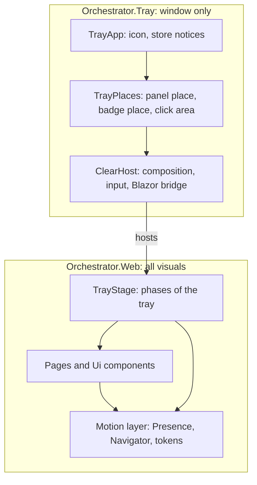
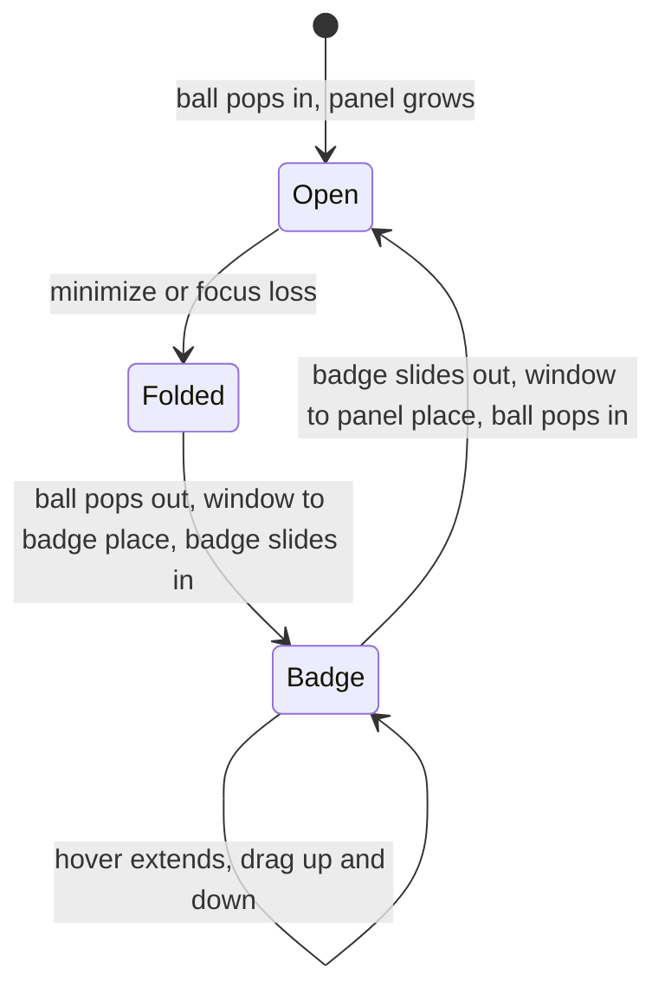

# Tray redesign plan

The tray widget is one transparent window that hosts the Blazor views of `Orchestrator.Web` with WebView2 in composition mode. All visuals and all motion are Razor components and CSS. C# controls only the window: its place, its click area and its input. One motion layer in `Orchestrator.Web` gives each view the same way to enter, leave and navigate, in the browser and in the tray.

Goal of this plan: parity. The tray and the browser look and work as before, on this structure. Proof: spikes S1 to S6 in `spikes/tray-display/`, results in `docs/plan.md` (section "Tray display spikes").

## Target structure



| Part | Project | Job |
|---|---|---|
| `ClearHost` | Tray | Transparent window, composition WebView2, input, Blazor bridge |
| `TrayPlaces` | Tray | The two places and their saved values, the click area of each phase, the badge drag |
| `TrayApp` | Tray | Tray icon, menu, store counts to the stage |
| `ITrayWindow` | Web | The contract between the stage and the window (below) |
| `TrayStage` | Web | The phase machine: start, open, folded, badge out, badge |
| Motion layer | Web | One way to enter, leave, navigate and time a motion |

## Motion layer

All motion uses three parts. No component starts or times a motion in another way.

| Part | Kind | Job |
|---|---|---|
| `motion.css` | CSS tokens | All durations and curves, as custom properties (`--t-sheet`, `--ease-out`) |
| `<Presence>` | Razor component | Enter and leave of sheets, toasts, dials, peeks |
| `Navigator` | C# service + small JS | Page moves; each page gives its depth |

### Presence

`<Presence Shown="open">` renders its child content with one phase class: `is-entering`, `is-shown` or `is-leaving`. When `Shown` turns false, it keeps the content until the browser reports `transitionend` or `animationend` for the block, then removes it. A time limit from the tokens stops a wait for a motion that does not run.

```razor
<Presence Shown="sheetOpen" OnGone="AfterClose">
    <div class="scrim" @onclick="() => sheetOpen = false"></div>
    <AnswerSheet Card="card" OnSend="Send" />
</Presence>
```

```css
.sheet { translate: 0 105%; transition: translate var(--t-sheet) var(--ease-out); }
.is-shown > .sheet { translate: 0 0; }
```

### Navigator

Each page states its depth once, with an attribute. The `Navigator` compares the depth of the current page and the target page and picks the move: tab (fade and rise), push (from the right) or back (to the right). `motion.js` keeps only `startViewTransition` and the wait for the Blazor render.

```csharp
[PageDepth(1)] // a session page: one step below the tab pages
public partial class SessionStatus { }
```

### Rules

| Rule | Reason |
|---|---|
| Durations and curves only in `motion.css` | One place to tune the feel |
| No `Task.Delay` to wait for a motion | The browser reports the end of a motion |
| Phase classes start with `is-` | A phase name matched a component class (S6) |
| Place state resets at each place change | A stale hover flag cut the badge (S6) |
| One element for one thing on the screen | Two copies need a handover (V15) |
| `prefers-reduced-motion` sets all tokens to 0 | One switch for all motion |

## Tray flow



The ball of the open panel is the home button of the app bar: one `HomeBall` element. In the browser, the app bar shows the same component. The badge ring uses the `KindRing` component of the views.

### ITrayWindow

```csharp
public interface ITrayWindow
{
    bool Pinned { get; }
    event Action? PinnedChanged;
    void SetPinned(bool pinned);
    Task GoTo(TrayPlace place);        // ends when the window is at the place
    event Action<TrayRequest>? Requested; // open, dock: from the icon, a focus loss or a badge click
    string? Label { get; }
}
```

The browser host has no `ITrayWindow`. Then the views show no window buttons and no `TrayStage`. The browser uses the same motion layer, because it shows the same components.

| Window button | Action |
|---|---|
| Pin | Keeps the window on top, in both places |
| Minimize | Docks the panel to the badge |
| Close | Hides the tray; the tray icon opens it again |

## Work order

| Step | Content | Done when |
|---|---|---|
| 1 | Motion layer: `motion.css`, `<Presence>`, `Navigator`, `[PageDepth]` | Sheets, toasts and page moves use it |
| 2 | Composition host in the tray, with the current views | Views run in `ClearHost`; host checks pass |
| 3 | `TrayStage` with the open, fold and badge flow | The S6 checks pass with the real views |
| 4 | Badge content: counts, ring spin, peek of a new card | The notice checks pass |
| 5 | Delete the native windows and their self-test groups | Tests pass; no GDI+ drawing |
| 6 | Tray self-test from the spike probes | Measure mode first; clicks only on the tray |
| 7 | Docs: `plan.md`, design page, `how-it-works.html`, `know-how.md` | Each page describes this structure |

<details>
<summary>Step 2 · checks of the composition host</summary>

| Check | Why |
|---|---|
| Keyboard input in the answer sheet text box | The host gives the focus |
| IME and dictation (`speech.js`) | Text input other than keys |
| Wheel scroll, right click, tooltips | Mouse input goes through the host |
| Screen reader | The host must give UI Automation |
| DPI change and a second monitor | The places use the DPI of their screen |
| Pin on top | The window keeps `TopMost` in both places |

</details>

<details>
<summary>Step 5 · code to delete</summary>

| File | Lines |
|---|---|
| `EdgeTab.cs` | 617 |
| `WidgetForm.cs` and `WidgetForm.Trace.cs` | 689 |
| `LayeredForm.cs`, `GrowShadow.cs`, `BallWindow.cs` | 486 |
| `SelfTest.*` groups of the native windows | about 1,000 |
| `tray.css` handover classes, `home-ball.png` | small |

</details>

## Non-goals

- No GDI+ drawing of a visual. Reason: each visual then exists two times and drifts.
- No second window for the shadow, the ball or the badge. Reason: windows need sync of order and frames.
- No change to the store, the supervisor or the data code. Reason: this work is about the display only.
- No exact shape for the click area of the badge. Reason: a box around the badge is simple and enough.
- No change to the swipe of the card deck (`swipe.js`). Reason: parity first; the deck moves to the motion layer after parity.
- No change to the data flow into the views. Reason: a review of the internals for a data-driven UI comes after parity.
