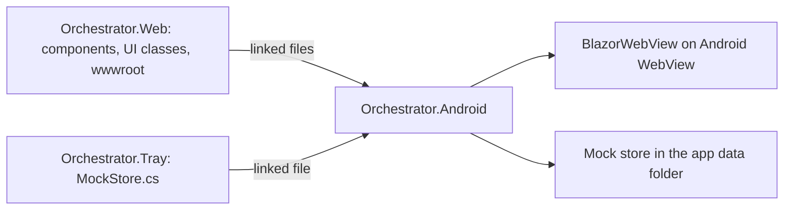

# Spike A1: Android host

A .NET MAUI Android app that shows the orchestrator UI. It uses the same model as the Windows tray: a `BlazorWebView` that runs the Razor components in the app process.



| Part | Source |
|---|---|
| Razor components | `src/Orchestrator.Web/Components`, linked. `App.razor` and `Routes.razor` stay out |
| UI classes (`Board`, `Ui`, `StreamHub`, ...) | `src/Orchestrator.Web/*.cs`, linked |
| CSS, JS, images | `src/Orchestrator.Web/wwwroot`, linked |
| Mock data | `src/Orchestrator.Tray/MockStore.cs`, linked |
| Templates and policy | Resources. `HomeFolder` writes them to the app data folder and sets `ORCH_HOME` |
| Host | `App.cs`, `AndroidRoutes.razor`, `wwwroot/index.html`, `Platforms/Android/` |

The spike changes no file in `src/`. The project is not in `Orchestrator.slnx`, because it needs the `maui-android` workload.

## Build

1. Install a .NET 10 SDK with the `maui-android` workload.
2. Install the Android SDK and a JDK:

   ```powershell
   dotnet build -t:InstallAndroidDependencies -f net10.0-android -p:AndroidSdkDirectory=<sdk> -p:JavaSdkDirectory=<jdk> -p:AcceptAndroidSDKLicenses=True
   ```

3. Build the APK:

   ```powershell
   dotnet publish -f net10.0-android -c Release -p:AndroidSdkDirectory=<sdk> -p:JavaSdkDirectory=<jdk>
   ```

4. Copy the signed APK from `bin/Release/net10.0-android/publish/` to the phone. Allow "Install unknown apps", then open the file.
